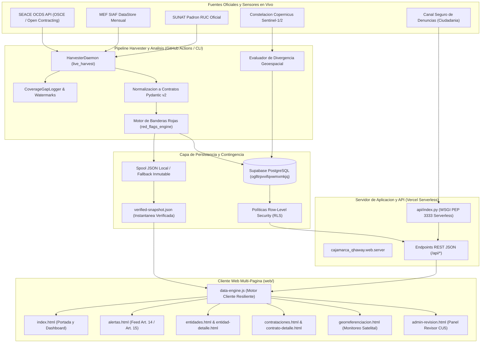

# Cajamarca Qhaway - Contexto Integral y Documentacion Tecnica del Proyecto

Plataforma civica de auditoria algoritmica, vigilancia ciudadana y control social sobre la administracion publica en el departamento de Cajamarca (Peru).
Cruza datos oficiales abiertos (SEACE OCDS, MEF SIAF y SUNAT) con teledeteccion satelital orbital (Sentinel-1/2) y un motor determinista de banderas rojas para priorizar candidatos de riesgo que un panel humano revisa antes de su publicacion.

---

## 1. Identidad, Mision y Gobernanza Civica

### 1.1 Que es Cajamarca Qhaway
*Qhaway* significa "observar", "vigilar" o "cuidar" en quechua. **Cajamarca Qhaway** es una plataforma tecnologica civica e independiente concebida para fortalecer la fiscalizacion de los fondos publicos en la region Cajamarca. La plataforma transforma datos tecnicos, presupuestales y contractuales dispersos en registros estructurados, comprensibles y accionables para la sociedad civil, las rondas campesinas, comites de veeduria comunal y el periodismo de investigacion.

### 1.2 El Problema Territorial en Cajamarca
Cajamarca es una de las regiones peruanas con mayores transferencias por concepto de canon minero y regalias, pero simultaneamente exhibe indices persistentes de pobreza monetaria, brechas de infraestructura rural y deficit de servicios basicos. Las causas estructurales incluyen:
- **Asimetria Informativa:** Los sistemas oficiales del Estado (SEACE y MEF SIAF) son tecnicos, fragmentados y de dificil acceso para el ciudadano comun.
- **Dispersion Geografica y Brecha Conectiva:** Comunidades campesinas y distritos en las 13 provincias enfrentan enlaces de telecomunicaciones inestables, requiriendo interfaces ultraligeras y resilientes sin frameworks pesados.
- **Riesgos Sistemicos en Contrataciones:** Recurrencia de postores unicos, adjudicaciones directas en umbrales limite (menores a 8 UIT), ventanas anómalas de postulacion y subejecucion critica de proyectos viales y de salud.

### 1.3 Articulacion con la Sociedad Civil
El proyecto no opera en el vacio ni busca reemplazar a las organizaciones sociales existentes. Ha sido disenado como una herramienta de soporte tecnico y analitico articulada con:
- **Proetica Cajamarca** (Capitulo Peruano de Transparency International).
- **Grupo Propuesta Ciudadana**.
- **GRUFIDES** (Grupo de Formacion e Intervencion para el Desarrollo Sostenible).
- Rondas campesinas, frentes de defensa y comites de vigilancia comunitaria provinciales.

---

## 2. Constitucion Etica e Invariantes Duros del Proyecto

El desarrollo del proyecto se rige por la **Constitucion del Metodo** (`docs/sdd/constitution.md`), compuesta por 19 articulos vinculantes que blindan legal, periodistica y tecnicamente toda la plataforma.

### Invariantes No Negociables
1. **Articulo 10 (Fuentes Oficiales Inmutables y Trazabilidad Cruda):**
   Los registros provienen de la API OCDS del SEACE y del modulo oficial MEF Consulta Amigable.
   El extractor mensual conserva sus ocho columnas, corte y ruta de navegacion en raw_payload.
   CKAN/PNDA mantiene su procedencia propia cuando entrega recursos verificables (ADR 0011).
2. **Articulo 14 (Separacion de Deteccion y Publicacion - Invariante 01):**
   Ninguna bandera roja tecnica (`RedFlag`) calculada por algoritmos se publica directamente como alerta al publico. Las senales son candidatos internos que deben ser validados, calificados o descartados por un **Panel Revisor Humano Colegiado** (`reviewed_by`, `reviewed_at`) con firma nominal acreditada.
3. **Articulo 15 (Explicabilidad Algoritmica Estricta - Art. 15 Ley 27806):**
   Toda alerta publicada (`Alert`) expone de forma abierta y falsable su formula matematica, umbral legal, valor observado, fuente de extraccion con timestamp (`retrieved_at`), revisor responsable y el descargo legal preceptivo.
4. **Articulo 16 (Prohibicion Expresa de Scoring o Ranking de Personas):**
   La plataforma evalua procesos administrativos, contratos publicos y partidas de gasto. Queda terminantemente prohibido generar rankings de personas, scores de honorabilidad o listas negras de funcionarios o personas naturales. Se preserva el principio de inocencia y neutralidad tecnica.
5. **Articulo 17 (Reserva Legal Ley 29733 - Declaraciones Juradas DJI):**
   Las declaraciones juradas se limitan a relaciones declaradas (empresa-familiar-funcionario). Queda prohibido cruzar DJI con cuentas bancarias, propiedades o redes sociales para inferir patrimonio no declarado (auditoria de estilo de vida fuera de alcance de Fase 1).
6. **Articulo 18 (Ambito Territorial Acotado a Cajamarca):**
   Fase 1 se circunscribe estrictamente al Gobierno Regional de Cajamarca y sus 13 municipalidades provinciales para evitar abstracciones prematuras y garantizar fidelidad contextual.
7. **Principio de No Imputacion Judicial:**
   Las alertas son llamadas de atencion preventivas basadas en reglas de negocio matematicas sobre datos abiertos. No constituyen sentencia judicial, imputacion penal ni acusacion formal (Art. 15, Ley N° 27806).

---

## 3. Universo de Entidades Fiscalizadas (14 Pliegos Fase 1)

El observatorio monitorea la totalidad del presupuesto y contrataciones asignadas al nivel departamental y provincial de Cajamarca:

| ID Canonico | RUC Oficial | Entidad Fiscalizada | Nivel | Identificador SIAF | UBIGEO capital |
|---|---|---|---|---|---|
| `ce-f5f5d8fc32518855` | `20453744168` | Gobierno Regional de Cajamarca | Regional | 445 | Departamental (13 Provincias) |
| `ce-2caad0e1b7467492` | `20143623042` | Municipalidad Provincial de Cajamarca | Provincial | SEC_EJEC `300549` | `060101` |
| `ce-b4a52d15b3cffe4f` | `20148288853` | Municipalidad Provincial de Cajabamba | Provincial | SEC_EJEC `300562` | `060201` |
| `ce-2b779c1e84ff4365` | `20148289825` | Municipalidad Provincial de Celendin | Provincial | SEC_EJEC `300566` | `060301` |
| `ce-45fad1d64ba4bf0f` | `20220499767` | Municipalidad Provincial de Chota | Provincial | SEC_EJEC `300578` | `060401` |
| `ce-3337df921084c80a` | `20191657447` | Municipalidad Provincial de Contumaza | Provincial | SEC_EJEC `300597` | `060501` |
| `ce-360cf7aadccadabb` | `20174691267` | Municipalidad Provincial de Cutervo | Provincial | SEC_EJEC `300605` | `060601` |
| `ce-dfd10c914365bbe3` | `20148260843` | Municipalidad Provincial de Hualgayoc - Bambamarca | Provincial | SEC_EJEC `300620` | `060701` |
| `ce-1817b32570ae7027` | `20201987297` | Municipalidad Provincial de Jaen | Provincial | SEC_EJEC `300623` | `060801` |
| `ce-697eb5a0a1b4e6c6` | `20148261572` | Municipalidad Provincial de San Ignacio | Provincial | SEC_EJEC `300635` | `060901` |
| `ce-ad540c85ce98e1d8` | `20175083937` | Municipalidad Provincial de San Marcos | Provincial | SEC_EJEC `300642` | `061001` |
| `ce-3511b005adba63bf` | `20143625843` | Municipalidad Provincial de San Miguel | Provincial | SEC_EJEC `300649` | `061101` |
| `ce-d7fc753b1fb5ff5b` | `20172446800` | Municipalidad Provincial de San Pablo | Provincial | SEC_EJEC `300662` | `061201` |
| `ce-f29ffd64eff3fe9a` | `20200367376` | Municipalidad Provincial de Santa Cruz | Provincial | SEC_EJEC `300666` | `061301` |

### Estado operativo del corte (2026-10-14)

Supabase conserva 14 entidades, 475 contrataciones y 42 presupuestos oficiales.
Cada ejercicio 2024, 2025 y 2026 tiene exactamente 14 entidades.
El [modulo mensual oficial del MEF](https://apps5.mineco.gob.pe/transparencia/Mensual/Navegar_6.aspx?y=2026&ap=ActProy) publica el corte 2026-09-30.
La cosecha historica devolvio 42 filas y el motor evaluo esas filas junto a 475 contratos.
El cruce municipal usa los codigos observados en el MEF, incluido Cajamarca `300549`.

Hay 471 candidatos internos, seis alertas `in_review` y dos `discarded`.
No hay alertas publicadas ni denuncias expuestas en el snapshot publico.
Los candidatos se cotejan contra los metadatos y el spool privado.
La procedencia de entidades permanece en `data/entities/*.yaml`, `verified_at` y SUNAT.
Estos criterios fueron confirmados por la persona responsable el 2026-10-14.

Verificacion reproducible:
`select fiscal_year, count(*), count(distinct entity_id) from budget_execution_records
 group by fiscal_year;` devuelve 14/14 en cada ejercicio.
`python -m cajamarca_qhaway.cli web audit` y `python scripts/audit_snapshot_parity.py`
verifican las cifras MPA del ultimo ejercicio; no suman presupuestos de tres anos.

---

## 4. Arquitectura del Sistema y Flujo de Datos

El sistema adopta un modelo polyrepo hibrido en la nube, disenado para una ejecucion sin dependencias de infraestructura local fija:



---

## 5. Los Tres Pilares Tecnicos del Proyecto

### Pilar 1: Cosecha Continua de Datos (Live Harvester)
- Implementado en `src/cajamarca_qhaway/capabilities/live_harvest/`.
- **HarvesterDaemon:** Ejecuta barridos incrementales y catalogacion de procesos SEACE y ejecucion presupuestal MEF SIAF.
- **WatermarkStore:** Control de marcas de agua para reanudar extracciones sin duplicar registros.
- **CoverageGapLogger:** Registro de incidentes de conexion, caidas de APIs estatales y ventanas de corte temporal.
- **Soporte Historico y Reciente:** Extrae periodos fiscales 2024, 2025 y 2026.

### Pilar 2: Base de Datos Relacional y Resiliencia (Supabase / Spool)
- Implementado en `src/cajamarca_qhaway/persistence/`.
- **Supabase PostgreSQL:** Base relacional remota (`oglltrpvvifqvwmxmkjq`) con 6 tablas maestras (`contracting_entities`, `procurement_records`, `budget_execution_records`, `red_flags`, `alerts`, `citizen_reports`).
- **Seguridad RLS (Row-Level Security):**
  - Vista publica anonima: Solo lectura de entidades, contratos, presupuesto y alertas con `status = 'published'`.
  - Panel revisor autenticado: Acceso a `red_flags` internas y transiciones de estado de alertas.
  - Canal de denuncias: Escritura de reportes ciudadanos con columnas sensibles protegidas.
- **Spool y Fallback Inmutable (`verified-snapshot.json`):** Si la red o Supabase no responden, el cliente web conmuta automaticamente a la instantanea local verificada sin interrumpir la experiencia de usuario.

### Pilar 3: Plataforma Web Multi-Pagina (MPA) y API Serverless
- Implementado en `web/` y `api/index.py`.
- **Arquitectura MPA (Multi-Page Application):** Optimizada tras el ADR 0008, retirando el enrutador hash SPA para asegurar indexacion SEO limpia, URLs canonicas para compartir expedientes y cero errores de carga en navegadores moviles.
- **WSGI Serverless (PEP 3333):** Desplegado en Vercel con aislamiento total de errores y soporte local con `python -m cajamarca_qhaway.cli web serve`.

---

## 6. Contratos Canonicos de Datos (Pydantic v2)

Definidos en `src/cajamarca_qhaway/models/`:

### 1. `ContractingEntity` (`contracting_entity.py`)
Representa a una institucion publica fiscalizada del universo dorado.
- `entity_id`: Hash canonico determinista (`ce-...`).
- `ruc`: 11 digitos numericos oficiales validados ante SUNAT.
- `official_name`: Denominacion legal de la entidad.
- `entity_level`: `'regional'` o `'provincial_municipality'`.
- `province`: Nombre de la provincia (`null` para el GORE).
- `raw_payload`: Registro fuente original.

El cruce administrativo SIAF/UBIGEO se conserva en `verification` de
`data/entities/cajamarca-universe.yaml`, separado del contrato canónico. El código del
MEF es el SEC_EJEC de cada municipalidad provincial, no `30` + UBIGEO ni una asignación
por rango. El SEC_EJEC `300605` sí corresponde a Cutervo; los códigos se validan uno a uno
contra el padrón oficial
MEF y el reporte de omisos 2026; los UBIGEO corresponden al distrito capital de cada
provincia según INEI.

| Entidad provincial | SEC_EJEC MEF | UBIGEO capital |
|---|---:|---:|
| Cajamarca | `300549` | `060101` |
| Cajabamba | `300562` | `060201` |
| Celendín | `300566` | `060301` |
| Chota | `300578` | `060401` |
| Contumazá | `300597` | `060501` |
| Cutervo | `300605` | `060601` |
| Hualgayoc (Bambamarca) | `300620` | `060701` |
| Jaén | `300623` | `060801` |
| San Ignacio | `300635` | `060901` |
| San Marcos | `300642` | `061001` |
| San Miguel | `300649` | `061101` |
| San Pablo | `300662` | `061201` |
| Santa Cruz | `300666` | `061301` |

El GORE se identifica por `NIVEL_GOBIERNO = 'R'` y `PLIEGO = '445'`. El padrón MEF
consultado está en [ejecutoras municipales](https://www.mef.gob.pe/contenidos/tesoro_pub/home/ejecutoras_munic.pdf)
y el [reporte MEF 2026](https://www.mef.gob.pe/dnep/reporte/2026/reporte_omisos_FCFP_022026.pdf);
el listado geográfico oficial es el [Compendio Estadístico Cajamarca 2025 del INEI](https://www.inei.gob.pe/media/MenuRecursivo/publicaciones_digitales/Est/CompDptal2025/Cajamarca2025.pdf).

### 2. `ProcurementRecord` (`procurement_record.py`)
Contratacion publica extraida del SEACE bajo el estandar OCDS 1.1.
- `procurement_id`: Identificador canonico del proceso (`pr-...`).
- `ocid`: Identificador oficial Open Contracting (ej. `ocds-k50b04-1025531`).
- `entity_id`: Llave foranea a `ContractingEntity`.
- `procurement_method`: Metodo de contratacion (`'open'`, `'selective'`, `'direct'`).
- `awarded_amount`: Monto total adjudicado en Soles (PEN).
- `number_of_bidders`: Numero total de postores participantes.
- `supplier_ruc` y `supplier_name`: Datos del proveedor ganador.

### 3. `BudgetExecutionRecord` (`budget_execution_record.py`)
Partida de ejecucion presupuestal extraida del DataStore del MEF SIAF.
- `execution_record_id`: Identificador canonico del registro (`me-...`).
- `entity_id`: Llave foranea a `ContractingEntity`.
- `fiscal_year`: Ano fiscal (2024, 2025, 2026).
- `budgeted_amount`: Presupuesto Institucional Modificado (PIM) asignado.
- `executed_amount`: Monto total devengado / girado a la fecha.
- `budget_category`: Categoria de inversion o proyecto.

### 4. `RedFlag` (`red_flag.py`)
Senal de alerta tecnica generada por el motor determinista.
- `red_flag_id`: Identificador unico de la senal (`rf-...`).
- `indicator_code`: Codigo oficial de la regla activada.
- `severity`: Nivel de riesgo (`'critical'`, `'high'`, `'medium'`, `'low'`).
- `observed_value`: Valor numerico o textual observado.
- `threshold_value`: Umbral configurado en la regla de negocio.
- `procurement_ids` y `execution_record_ids`: Enlaces a la evidencia.
- `formula_description`: Explicacion transparente del calculo (Art. 15).

### 5. `Alert` (`alert.py`)
Alerta formal publicada tras intervencion del Panel Revisor Humano.
- `alert_id`: Identificador formal de publicacion (`al-...`).
- `red_flag_ids`: Lista de banderas rojas validadas.
- `entity_id`: Entidad publica responsable.
- `status`: Estado del ciclo de vida (`'generated'`, `'in_review'`, `'published'`, `'discarded'`, `'rectified'`).
- `reviewed_by`: Nombre y credencial del veedor revisor nominal (Art. 14).
- `reviewed_at`: Fecha y hora UTC del dictamen colegiado.
- `review_notes`: Fundamentacion tecnica de la revision.
- `legal_disclaimer`: Texto obligatorio de no imputacion judicial.

### 6. `CitizenReport` (`citizen_report.py`)
Reporte de presunta irregularidad recibido a traves del Canal Ciudadano (CU4).
- `report_id`: Identificador confidencial del reporte (`cr-...`).
- `entity_id`: Entidad objeto de la alerta.
- `cui_or_contract`: Codigo Unico de Inversiones (CUI) o proceso SEACE.
- `evidence_urls`: Documentos o enlaces probatorios adjuntos.
- `tracking_token`: Hash SHA-256 para consulta pública anonima del denunciante.
- `legal_disclaimer_shown`: Booleano mandatorio que certifica lectura de advertencias.

---

## 7. Catalogo Activo de Indicadores de Riesgo (Red Flags)

El motor determinista `red_flags_engine` evalua las contrataciones y presupuestos contra reglas de negocio codificadas:

1. `single-bidder` (Severidad Critica):
   Licitacion o concurso publico de obras mayores adjudicado con la presentacion de un unico postor competidor.
2. `short-tender-window` (Severidad Alta):
   Ventana de tiempo anormalmente corta (menor a 8 dias calendario) entre la publicacion de bases en SEACE y la presentacion de ofertas.
3. `execution-overrun` (Severidad Alta):
   Sobrecosto financiero donde el monto ejecutado/devengado supera en mas del 20% el presupuesto contratado originalmente.
4. `contract-concentration` (Severidad Alta):
   Concentracion excesiva de adjudicaciones en una misma empresa o consorcio dentro del mismo ejercicio fiscal.
5. `direct-award-threshold` (Severidad Media):
   Contrataciones emitidas justo por debajo del umbral legal de 8 UIT (S/ 41,200) para evadir procesos competitivos de ley.
6. `direct-administration-equipment-rent` (Severidad Alta):
   Alquiler sistematico de maquinaria pesada bajo la modalidad de obras por administracion directa.
7. `contract-splitting-orders` (Severidad Critica):
   Fraccionamiento de requerimientos en multiples ordenes de compra o servicio menores dirigidas al mismo proveedor.
8. `mef-underspending` (Severidad Critica):
   Subejecucion presupuestal severa (menor al 30% al cierre del corte semestral) en partidas de infraestructura basica y canon minero.
9. `recurrent-direct-award` (Severidad Critica):
   Adjudicaciones directas recurrentes y consecutivas otorgadas al mismo RUC en plazos inferiores a 90 dias.
10. `hhi-concentration` (Severidad Alta):
    Indice Herfindahl-Hirschman (HHI) superior a 2,500 puntos en el mercado de proveedores de una municipalidad provincial, denotando captura de mercado o cartelizacion.

---

## 8. Monitoreo Geoespacial y Satelital de Obras (Capacidad 007)

Implementado en `src/cajamarca_qhaway/capabilities/geospatial_monitoring/`:

### 8.1 Fundamentacion y Fuentes Satelitales Abiertas
Debido a la alta nubosidad de los Andes cajamarquinos, la plataforma implementa una estrategia de teledeteccion hibrida basada exclusivamente en sensores publicos abiertos:
- **Sentinel-2 (MSI):** Resolucion optica multiespectral de 10 m por pixel con revisita cada 5 dias para deteccion de movimiento de tierras y avance estructural.
- **Sentinel-1 (SAR - Synthetic Aperture Radar):** Radar de apertura sintetica en banda C que penetra la cobertura densa de nubes y lluvias en cuencas norte y de ceja de selva (Jaen, San Ignacio, Cutervo).
- **NASA HLS (Harmonized Landsat Sentinel) y GIBS:** Mosaicos corregidos radiometricamente para series temporales de largo plazo.
- **Camaras Publicas de Obra:** Integracion de transmisiones en tiempo real cuando la entidad municipal o regional dispone de visualizador abierto en portal institucional.

### 8.2 Algoritmo de Divergencia Fisico-Financiera
El sistema calcula el indice de discrepancia:
$$\Delta_{divergencia} = |Devengado_{MEF} - Actividad_{satelital}|$$
Si una obra registra un devengado financiero superior al 80% en MEF SIAF pero el indice de cambio de textura de radar SAR y reflectancia optica muestra menos del 30% de movimiento fisico efectivo, se emite una senal de divergencia geoespacial prioritaria (`sig-geo-...`) para inspeccion de campo por las rondas campesinas y veedurias locales.

---

## 9. Mapa del Sitio y Plataforma Web Multi-Pagina (MPA)

La plataforma web reside en la carpeta `web/` y se compone de 14 vistas funcionales:

- `/` (`index.html`): Portada ciudadana, velocimetro reactivo de ejecucion regional, tarjetas KPI consolidadas, radar territorial de 6 pliegos prioritarios, buscador OCDS interactivo y vitrina de casos satelitales.
- `/entidades` (`entidades.html`): Directorio completo y clasificable de las 14 entidades fiscalizadas con buscador en tiempo real, filtros por nivel y ordenamiento por PIM, devengado y banderas rojas.
- `/entidad?id=...` (`entidad-detalle.html`): Expediente institucional individual en 5 columnas bento: datos SUNAT, PIM vs Devengado, contrataciones mayores, catalogo de banderas rojas y top 5 proveedores adjudicados.
- `/alertas` (`alertas.html`): Feed oficial de alertas preventivas validadas por el Panel Revisor, con filtros interactivos por severidad (Critica, Alta, Media), explicabilidad algoritmica y descargo legal.
- `/contrataciones` (`contrataciones.html`): Catalogo de procesos contractuales SEACE bajo estandar OCDS, con explicacion grafica del ciclo de compras publicas (Planificacion, Convocatoria, Adjudicacion, Contrato, Ejecucion).
- `/contrato-detalle.html?id=...`: Dossier exhaustivo de una contratacion especifica, con desglose de postores, fecha de adjudicacion, montos comparativos y visor de payload JSON crudo.
- `/presupuesto` (`presupuesto.html`): Tablero presupuestal del departamento, analisis de fuentes de financiamiento (Canon y Regalias, Recursos Ordinarios, FONCOMUN) y tabla de subejecucion por pliego.
- `/proveedores` (`proveedores.html`): Herramienta analitica de concentracion de compras y calculo del Indice HHI por provincia y a nivel departamental.
- `/georreferenciacion` (`georreferenciacion.html`): Centro de Monitoreo Satelital de obras, mapa interactivo, seleccion de sensores (Sentinel-1 SAR / Sentinel-2) y fichas de contraste multi-temporal.
- `/denuncia` (`denuncia.html`): Canal seguro de reporte ciudadano anónimo (CU4), con cifrado local de campos, subida de enlaces de evidencia y generacion de token criptografico SHA-256 para seguimiento.
- `/admin/revision` (`admin-revision.html`): Panel de control colegiado para veedores acreditados (CU5). Permite dictaminar banderas rojas, cambiar estados a publicado/descartado y registrar notas tecnicas nominales.
- `/login` (`login.html`): Puerta de acceso seguro y acreditacion oficial para veedores de Proetica, Propuesta Ciudadana y GRUFIDES.
- `/transparencia` (`transparencia.html`): Centro de datos abiertos con descarga directa de microdatos en formatos CSV, JSON OCDS y Parquet, documentacion de la API REST y memoria metodologica.
- `/acerca` (`acerca.html`): Fundamentos institucionales, alianza civica, base constitucional y respuestas a preguntas frecuentes de la comunidad.

---

## 10. Pedagogia Civica, Lenguaje Claro y Accesibilidad

Para democratizar la comprension tecnica del presupuesto publico, la plataforma integra componentes de pedagogia civica activa:
- **Selector de Modo de Lectura:**
  - *Modo Ciudadano:* Traduce los conceptos complejos a lenguaje cotidiano de bolsillo ("Dinero del ano" por PIM, "Dinero ya pagado" por Devengado, "S/ 73 de cada S/ 100" por porcentaje de ejecucion).
  - *Modo Especialista:* Presenta la nomenclatura tecnica oficial presupuestal y del estandar OCDS.
- **Diccionario Civico Modal:** Glosario contextual accesible desde cualquier vista para consultar terminos clave (PIM, Devengado, SEACE, OCDS, HHI, Canon, Pliego).
- **Micro-Tooltips Interactivos:** Botones discretos `?` al lado de cada termino tecnico que despliegan explicaciones sencillas y ejemplos cotidianos.
- **Accesibilidad Universal (WCAG 2.1 / 2.2 AA):**
  - Contraste cromatico superior a 4.5:1 en texto normal y 3:1 en componentes UI.
  - Navegacion integra por teclado con indicadores de foco visibles.
  - Atributos semanticos ARIA (`role="region"`, `aria-live="polite"`, `aria-expanded`).
  - Diseno responsivo libre de desbordamientos (*no horizontal scroll*) en dispositivos moviles.

---

## 11. Seguridad, Autenticacion y Privacidad

- **Proteccion de Denunciantes:** No se almacenan direcciones IP ni identificadores del dispositivo en la tabla publica de denuncias. El `tracking_token` es un hash unidireccional SHA-256 generado en el cliente.
- **Autenticacion de Veedores:** Panel colegiado protegido con credenciales de organizaciones reconocidas (Proetica Cajamarca). Sesion persistida en almacenamiento seguro con auto-cierre ante inactividad.
- **Cabeceras de Seguridad HTTP:**
  - `Content-Security-Policy`: Restriccion de ejecucion a scripts locales y origenes HTTPS de confianza.
  - `X-Content-Type-Options: nosniff`
  - `X-Frame-Options: DENY` (anti-clickjacking).
  - `Referrer-Policy: strict-origin-when-cross-origin`
- **Politica Antislop R-02:** Tolerancia cero a caracteres em-dash (guion largo U+2014) en todo el codigo de la plataforma web, asegurando codificacion limpia UTF-8 en todo servidor.

---

## 12. Estructura Completa del Repositorio

```text
cajamarca-qhaway/
|-- .claude/                             # Configuracion y reglas para Claude Code
|-- .github/workflows/                   # Automatizaciones CI/CD
|   |-- live-harvest.yml                 # Worker recurrente de extraccion en vivo
|   |-- verify.yml                       # Pipeline de validacion de pruebas y linters
|-- api/
|   `-- index.py                         # Punto de entrada WSGI Serverless PEP 3333 (Vercel)
|-- context/
|   `-- snapshots/                       # Snapshots inmutables de sesion
|       `-- latest.md                    # Estado operativo reciente del proyecto
|-- data/                                # Semillas y fuentes de datos estaticas
|   |-- entities/                        # Definiciones YAML de las 14 entidades
|   |-- samples/                         # Muestras crudas de SEACE y MEF
|   `-- sunat/                           # Padron tributario RUC consolidado
|-- docs/                                # Documentacion tecnica estructurada
|   |-- INDEX.md                         # Mapa maestro de la documentacion
|   |-- adr/                             # Architecture Decision Records (ADR 0001 - 0009)
|   |-- architecture/                    # Disenos de arquitectura por capacidad
|   |-- research/                        # Investigaciones tecnicas y de fuentes
|   `-- sdd/                             # Constitucion y reglas del Spec-Driven Development
|-- scripts/                             # Scripts de utilidad y siembra
|   |-- seed_contracting_entities.py     # Siembra de entidades en PostgreSQL
|   `-- generate_verified_snapshot.py    # Generador del snapshot estatico
|-- specs/                               # Especificaciones formales por capacidad
|   |-- 001-entity-mapping/              # Capacidad 001: Mapeo de entidades
|   |-- 002-seace-ingestion/             # Capacidad 002: Ingesta SEACE OCDS
|   |-- 003-mef-ingestion/               # Capacidad 003: Ingesta MEF SIAF
|   |-- 004-red-flags-engine/            # Capacidad 004: Motor de banderas rojas
|   |-- 005-review-panel/                # Capacidad 005: Panel colegiado revisor
|   |-- 006-denuncia-intake/             # Capacidad 006: Canal seguro de denuncias
|   `-- 007-geospatial-satellite-monitoring/ # Capacidad 007: Satelite y camaras
|-- src/cajamarca_qhaway/                # Codigo fuente Python del paquete
|   |-- capabilities/                    # Modulos de negocio por capacidad
|   |   |-- denuncia_intake/             # Validacion y recepcion de denuncias
|   |   |-- entity_mapping/              # Normalizacion y dataset de entidades
|   |   |-- geospatial_monitoring/       # Teledeteccion Sentinel-1/2 y divergencia
|   |   |-- live_harvest/                # Daemon recolector continuo y watermarks
|   |   |-- mef_ingestion/               # Cliente y parser de datos SIAF
|   |   |-- red_flags_engine/            # Reglas y calculo de banderas rojas
|   |   |-- review_panel/                # Gestion de estados de alertas y dictamenes
|   |   |-- seace_ingestion/             # Cliente OCDS y parser de licitaciones
|   |   `-- sunat_enrichment/            # Consulta y validacion tributaria de RUCs
|   |-- models/                          # Contratos canonicos Pydantic v2
|   |-- persistence/                     # Repositorios, conexion Supabase y spool
|   |-- web/                             # Servidor HTTP local y exportador de datos
|   |-- cli.py                           # CLI principal `cajamarca-qhaway`
|   `-- pipeline.py                      # Orquestador del pipeline integral
|-- tests/                               # Suite de pruebas automatizadas
|   |-- test_web_platform.py             # Pruebas integrales de la plataforma web
|   `-- ...                              # Pruebas unitarias de las capacidades (216 tests)
|-- web/                                 # Plataforma web frontend (MPA)
|   |-- css/                             # Estilos CSS compilados y tokens
|   |-- media/                           # Logotipos vectoriales SVG y emblemas
|   |-- src/data/                        # Instantanea `verified-snapshot.json`
|   |-- src/js/                          # Modulos JavaScript nativos ES6
|   |   |-- app.js                       # Controlador principal e hidratacion de vistas
|   |   |-- config.js                    # Configuracion de Supabase y endpoints
|   |   |-- data-engine.js               # Motor de datos resiliente con fallback
|   |   |-- dictionary-data.js           # Diccionario civico y definiciones
|   |   |-- review-panel.js              # Logica interactiva del panel de revisor
|   |   `-- supabase-client.js           # Cliente PostgREST y autenticacion
|   |-- index.html                       # Portada y velocimetro regional
|   |-- alertas.html                     # Feed oficial de alertas con explicabilidad
|   |-- entidades.html                   # Directorio de 14 entidades
|   |-- entidad-detalle.html             # Expediente individual de entidad
|   |-- contrataciones.html              # Explorador de contratos SEACE OCDS
|   |-- contrato-detalle.html            # Ficha de contratacion individual
|   |-- presupuesto.html                 # Ejecucion presupuestal y financiamiento
|   |-- proveedores.html                 # Analisis de concentracion e Indice HHI
|   |-- georreferenciacion.html          # Centro de monitoreo satelital orbital
|   |-- denuncia.html                    # Canal seguro de alerta ciudadana
|   |-- admin-revision.html              # Panel colegiado de revisores (CU5)
|   |-- login.html                       # Acreditacion de veedores
|   |-- transparencia.html               # Descarga de microdatos y API abierta
|   `-- acerca.html                      # Mision institucional y alianza civica
|-- AGENTS.md                            # Reglas operativas locales para agentes de IA
|-- PROJECT.yaml                         # Manifiesto de maquina y metadatos del proyecto
|-- pyproject.toml                       # Dependencias, empaquetado y configuracion pytest
|-- vercel.json                          # Configuracion de rutas y despliegue en Vercel
`-- README.md                            # Documento maestro de contexto integral
```

---

## Corte operativo MEF 2024-2026

Supabase y snapshot conservan 14 entidades, 475 contrataciones y 42 presupuestos oficiales.
Hay 14 entidades por ano y 471 candidatos privados; ninguna alerta esta publicada.
PIM 2026: S/ 6,011,280,694; devengado: S/ 4,006,118,779; avance: 66.6% al 2026-10-14.
El maestro diario conserva ocho momentos, modificaciones y avance.
Proyecto, Actividad y fuentes/rubros se consultan como partes del maestro, sin doble conteo.
El corte mensual 2026-09-30 se ofrece como comparacion separada.
El cierre fiscal 2024/2025 conserva la fecha real observada en el portal (2026-10-13).

OECE Pentaho aporto 77,981 filas filtradas de 43 recursos oficiales 2024-2026.
Hay 438 filas vinculadas por identidad oficial a 191 de los 475 procesos OCDS preexistentes.
Las ordenes sin codigo de convocatoria se conservan como evidencia independiente.
El buscador JSF devuelve reCAPTCHA v3: la cobertura registra `CAPTCHA_REQUIRED`.
El acceso OCDS desde GitHub dio HTTP 403 en la verificacion anterior.
Estos estados no se presentan como consultas protegidas exitosas.

La identidad utiliza Anil, Jalca y Cal, con Fraunces, Public Sans y JetBrains Mono locales.
Las 16 paginas conservan sus IDs funcionales y los 88 activos web de la identidad entregada.
El explorador permite elegir ejercicio, ambito, rubro y corte; cada cambio sustituye la vista.
El visor JSON conserva la procedencia sin inventar un dictamen de revision humana.

El catalogo geoespacial sigue sin obras verificadas.
El adaptador cloud de denuncias conserva su respuesta 503 cuando no puede persistir.
El diseno no convierte esos estados en cobertura real.

Fuentes: [MEF](https://apps5.mineco.gob.pe/transparencia/Navegador/Navegar_6.aspx?y=2026&ap=ActProy),
[OECE](https://bi.seace.gob.pe/pentaho/api/repos/%3Apublic%3Aportal%3Adatosabiertos.html/content?userid=public&password=key)
y [SEACE publico](https://prod2.seace.gob.pe/seacebus-uiwd-pub/buscadorPublico/buscadorPublico.xhtml).


## 13. Guia de Instalacion, Pruebas y Operacion CLI

### 13.1 Instalacion en Entorno Local
Requisitos: Python 3.12 o 3.13 en Windows, Linux o macOS.

```bash
# 1. Clonar el repositorio
git clone https://github.com/richardsonyelstin-commits/cajamarca-qhaway.git
cd cajamarca-qhaway

# 2. Crear y activar entorno virtual
python -m venv .venv

# En Windows (PowerShell):
.venv\Scripts\Activate.ps1
# En Linux / macOS:
source .venv/bin/activate

# 3. Instalar paquete en modo editable con herramientas de desarrollo
pip install -e ".[dev]"
```

### 13.2 Ejecucion de la Suite de Pruebas
El corte ejecuta 216 pruebas Python y 12 pruebas Node deterministas:

```bash
# Ejecutar todas las pruebas con reporte resumido
pytest -q

# Ejecutar auditoria de la plataforma web
python -m cajamarca_qhaway.cli web audit

# Ejecutar pruebas especificas de la plataforma web
pytest tests/test_web_platform.py -v
```

### 13.3 Comandos Disponibles del CLI `cajamarca-qhaway`

```bash
# Listar las 14 entidades verificadas
cajamarca-qhaway entities

# Mostrar el catalogo de indicadores de banderas rojas
cajamarca-qhaway catalog

# Ejecutar el recolector en vivo (una corrida)
cajamarca-qhaway harvest run --once --source seace,mef

# Ejecutar extraccion historica completa (2024, 2025 y 2026)
cajamarca-qhaway harvest run --historical --years 2024,2025,2026

# Consultar estado de marcas de agua del recolector
cajamarca-qhaway harvest status

# Exportar instantanea verificada para la plataforma web
cajamarca-qhaway web export-snapshot

# Iniciar servidor local de desarrollo sirviendo la plataforma web y API
cajamarca-qhaway web serve --port 8080

# Consultar evaluacion geoespacial satelital de una obra
cajamarca-qhaway geospatial evaluate --site-id site-01-cenepa-cajamarca --sar

# Consultar informacion de un proveedor en SUNAT
cajamarca-qhaway sunat lookup --ruc 20453744168
```

---

## 14. Instrucciones de Trabajo y Directrices para LLMs / Agentes

Cuando un modelo de lenguaje (LLM) o agente autonomo intervenga en este repositorio, debe acatar estrictamente las siguientes directrices:

1. **Invariantes Constitucionales:** Jamas alterar el flujo para publicar alertas de manera automatica. Toda alerta requiere `reviewed_by` y `reviewed_at`.
2. **Prohibicion de Em-Dash (Antislop R-02):** Ningun archivo nuevo o editado bajo `web/` o la documentacion debe contener el caracter em-dash (guion largo U+2014). Utilizar guion corto `-`, dos puntos `:` o parentesis.
3. **Consistencia Estatica y Prevencion de FOUC:** Toda cifra mostrada en el HTML inicial (`index.html`, `alertas.html`, `entidades.html`, `presupuesto.html`, `entidad-detalle.html`) debe coincidir exactamente con los calculos generados por `dataEngine` y `verified-snapshot.json`.
4. **Respeto a las Rutas Limpias (MPA):** No implementar enrutadores hash (`#/`) en el cliente. Usar enlaces de rutas limpias (`/entidades`, `/alertas`, `/contrataciones`, etc.) que estan configurados en `vercel.json` y `server.py`.
5. **Aislamiento en Ramas de Agente:** Todo trabajo de modificacion de codigo debe realizarse forzosamente en una rama aislada `agent/<nombre>/<tarea>` antes de su integracion en `main`.
6. **No Modificar Secretos ni ADRs Aceptados:** Jamas acceder a carpetas de credenciales ni editar archivos dentro de `docs/adr/` marcados como `accepted` (se deben crear nuevos ADRs que utilicen `supersedes`).
