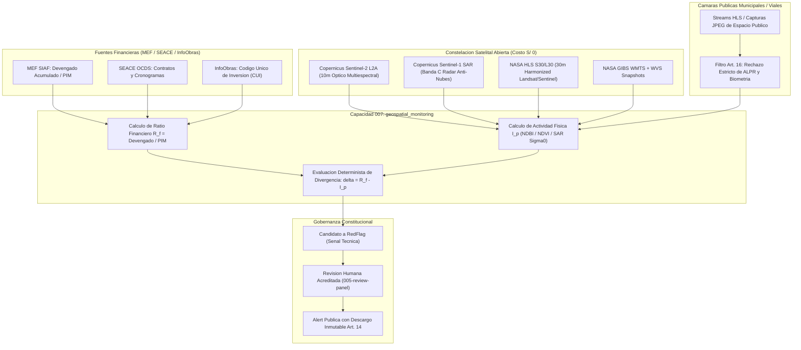

# Monitoreo geoespacial multi-temporal satelital y de camaras publicas para obras de infraestructura

Se adopta una arquitectura de teledeteccion multi-temporal abierta basada en Sentinel-2 L2A (optico), Sentinel-1 SAR (radar anti-nubes), NASA HLS/GIBS y camaras publicas municipales estrictamente acotadas a poligonos de obras públicas para contrastar el avance fisico observable contra el avance financiero devengado (MEF/SEACE), emitiendo senales tecnicas como candidatos a RedFlag bajo revision humana obligatoria (Articulo 14 de la constitucion).

## Contexto y planteamiento del problema

En la ejecucion de obra publica en el Peru (y especificamente en las 13 provincias de Cajamarca), una de las modalidades recurrentes de malversacion o ineficiencia severa es la declaracion de avances financieros elevados o liquidaciones del 100% en el Sistema de Informacion de Administracion Financiera (MEF SIAF) mientras la infraestructura fisica en terreno presenta abandono, retrasos criticos o inejecucion sustancial ("obras fantasma" o "elefantes blancos").

Hasta ahora, `cajamarca-qhaway` procesaba exclusivamente trazas documentales: convocatorias y contratos de SEACE OCDS (Capacidad 002) y devengados presupuestales del MEF (Capacidad 003). Sin embargo, la auditoria puramente documental es ciega ante la realidad material del territorio.

El repositorio de referencia `gods-eye-view` demuestra la factibilidad tecnica de construir un visor 3D planetario de inteligencia abierta (OSINT) combinando pases satelitales (SGP4), mosaicos diarios abiertos de NASA GIBS WMTS, catalogo CMR de HLS (Sentinel-2 y Landsat) y camaras web publicas, sin requerir claves de API de pago.

Se requiere formalizar la decision arquitectonica de incorporar esta capacidad a `cajamarca-qhaway`, definiendo los sensores, los algoritmos de contraste fisico-financiero y las salvaguardas legales y constitucionales obligatorias.

## Factores de decision

- Cobertura meteorologica andina: Durante el periodo de lluvias (noviembre a abril), Cajamarca presenta nubosidad persistente que inutiliza los sensores opticos satelitales en mas del 75% de las tomas.
- Costo operativo S/ 0 (Articulo 19 de la constitucion): Prohibicion de contratar proveedores comerciales de imagineria de muy alta resolucion (como PlanetScope o Maxar) que requieran presupuestos recurrentes.
- Proteccion de Datos Personales y Articulo 16: La Ley N° 29733 y la constitucion del proyecto prohiben de forma absoluta el reconocimiento facial, rastreo de individuos o lectura automatizada de matriculas (ALPR).
- Articulo 14 de la constitucion: Ninguna divergencia observada puede publicarse como acusacion o alerta ciudadana sin pasar por la compuerta de revision humana acreditada en `005-review-panel`.
- Precision espacial minima: Las obras de infraestructura publica (carreteras, colegios, represas, hospitales) requieren resoluciones de entre 10 y 30 metros para detectar movimiento de tierras y cambio estructural.

## Diagrama de la Arquitectura Decidida

## Opciones consideradas

### Opcion 1: Proveedores comerciales de muy alta resolucion (Planet Labs / Airbus OneAtlas)
- Descripcion: Contratar APIs comerciales con resolucion submetrica (0.5m a 3m) y revisita diaria.
- Pros: Mayor detalle visual, identificacion nitida de vehiculos y obreros en sitio.
- Contras: Viola flagrantemente el principio de presupuesto operativo S/ 0 (costos de miles de dolares mensuales); genera dependencia de proveedores propietarios y clausulas restrictivas de redistribucion de datos abiertos.

### Opcion 2: Teledeteccion basada exclusivamente en satelites opticos abiertos (Sentinel-2 y Landsat)
- Descripcion: Utilizar solo Sentinel-2 L2A y NASA HLS sin componentes radar ni camaras terrestres.
- Pros: Implementacion sencilla con algoritmos convencionales de NDVI y NDBI.
- Contras: Falla catastrofica en la sierra andina durante 5 a 6 meses del ano debido a nubosidad densa permanente, bloqueando la capacidad de monitoreo en temporada de lluvias.

### Opcion 3: Arquitectura hibrida abierta (Sentinel-2 L2A + Sentinel-1 SAR + NASA HLS/GIBS + Camaras Publicas de Obra) [ELEGIDA]
- Descripcion: Combinar teledeteccion optica multiespectral de 10m/30m con radar de apertura sintetica (SAR Banda C) para atravesar la nubosidad andina, complementado con feeds de camaras publicas viales/municipales sin biometria ni ALPR.
- Pros:
  - 100% de datos abiertos y gratuitos (Costo S/ 0).
  - Resiliente al clima andino gracias a la penetracion de nubes por radar SAR de Sentinel-1.
  - Trazabilidad y explicabilidad completas.
  - Blindaje constitucional integral (Art. 14, 16, 18 y 19).
- Contras: Requiere procesamiento especializado de senales de retrodispersion radar y descarte sistematico de cuadros opticos con nubosidad superior al 50%.

## Decision tomada

Se aprueba la **Opcion 3**. El sistema `cajamarca-qhaway` implementara la Capacidad 007 (`geospatial_monitoring`) incorporando:
1. Conectores a NASA GIBS WMTS y NASA CMR Search API para adquisicion de granulos HLS (S30/L30) sin clave de API.
2. Integracion con pases de Sentinel-1 SAR para cobertura continua durante temporadas de lluvia.
3. Ingesta de camaras publicas municipales filtradas por el invariante Art. 16 (cero biometria, cero ALPR).
4. Evaluador determinista de divergencia fisico-financiera que emite candidatos a `RedFlag` para revision humana (Art. 14).

## Consecuencias

### Positivas
- Permite detectar tempranamente obras paralizadas o ficticias con desembolso presupuestal acelerado.
- Brinda a los revisores humanos y a la ciudadania evidencia visual e interferometrica incontrovertible.
- Sostenibilidad financiera absoluta: no genera gastos de suscripcion a satelites comerciales.
- Respeto impecable del derecho a la intimidad y la presuncion de inocencia consagrados en la constitucion del proyecto y las leyes peruanas.

### Negativas (Obligatorias por regla MADR)
- La resolucion de 10m a 30m no permite auditar obras civiles de muy pequena envergadura (como refaccion de aulas individuales o veredas estrechas), limitando la eficacia a obras medianas y grandes (carreteras, puentes, colegios emblemáticos, hospitales, canales y defensas riberenas).
- En dias de tormenta severa o inundacion donde tampoco haya pasada reciente de Sentinel-1, el sistema debe degradar temporalmente la senal y reportar "observacion climatologicamente atenuada", evitando emitir falsos positivos.
- Requiere mantener un catalogo geografico preciso de coordenadas y perimetros para cada proyecto de inversion publica.

## Salvaguardas Constitucionales y Legales

1. **Articulo 14 (Compuerta Humana)**: Toda divergencia calculada es una senal tecnica y candidato a `RedFlag`. Queda prohibido que el modulo publique directamente una `Alert` ciudadana.
2. **Articulo 16 y Ley N° 29733**: Se prohibe terminantemente el reconocimiento facial y la captura de placas de automoviles. Las camaras se circunscriben a la zona de infraestructura publica y se rechaza cualquier feed que active tecnologias biometricas.
3. **Articulo 18 (Cajamarca)**: El catalogo se acota a las 13 provincias de la region Cajamarca.
4. **Articulo 19 (Presupuesto S/ 0)**: Solo se emplean fuentes de datos de dominio publico y libre acceso gubernamental/cientifico.
