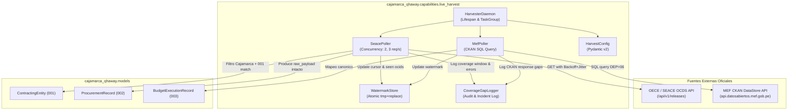
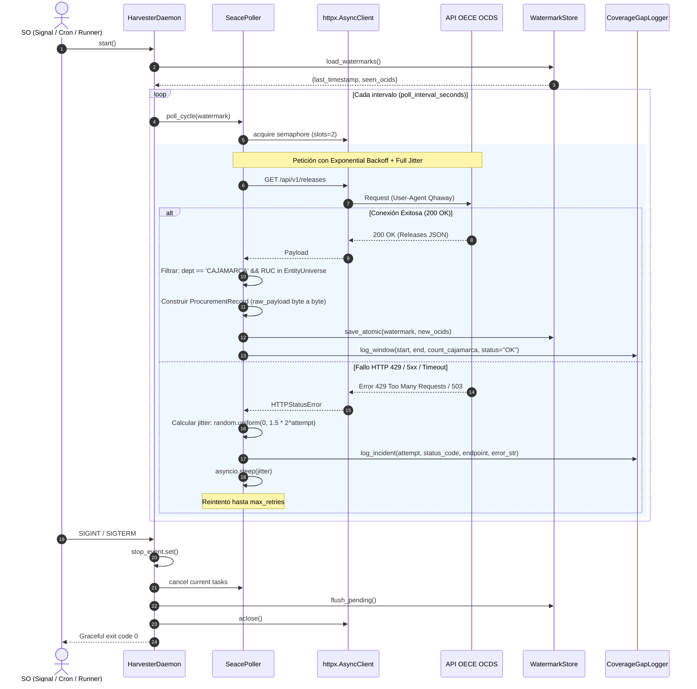

# Arquitectura Técnica Integral - Pilar 1: Cosecha Continua de Datos en Vivo
**Componente:** Harvester Daemon & Background Worker (`live_harvest`)  
**Proyecto:** Cajamarca Qhaway (`c:\ws\projects\cajamarca-qhaway`)  
**Autor:** `sdd-architect`  
**Fecha:** 2026-10-12  
**Estado:** `APPROVED_DESIGN`  
**Alineación SDD:** Artículos 1, 2, 6, 10, 14, 15, 16, 18, 19 de `docs/sdd/constitution.md` | Specs 001, 002, 003 | Tasks TK-101 a TK-105

## Verificacion operativa del corte (2026-10-14)

La cosecha historica oficial devuelve 42 presupuestos: 14 entidades en cada ano 2024-2026.
El corte publicado por el [modulo mensual MEF](https://apps5.mineco.gob.pe/transparencia/Mensual/Navegar_6.aspx?y=2026&ap=ActProy) es 2026-09-30.
Cada fila conserva las ocho columnas presupuestales, ano, corte, https://apps5.mineco.gob.pe/transparencia/Mensual/Navegar_6.aspx?y=2026&ap=ActProy y ruta de navegacion.
El extractor renueva estado WebForms y cookies; rechaza importes ausentes y filas incoherentes.

El cruce provincial validado usa Cajamarca `300549`, Cajabamba `300562`, Celendin `300566`,
Chota `300578`, Contumaza `300597`, Cutervo `300605`, Hualgayoc `300620`, Jaen `300623`,
San Ignacio `300635`, San Marcos `300642`, San Miguel `300649`, San Pablo `300662`
y Santa Cruz `300666`; GORE usa pliego `445`.
La persona responsable confirmo conservar este mapa oficial el 2026-10-14.

Supabase conserva 475 contrataciones; el motor genera 473 candidatos internos.
Las seis alertas en revision y las dos descartadas conservan su estado.
No se publican candidatos ni alertas sin dictamen humano.
La procedencia de entidades se verifica en el dataset canonico y perfiles SUNAT.

Comandos de evidencia:
`harvest run --historical --years 2024,2025,2026 --source mef` devuelve 42 filas.
`select fiscal_year,count(*),count(distinct entity_id) from budget_execution_records
 group by fiscal_year;` devuelve 14/14 para cada ano.
`python scripts/audit_snapshot_parity.py` compara el ultimo ejercicio con el DOM estatico.

El diseno siguiente describe componentes del worker.
CKAN/PNDA conserva su procedencia propia; sus fallos no invalidan una respuesta MEF mensual.

---

## 1. Visión y Fundamentos del Pilar 1

El **Pilar 1: Cosecha Continua de Datos en Vivo** es el subsistema encargado de la ingesta permanente, desacoplada, resiliente y auditable de los dos flujos primarios de datos públicos para la región Cajamarca:
1. **SEACE/OECE OCDS Feed:** Contrataciones públicas en formato Open Contracting Data Standard vía el endpoint verificado `GET https://contratacionesabiertas.oece.gob.pe/api/v1/releases` y de detalle `/api/v1/release/{ocid}`.
2. **Fuentes oficiales MEF:** CKAN/PNDA y el Módulo Oficial de Consulta de Ejecución del Gasto (`id=504`) son fuentes primarias en paridad. Consulta Amigable opera bajo `apps5.mineco.gob.pe/transparencia/Mensual/` y `/Navegador/`; el poller conserva la sesión WebForms y etiqueta cada registro con su fuente.

### Cumplimiento Invariable de la Constitución SDD
* **Artículo 10 (Evidencia inmutable y `raw_payload`):** Los campos `ProcurementRecord.raw_payload` y `BudgetExecutionRecord.raw_payload` preservan el JSON devuelto por la fuente externa sin alteración byte a byte.
* **Artículo 14 (Prohibición estricta de emitir `Alert` de forma automática):** El daemon y sus pollers **únicamente** producen y persisten `ProcurementRecord` y `BudgetExecutionRecord`. Jamás generan candidatos de alerta ni tocan el estado de alerta humana.
* **Artículo 15 (Trazabilidad y procedencia obligatoria):** Todo registro generado por el Harvester lleva `retrieved_at` en ISO 8601 UTC estricto y su fuente canónica (`"seace-ocds"`, `"mef-datastore"` o `"mef-consulta-amigable"`).
* **Artículo 16 (Prohibición de scoring/perfilamiento de personas físicas):** El Harvester indexa y procesa contratos, procesos y partidas presupuestales. Bajo ninguna circunstancia crea estructuras ni índices centrados en personas naturales.
* **Artículo 18 (Ámbito geográfico exclusivo Cajamarca):** Restricción inviolable. El poller de SEACE coteja la entidad y el departamento. El parser MEF acepta `NIVEL_GOBIERNO=R` y `PLIEGO=445` para el GORE; para municipalidades usa exclusivamente el cruce oficial de `SEC_EJEC` provincial y UBIGEO capital validado en `data/entities/cajamarca-universe.yaml`, con verificación de Cajamarca. No se aceptan códigos por pertenecer a un rango sin verificar entidad y provincia.
* **Consulta Amigable:** Solo se usa el formulario oficial con campos hidden y sesión persistente. Cambios de DOM o errores de postback se registran como brecha, sin atribuir resultados parciales a otros pliegos.

---

## 2. Parámetros de Configuración (`HarvestConfig` con Pydantic v2)

El diseño tipa rigurosamente todos los umbrales de rate limit, timeouts, semáforos, intervalos de sondeo y persistencia atómica en `cajamarca_qhaway.capabilities.live_harvest.config`:

```python
from __future__ import annotations
from pathlib import Path
from pydantic import BaseModel, ConfigDict, Field, HttpUrl

class SeaceHarvestConfig(BaseModel):
    model_config = ConfigDict(extra="forbid", frozen=True)
    base_url: str = Field(default="https://contratacionesabiertas.oece.gob.pe/api/v1")
    user_agent: str = Field(default="CajamarcaQhaway-Harvester/1.0 (+https://github.com/richardsonyelstin/cajamarca-qhaway)")
    max_concurrency: int = Field(default=2, description="Máx 2 peticiones paralelas en semáforo")
    rate_limit_per_second: float = Field(default=3.0, description="Máx 3 req/segundo")
    poll_interval_seconds: int = Field(default=300, description="Intervalo entre barridos (5 min)")
    timeout_seconds: float = Field(default=20.0)
    max_retries: int = Field(default=4)
    backoff_initial_delay: float = Field(default=1.5)
    backoff_factor: float = Field(default=2.0)
    jitter_max: float = Field(default=1.0)

class MefHarvestConfig(BaseModel):
    model_config = ConfigDict(extra="forbid", frozen=True)
    base_url: str = Field(default="https://api.datosabiertos.mef.gob.pe/DatosAbiertos/v1")
    resource_id: str = Field(default="615644aa-ef73-4358-b4e0-0c20931632f3", description="Recurso oficial consultado; validar disponibilidad")
    user_agent: str = Field(default="CajamarcaQhaway-Harvester/1.0")
    poll_interval_seconds: int = Field(default=3600, description="Intervalo entre barridos (1 hora)")
    timeout_seconds: float = Field(default=30.0)
    max_retries: int = Field(default=3)
    backoff_initial_delay: float = Field(default=2.0)
    backoff_factor: float = Field(default=2.0)
    cajamarca_dep_code: str = Field(default="06", description="Código departamento Cajamarca en MEF")

class StorageConfig(BaseModel):
    model_config = ConfigDict(extra="forbid", frozen=True)
    watermark_file_path: Path = Field(default=Path("data/state/watermarks.json"))
    coverage_gap_log_path: Path = Field(default=Path("data/state/coverage_gaps.jsonl"))
    records_storage_dir: Path = Field(default=Path("data/harvested"))

class HarvestConfig(BaseModel):
    model_config = ConfigDict(extra="forbid", frozen=True)
    seace: SeaceHarvestConfig = Field(default_factory=SeaceHarvestConfig)
    mef: MefHarvestConfig = Field(default_factory=MefHarvestConfig)
    storage: StorageConfig = Field(default_factory=StorageConfig)
    max_records_per_cycle: int = Field(default=1000)
```

---

## 3. Arquitectura de Capas y Componentes

El paquete `cajamarca_qhaway.capabilities.live_harvest` se estructura en responsabilidades desacopladas:

1. **`HarvesterDaemon` (Orquestador y Ciclo de Vida):**
   - Maneja `asyncio.TaskGroup` nativo de Python 3.12 y supervisión de tareas de fondo.
   - Captura señales del sistema operativo (`SIGINT`, `SIGTERM`) mediante `asyncio.Event` de parada coordinada.
   - Gestiona el ciclo de vida del cliente HTTP (`httpx.AsyncClient`) y los semáforos de concurrencia.
2. **`SeacePoller` (Recolector Resiliente SEACE/OCDS):**
   - Consume `/releases` con semáforo de concurrencia acotado a 2 slots y limitador de tasa de 3 req/seg.
   - Aplica política de reintentos exponenciales con **full jitter** (`sleep = random.uniform(0, min(max_backoff, base * 2^attempt))`).
   - Aplica cliente de filtrado contra `parties[].address.department == "CAJAMARCA"` y cotejo biunívoco contra el universo de `ContractingEntity` de `001-entity-mapping`.
   - Genera instancias canónicas de `ProcurementRecord` con preservación byte a byte de `raw_payload`.
3. **`MefPoller` (Recolector MEF CKAN DataStore):**
   - Consulta `datastore_search` y valida que la respuesta contenga una lista real `records` antes de parsear.
   - Rechaza montos PIM o devengado ausentes y coteja exclusivamente pliegos permitidos; la respuesta actual del recurso no contiene filas.
4. **`WatermarkStore` (Cursor y Estado Atómico):**
   - Registra el cursor temporal `last_harvested_timestamp` y set/hash de `seen_ocids` para deduplicación idempotente (CA-002-04).
   - Implementa **escritura atómica garantizada en POSIX/Windows**: escribe a fichero temporal (`.tmp.PID`) con `flush()` y `os.replace` atómico, previniendo corrupción ante fallos de alimentación o SIGKILL.
5. **`CoverageGapLogger` (Auditoría de Brechas y Cobertura RN-002-06, RN-002-07, RN-003-06):**
   - Registra en append-only (`.jsonl`) cada intervalo temporal muestreado, el número de items evaluados vs retenidos, y los incidentes/errores HTTP con código de estado y causa de excepción.

---

## 4. Diagramas Mermaid de Arquitectura y Secuencia

### Diagrama de Componentes y Flujo de Datos


### Diagrama de Secuencia: Ciclo de Cosecha Continua con Manejo de Fallos


---

## 5. Árbol Canónico de Módulos e Imports Exactos

### Árbol de Ficheros
```text
src/cajamarca_qhaway/capabilities/live_harvest/
├── __init__.py
├── config.py             # HarvestConfig, SeaceHarvestConfig, MefHarvestConfig
├── daemon.py             # HarvesterDaemon, graceful shutdown, lifespan
├── seace_poller.py       # SeacePoller, rate-limiting, backoff, filter
├── mef_poller.py         # MefPoller, CKAN DataStore query execution
├── watermark_store.py    # WatermarkStore atómico (temp file + rename)
├── coverage_logger.py    # CoverageGapLogger (JSONL audit log)
└── backoff.py            # Async retry backoff con full jitter decorador/util

tests/capabilities/live_harvest/
├── test_config.py
├── test_watermark_store.py
├── test_seace_poller.py
├── test_mef_poller.py
├── test_coverage_logger.py
└── test_daemon_lifecycle.py
```

### Imports Canónicos y Estándar Utilizados
* **Estándar Python 3.12:**
  `from __future__ import annotations`  
  `import asyncio`, `import signal`, `import os`, `import json`, `import random`  
  `from datetime import datetime, timezone`  
  `from pathlib import Path`  
  `from typing import Any, AsyncIterator, Final, Sequence`
* **Dependencias de Producción:**
  `import httpx`  
  `from pydantic import BaseModel, ConfigDict, Field, HttpUrl`
* **Modelos Canónicos del Dominio:**
  `from cajamarca_qhaway.models import ContractingEntity, ProcurementRecord, BudgetExecutionRecord`

---

## 6. Verificación de Cumplimiento de Invariantes Constitucionales

| Artículo | Regla | Verificación Técnica en el Diseño |
|---|---|---|
| **Art. 10** | Evidencia inmutable y `raw_payload` | `SeacePoller` asigna `raw_payload=rel` intacto; `MefPoller` asigna `raw_payload=row` intacto. |
| **Art. 14** | Cero alertas automáticas | Ni `HarvesterDaemon` ni los pollers importan o instancian `Alert`. Solamente persisten registros canónicos. |
| **Art. 15** | Explicabilidad y procedencia | `retrieved_at` se estampa con timestamp UTC del momento exacto del HTTP socket return. `source` es inmutable. |
| **Art. 16** | Prohibido ranking de personas | Ningún campo o estructura procesa o agrega personas naturales; solo RUCs de entidades y montos. |
| **Art. 18** | Ámbito regional Cajamarca | GORE `PLIEGO=445`; municipalidades por SEC_EJEC provincial verificado y departamento/UBIGEO Cajamarca; la cobertura MEF no pasa Gate 2. |
| **Art. 19** | Contratos canónicos compartidos | Emplea sin alteraciones `ContractingEntity`, `ProcurementRecord` y `BudgetExecutionRecord` de `cajamarca_qhaway.models`. |
| **Resiliencia** | Tolerancia a fallos y sin corrupción | Escritura en dos fases con fichero temporal + `os.replace` atómico y registro auditable de gaps temporales. |

Este diseño arquitectónico queda listo como referencia base definitiva para las tareas TK-101 a TK-105.
