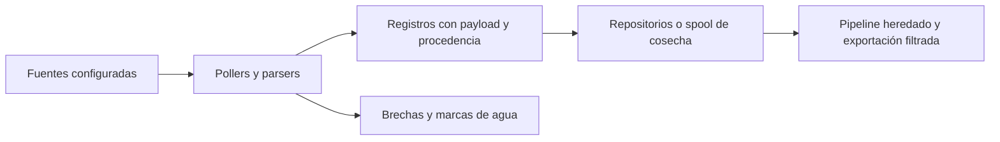

# Cosecha continua y fuentes oficiales

La cosecha obtiene registros, conserva procedencia y registra brechas de cobertura.
El worker programado y la consulta oficial bajo demanda son workflows diferentes.
Una corrida local o histórica no garantiza disponibilidad actual de una fuente externa.

## Implementación

El módulo [live_harvest](../../src/cajamarca_qhaway/capabilities/live_harvest/)
contiene configuración, pollers, daemon y gestión de estado.
Los parsers específicos viven en seace_ingestion/ y mef_ingestion/.
La evidencia de contratación incorpora fuentes OCDS y evidencia oficial adicional;
no se sustituyen claves oficiales por emparejamientos difusos.



## Automatización existente

[harvester-cron.yml](../../.github/workflows/harvester-cron.yml) declara cron 0 */2 * * *
y disparo manual; ejecuta cosecha, comprobación de conexión y controles finales.
[official-sources.yml](../../.github/workflows/official-sources.yml) permite la ejecución
bajo demanda del conector dual con navegador.
La comprobación geoespacial del worker no acredita un catálogo de obras poblado.

```powershell
uv run cajamarca-qhaway harvest --help
uv run cajamarca-qhaway harvest status
uv run cajamarca-qhaway harvest gaps --limit 10
```

Los comandos de cosecha o persistencia tienen efectos y requieren configuración real.
No deben utilizarse como pruebas offline de documentación.
Los parámetros efectivos se consultan en la CLI y en los workflows, sin copiar credenciales.

## Límites de cobertura

Conservar fecha del hecho y fecha de extracción como campos diferentes.
Un CAPTCHA, un HTTP de rechazo o una fuente vacía se registra como brecha.
Los cortes MEF de distintos momentos, ejercicios y ámbitos no se agregan como duplicados.
El spool no demuestra durabilidad de una decisión del panel ni recepción de una denuncia.
011 no está conectado automáticamente al worker: su entrada y ejecución siguen privadas.
Las observaciones fechadas de runs anteriores permanecen en audits/ como antecedentes.
