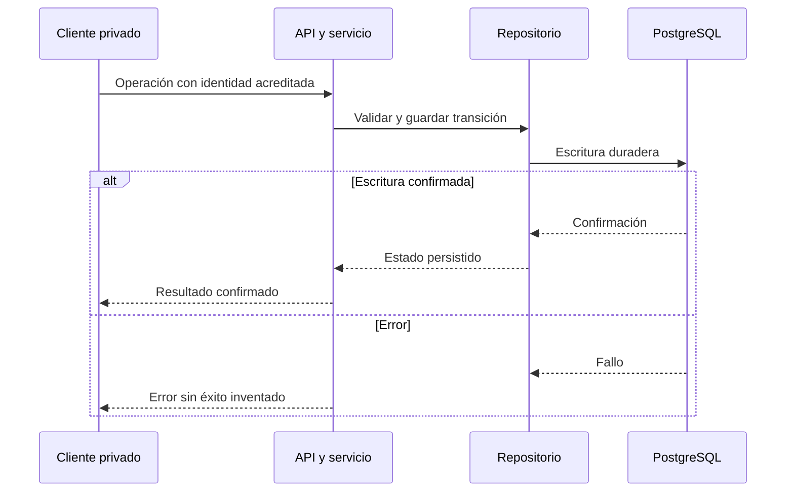

# Persistencia y durabilidad

PostgreSQL es la persistencia operativa; SQLite en memoria sirve a pruebas y desarrollo.
La cosecha puede usar spool, pero las escrituras privadas no confirman una contingencia efímera.
La política real depende del código, las migraciones aplicadas y la configuración del entorno.

## Configuración y conexión

[DatabaseConfig](../../src/cajamarca_qhaway/persistence/config.py) es un modelo congelado
con campos cerrados; database_url es opcional y se lee de CAJAMARCA_QHAWAY_DATABASE_URL.
Incluye session_pooler_host, tiempos de conexión y opciones de spool.
No introducir una DSN ficticia para simular configuración productiva.
[DatabaseManager](../../src/cajamarca_qhaway/persistence/connection.py) identifica PostgreSQL
a partir de la URL y ofrece conexión SQLite en memoria para los usos permitidos.
El driver psycopg es dependencia de ejecución, no solo del extra db.

## Repositorios

[repositories/](../../src/cajamarca_qhaway/persistence/repositories/) implementa entidades,
contrataciones, presupuestos, señales, alertas, denuncias, análisis y evidencia de fuentes.
La construcción de esquema local no sustituye aplicar migraciones PostgreSQL.
Las migraciones se conservan en [scripts/migrations/](../../scripts/migrations/)
y [supabase/migrations/](../../supabase/migrations/); no se borran por similitud de nombres.



## Privacidad y comprobación

Las políticas SQL existentes no se describen como permisos abiertos universales.
Revisar cada tabla y función en las migraciones antes de conceder acceso.
Las decisiones usan save_decision y la moderación usa moderate_pending con transición condicional.
Referencias de comportamiento: [pruebas de remediación](../../tests/test_audit_remediation.py).
El núcleo 011 no importa repositorios ni escribe en esta capa.

```powershell
uv run cajamarca-qhaway db --help
```

Consultar db status, seed o sync requiere conocer sus efectos y el entorno real.
Las pruebas con dobles o SQLite no acreditan una migración remota ni continuidad entre instancias.
