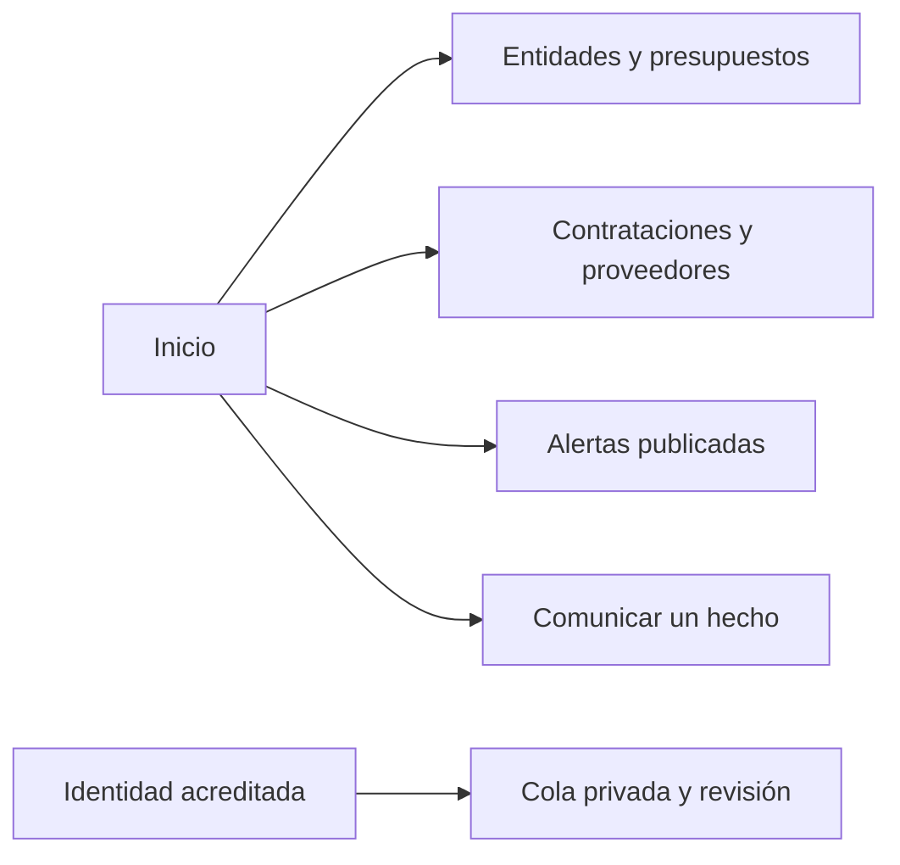

# Mapa de páginas y acceso

La interfaz usa páginas HTML independientes con rutas limpias y recursos locales.
El panel de revisión, la sesión y las denuncias tienen controles privados en la API.
La ruta visible no sustituye validar identidad, privacidad y durabilidad en el servidor.

## Rutas

| Familia | Páginas o rutas |
|---|---|
| Inicio y entidades | /, /entidades, /entidad |
| Contrataciones | /contrataciones, /contrato |
| Presupuesto y proveedores | /presupuesto, /proveedores, /concentracion |
| Información | /alertas, /transparencia, /acerca, /metodologia |
| Territorio | /georreferenciacion, /mapa |
| Recepción | /denuncia |
| Identidad y panel | /login, /acreditacion, /admin, /admin/revision |

Las fuentes exactas son CLEAN_PAGE_ROUTES en
[server.py](../../src/cajamarca_qhaway/web/server.py) y los rewrites de
[vercel.json](../../vercel.json).
Los alias y el destino estático deben comprobarse en cada entrypoint;
una comprobación local no acredita la configuración del despliegue.

## Navegación e interacción

No existe router.js ni navegación #/ para cambiar páginas.
Los módulos reales están en [web/src/js/](../../web/src/js/).
Las anclas y atributos DOM se verifican en
[test_identity_dom_contract.py](../../tests/test_identity_dom_contract.py).
Un catálogo geoespacial vacío se trata como falta de cobertura, sin crear obras ilustrativas.
La presencia de una página no implica que DJI o notificación SMS/WhatsApp estén implementados.
