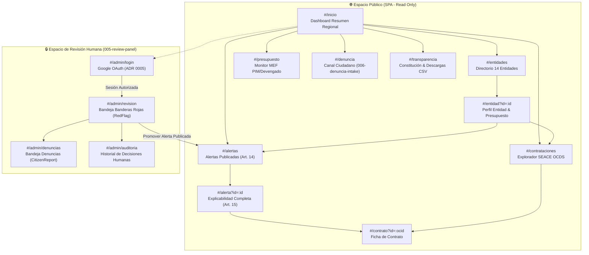
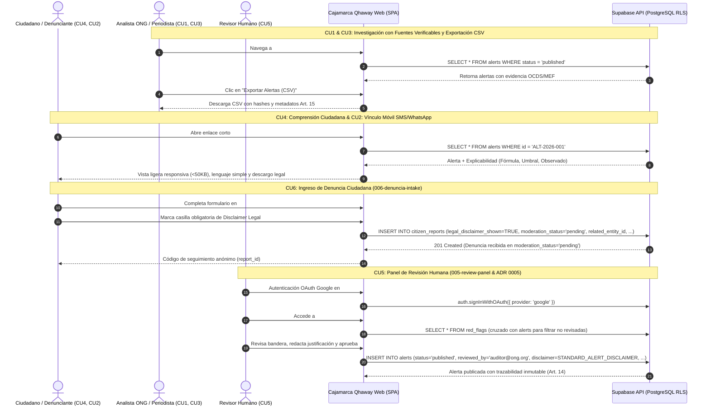

# 004: Mapa de Sitio y Arquitectura de Información Web de Cajamarca Qhaway

## 1. Visión General y Propósito

Este documento establece la arquitectura de información, rutas de navegación, estructura de componentes y compuertas de seguridad para la plataforma web de **Cajamarca Qhaway**. La plataforma opera como una Single-Page Application (SPA) estática optimizada para conectividad rural, sin enlaces rotos ni marcadores de posición (Regla R-24 de Antislop), consumiendo datos públicos verificados desde Supabase (`tiythjlrjhvwkiqsnvwq`) y respaldos JSON locales.

El diseño web se rige estrictamente por la **Constitución Ética y Técnica del Proyecto**:
- **Art. 10**: Fuentes verificables (OCDS SEACE `seace-ocds` y Portal de Datos Abiertos MEF CKAN DataStore `mef-datastore`, con veto estricto a Consulta Amigable `apps5.mineco.gob.pe`).
- **Art. 14**: Separación estricta entre detección y publicación. Las banderas técnicas (`RedFlag`) son invisibles al público y requieren revisión humana (`Alert.status = 'published'`, con `reviewed_by` y `reviewed_at`) para ser visibles.
- **Art. 15**: Explicabilidad integral obligatoria en cada alerta (fórmula, umbral, valor observado, fecha y fuente de evidencia, payload crudo y disclaimer legal).
- **Art. 16**: Prohibición de perfilamiento, rankings o scoring de personas por nombre propio.
- **Art. 17**: Integración DJI bloqueada en Fase 1 (estado de reserva transparente, sin cruces especulativos).
- **Art. 18**: Alcance territorial exclusivo: Región Cajamarca (Gobierno Regional + 13 municipalidades provinciales).
- **Art. 24 (R-24)**: Cero enlaces muertos, rutas 404 o botones ficticios. Toda ruta o botón mapea a una función o vista real.

---

## 2. Mapa de Sitio y Árbol de Rutas

La plataforma implementa un enrutamiento por hash (`#/<ruta>`) y parámetros de consulta (`?id=...`), permitiendo navegación sin recarga de página, enlaces directos compartibles para canales de mensajería (WhatsApp/SMS) y compatibilidad con hosting estático (Vercel / GitHub Pages).

### 2.1 Estructura Jerárquica de Vistas

```
Cajamarca Qhaway Platform (/)
│
├── 🌐 Zona Pública (Acceso Universal - Sin Autenticación)
│   ├── #/inicio ──────────────────────── Dashboard Resumen Regional (KPIs, 14 Entidades, Alertas Recientes)
│   ├── #/entidades ───────────────────── Directorio de las 14 Entidades (1 GORE + 13 Provincias)
│   │   └── #/entidad?id=:entidad_id ──── Perfil Entidad: Resumen Presupuestal MEF, Contratos SEACE, Alertas Publicadas
│   ├── #/alertas ─────────────────────── Explorador de Alertas Publicadas (Filtros: Entidad, Severidad, Categoría)
│   │   └── #/alerta?id=:alert_id ─────── Detalle Explicable de Alerta (Art. 15: Fórmula, Umbral, Observado, JSON Crudo)
│   ├── #/contrataciones ──────────────── Buscador de Contratos OCDS SEACE (Filtros: Entidad, Monto, Proveedor, Modalidad)
│   │   └── #/contrato?id=:ocid ───────── Ficha de Contratación con enlaces a SEACE y Banderas Asociadas
│   ├── #/presupuesto ─────────────────── Monitor Presupuestal MEF (PIM vs. Devengado por entidad y categoría)
│   ├── #/denuncia ────────────────────── Formulario de Denuncia Ciudadana (006-denuncia-intake con Aviso Legal Ley 29733)
│   ├── #/transparencia ──────────────── Metodología, Constitución del Proyecto, Estado de Fuentes y Descarga de Datos (CSV/JSON)
│   └── #/acerca ─────────────────────── Misión cívica, disclaimer legal y contacto institucional
│
└── 🔒 Zona Restringida (Panel Interno de Revisión Humana - 005-review-panel)
    ├── #/admin/login ────────────────── Acceso vía OAuth Google (ADR 0005) o Supabase Auth
    ├── #/admin/revision ─────────────── Bandeja de Banderas Rojas Pendientes (Triage, Promover a Alerta o Descartar con Nota)
    ├── #/admin/denuncias ────────────── Moderación de Denuncias Ciudadanas (Revisión de Evidencias, Estado: Evaluando/Descartado)
    └── #/admin/auditoria ────────────── Registro Inmutable de Decisiones Humanas (reviewed_by, timestamps y notas)
```

---

## 3. Diagramas de Arquitectura y Flujos de Navegación

### 3.1 Diagrama de Navegación del Sitio (Flowchart)



### 3.2 Diagrama de Flujo de Casos de Uso y Compuertas de Seguridad



---

## 4. Matriz de Casos de Uso (CU1 - CU5) y Especificaciones Técnicas

| Caso de Uso | Actor Principal | Ruta Principal | Capacidad Clave | Invariante Aplicado |
|---|---|---|---|---|
| **CU1: Investigación de Sobrecostos y Exportación CSV** | Analista de ONG / Investigador | `#/alertas`<br/>`#/contrataciones` | Filtros por entidad, modalidad y sobrecosto. Exportación directa a CSV con checksum SHA-256 de los registros consultados. | **Art. 10**: Fuentes verificables SEACE.<br/>**Art. 18**: Ámbito exclusivo 14 entidades. |
| **CU2: Acceso Móvil Ligero Rural (SMS / WhatsApp)** | Líder comunitario / Poblador rural | `#/alerta?id=:id`<br/>`#/entidad?id=:id` | Carga de vistas optimizada (<50KB primer render), tarjetas de resumen legibles en 2G/3G sin dependencias pesadas. | **R-24**: Sin scripts rotos ni bloqueos por red lenta. |
| **CU3: Verificación Periodística con Trazabilidad** | Periodista de radio local / Prensa | `#/contrato?id=:ocid`<br/>`#/alerta?id=:id` | Exposición de fecha de extracción (`evidence_retrieved_at`), identificador OCDS SEACE y enlace al portal del MEF. | **Art. 10 & Art. 15**: Datos crudos verificables y fecha de corte explícita. |
| **CU4: Explicabilidad Ciudadana en Lenguaje Claro** | Ciudadano de a pie | `#/alerta?id=:id` | Desglose en lenguaje no técnico de la anomalía, comparación de umbral vs. observado y disclaimer obligatorio de presunción de inocencia. | **Art. 15**: Explicabilidad completa obligatoria.<br/>**Art. 16**: Sin juicios ni nombres de personas. |
| **CU5: Panel Interno de Revisión Humana y Triage** | Especialista técnico / Auditor | `#/admin/revision`<br/>`#/admin/denuncias` | Acceso autenticado (Google OAuth ADR 0005). Promoción de `RedFlag` a `Alert` publicada o descarte documentado con notas obligatorias. | **Art. 14**: Ninguna alerta pública sin revisión humana (`reviewed_by`). |

---

## 5. Mapeo Canónico de Entidades y Contratos (Art. 19)

Cada nodo del mapa de sitio se alimenta exclusivamente de los modelos canónicos definidos en el Artículo 19:

```
┌─────────────────────────────────┐       ┌──────────────────────────────────┐
│ 1. ContractingEntity            │       │ 2. ProcurementRecord             │
│    Rutas: #/entidades, #/entidad│◄──────┤    Rutas: #/contrataciones,      │
│    Universo: 14 entidades       │       │           #/contrato             │
└────────────────┬────────────────┘       └─────────────────┬────────────────┘
                 │                                          │
                 │                                          ▼
┌────────────────┴────────────────┐       ┌──────────────────────────────────┐
│ 3. BudgetExecutionRecord        │       │ 4. RedFlag (Solo Admin 005)      │
│    Rutas: #/presupuesto,        │       │    Rutas: #/admin/revision       │
│           #/entidad             │       │    Invisible al público (Art.14) │
└─────────────────────────────────┘       └─────────────────┬────────────────┘
                                                            │ Promovido por
                                                            │ Revisor Humano
                                                            ▼
┌─────────────────────────────────┐       ┌──────────────────────────────────┐
│ 6. CitizenReport                │       │ 5. Alert (Público tras 005)      │
│    Rutas: #/denuncia,           │       │    Rutas: #/alertas, #/alerta    │
│           #/admin/denuncias     │       │    Explicabilidad Art. 15        │
└─────────────────────────────────┘       └──────────────────────────────────┘
```

1. **`ContractingEntity`**: Mapeado en `#/entidades` y `#/entidad?id=:id`. Contiene el universo cerrado de 14 entidades de Cajamarca.
2. **`ProcurementRecord`**: Mapeado en `#/contrataciones` y `#/contrato?id=:ocid`. Contratos SEACE normalizados en OCDS.
3. **`BudgetExecutionRecord`**: Mapeado en `#/presupuesto` y gráficos de ejecución PIM vs. Devengado en `#/entidad?id=:id`.
4. **`RedFlag`**: Mapeado únicamente en `#/admin/revision`. Las banderas rojas son hallazgos estadísticos algorítmicos. **Nunca se exponen al público sin intervención humana**.
5. **`Alert`**: Mapeado en `#/alertas` y `#/alerta?id=:id`. Solo se muestran alertas con `status = 'published'`, con autor humano identificado en `reviewed_by` y explicabilidad Art. 15.
6. **`CitizenReport`**: Mapeado en el intake público `#/denuncia` (con `legal_disclaimer_shown = true`) y moderado en `#/admin/denuncias`.

---

## 6. Estado de Declaraciones Juradas de Intereses (DJI) - Art. 17

Conforme al **Artículo 17** de la Constitución del Proyecto:
- La fuente de Declaraciones Juradas de Intereses (DJI) de la Contraloría permanece en estado **RESERVADA / EN EVALUACIÓN LEGAL** durante la Fase 1.
- No se realiza cruce automatizado de nombres con personas naturales ni funcionarios públicos en ninguna vista.
- La sección `#/transparencia` contiene un panel explicativo formal indicando la base legal (Ley 29733 de Protección de Datos Personales) y el estatus técnico de la evaluación.

---

## 7. Garantías de Usabilidad y Calidad de Código (Antislop R-24)

1. **Cero Enlaces Rotos**: Todos los hipervínculos del encabezado, pie de página y botones de acción dirigen a un hash registrado en el enrutador SPA.
2. **Estados de Carga y Respaldo Local**: Si la conexión con Supabase falla o experimenta alta latencia, el enrutador carga automáticamente los datos de muestra sembrados desde `web/data/seeds.json`.
3. **Responsividad Móvil**: Grid fluida con CSS modular que prioriza la legibilidad en pantallas pequeñas (360px de ancho) sin horizontales innecesarios.
4. **Accesibilidad y Exportabilidad**: Toda tabla de datos incluye encabezados semánticos accesibles y botón de exportación CSV con codificación UTF-8 con BOM para visualización correcta en Excel.
