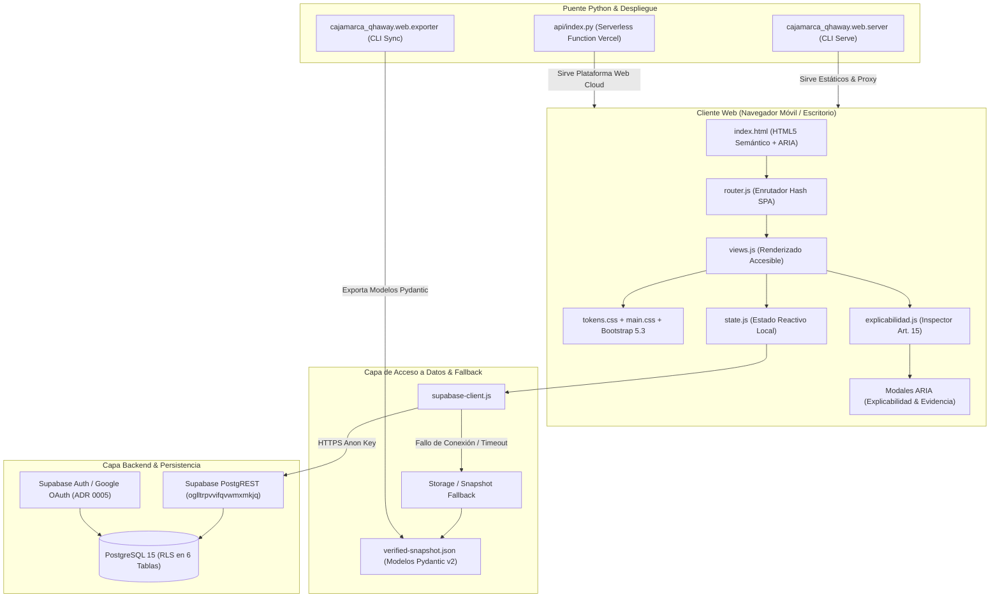
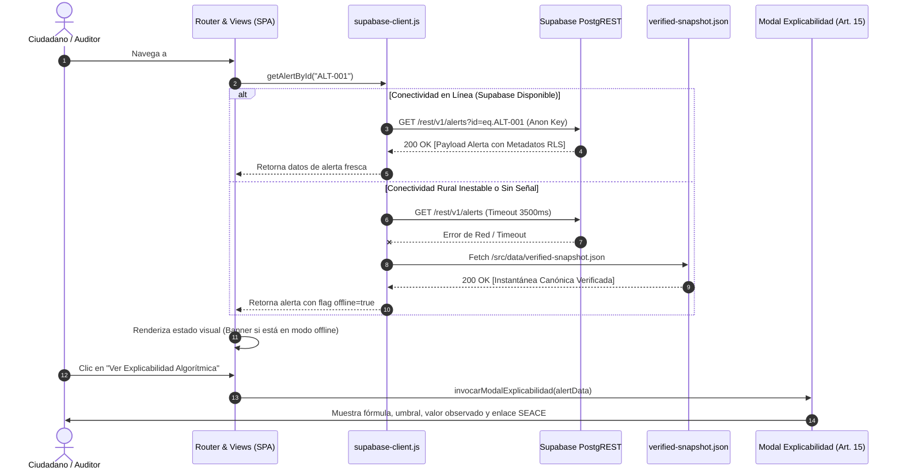

# 005: Arquitectura Técnica Integral de la Plataforma Web (Pilar 3)

## 1. Visión y Fundamentos de Arquitectura

La plataforma web de **Cajamarca Qhaway** es el canal cívico y de auditoría pública del observatorio. Su diseño responde a una premisa ineludible: operar con máxima resiliencia y velocidad ante la brecha de conectividad digital en las 13 provincias del departamento de Cajamarca (desde distritos rurales altoandinos con enlaces móviles intermitentes hasta redacciones periodísticas en la capital departamental).

Para salvaguardar la confianza pública y la rigurosidad técnica, la arquitectura se fundamenta en los siguientes principios:

1. **Cumplimiento Estricto de la Constitución Ética y Técnica**:
   - **Art. 10 (Fuentes Verificables)**: Todo dato presentado proviene de OCDS SEACE (`seace-ocds`) o MEF DataStore (`mef-datastore`). La interfaz provee visores de payloads crudos verificados e inspectores de metadatos de sincronización.
   - **Art. 14 (Separación de Detección y Publicación)**: La vista pública solo consulta alertas en estado `published`, verificadas por un revisor humano (`reviewed_by`, `reviewed_at`). Las banderas técnicas internas (`red_flags`) permanecen restringidas al panel de revisión.
   - **Art. 15 (Explicabilidad Algorítmica)**: Cada alerta cuenta con una ficha comprensible que desglosa la fórmula de cálculo, el umbral predeterminado, el valor observado y el enlace a la evidencia.
   - **Art. 16 (Prohibición de Perfilamiento Personal)**: La plataforma no calcula índices de riesgo individuales sobre personas naturales.
   - **Art. 24 (R-24 Antislop - Enlaces y Rutas Vivas)**: Cero rutas rotas, placeholders o botones inertes. Toda acción mapea a una función o modal operativo.

2. **Arquitectura Híbrida Desacoplada (Vanilla JS ES6+ / PostgREST / Snapshot Local)**:
   - En concordancia con el **ADR 0001**, no se adoptan frameworks pesados de frontend (React, Angular, Next.js) que inflan bundles en redes lentas. Se utiliza HTML5 semántico, Bootstrap 5.3 (CSS utilitario y componentes accesibles) y JavaScript ES6 modular nativo (`type="module"`).
   - Consumo directo de la API REST de Supabase (`https://oglltrpvvifqvwmxmkjq.supabase.co`) bajo políticas de seguridad a nivel de fila (RLS).
   - Modo de contingencia sin degradación crítica: si la red falla, la plataforma conmuta automáticamente a una instantánea local verificada (`verified-snapshot.json`).

---

## 2. Diagramas de Arquitectura

### 2.1 Arquitectura de Capas y Componentes (Flowchart)



### 2.2 Ciclo de Vida de Datos y Estrategia de Resiliencia (Sequence Diagram)



---

## 3. Estructura de Directorios de la Plataforma Web (`web/`)

La raíz de la plataforma web se organiza de manera autónoma en `c:\ws\projects\cajamarca-qhaway\web\`:

```
c:\ws\projects\cajamarca-qhaway\web\
│
├── index.html                     # Punto de entrada SPA, maquetación semántica y contenedores modales
├── DESIGN.md                      # Dirección formal de diseño (antislop R-37, contraste WCAG AA, tokens)
│
├── src\
│   ├── css\
│   │   ├── tokens.css             # Design Tokens CSS: colores, tipografía, espaciado, elevaciones
│   │   ├── main.css               # Reglas globales, reseteo, accesibilidad y layout base
│   │   └── components.css         # Estilos específicos: tarjetas de alerta, tablas densas, modales
│   │
│   ├── js\
│   │   ├── config.js              # Configuración de URLs, claves públicas, rutas y constantes
│   │   ├── supabase-client.js     # Cliente PostgREST con fallback determinista a instantánea local
│   │   ├── state.js               # Almacén de estado reactivo y caché en memoria de la sesión
│   │   ├── router.js              # Enrutador por hash, control de deep linking y manejo de scroll
│   │   ├── views.js               # Funciones de renderizado para las 11 vistas del sitemap
│   │   ├── explicabilidad.js      # Formateador y desglosador de indicadores algorítmicos (Art. 15)
│   │   ├── denuncias.js           # Formulario ciudadano con aviso Ley 29733 e inserción segura
│   │   ├── review-panel.js        # Vistas y controladores del panel interno de revisión (OAuth Google)
│   │   ├── export-csv.js          # Exportador en navegador de datos públicos a formato CSV
│   │   └── app.js                 # Inicializador principal de la plataforma y listeners globales
│   │
│   └── data\
│       └── verified-snapshot.json # Instantánea canónica generada desde los modelos Pydantic v2
│
├── media\
│   ├── cajamarca-map.svg          # Mapa vectorial interactivo con las 13 provincias de Cajamarca
│   ├── brand-mark.svg             # Isotipo y logotipo institucional sobrio de Cajamarca Qhaway
│   └── architecture-flow.svg      # Diagrama de transparencia de datos para la vista pública
│
└── tools\
    ├── validate_web_integrity.py  # Verificador automatizado de rutas, contraste y ausencia de 404
    └── sync_web_snapshot.py       # Script de extracción desde BD/Pipeline hacia verified-snapshot.json
```

---

## 4. Especificación Detallada de Módulos

### 4.1 Punto de Entrada HTML (`web/index.html`)
- **Semántica**: `<header role="banner">`, `<nav aria-label="Navegación principal">`, `<main id="app" role="main" aria-live="polite">`, `<footer role="contentinfo">`.
- **Accesibilidad**: Salto al contenido principal (`<a href="#app" class="visually-hidden-focusable">Saltar al contenido principal</a>`), soporte completo de foco por teclado, atributos ARIA dinámicos.
- **Modales Estáticos en HTML**:
  - `#modal-explicabilidad`: Diálogo accesible con desglose de indicador, umbral, valor observado y botón de descarga de evidencia.
  - `#modal-evidencia-json`: Visor de código preformateado con copia rápida y validación de hash SHA-256.

### 4.2 Módulos JavaScript (`web/src/js/`)
1. **`config.js`**:
   - Centraliza el endpoint `https://oglltrpvvifqvwmxmkjq.supabase.co`.
   - Clave pública anónima de Supabase.
   - Umbrales y límites de consulta (paginación de 25 registros por página).
2. **`supabase-client.js`**:
   - Funciones tipadas para consultar `contracting_entities`, `procurement_records`, `budget_execution_records`, `alerts` y `citizen_reports`.
   - Estrategia de reintento con timeout de 3.5 segundos. Si falla la petición HTTP, lee transparentemente de `verified-snapshot.json` y emite evento de estado offline.
3. **`state.js`**:
   - Patrón pub/sub simple y ligero para suscripción de vistas a cambios de datos.
4. **`router.js`**:
   - Enrutador hash (`window.location.hash`) con soporte de parámetros de consulta (`?id=...`).
   - Gestión de vistas y control de 404 limpio: si la ruta no existe, renderiza vista explicativa sin romper la aplicación.
5. **`explicabilidad.js`**:
   - Convierte el objeto de metadatos de la alerta en explicaciones en lenguaje claro, desglosando la fórmula matemática y el fundamento normativo de contratación pública.
6. **`denuncias.js`**:
   - Valida la aceptación explícita de términos legales (`legal_disclaimer_shown = true`), RUC de entidad investigada y estructura de hechos antes del envío.
7. **`review-panel.js`**:
   - Restringido a usuarios autenticados. Administra el cambio de estado de alertas (de `pending` a `published` o `dismissed`) registrando `reviewed_by`.

---

## 5. Puente Python y Despliegue en Cloud

### 5.1 Integración Backend en `src/cajamarca_qhaway/web/`
- **`server.py`**:
  - Servidor ligero basado en `http.server` o ASGI ligero para desarrollo local y ejecución autónoma mediante el comando CLI `cajamarca-qhaway web serve --port 8000`.
  - Configura cabeceras de seguridad estrictas: `Content-Security-Policy`, `X-Content-Type-Options: nosniff`, `X-Frame-Options: DENY`, `Referrer-Policy: strict-origin-when-cross-origin`.
- **`exporter.py`**:
  - Toma los modelos canónicos Pydantic v2 del pipeline (`Alert`, `ProcurementRecord`, `ContractingEntity`, `BudgetExecutionRecord`) y produce el archivo `web/src/data/verified-snapshot.json` para garantizar el fallback sin internet.

### 5.2 Despliegue Serverless en Vercel
- **`vercel.json`**:
  - Configuración que sirve la carpeta `web/` como estáticos globales con caché CDN eficiente.
  - Redirecciona las rutas de la API a `api/index.py` Serverless Function para verificación de estado y métricas.
- **`api/index.py`**:
  - Función Python serverless que expone endpoint `/api/health` y `/api/status`, reportando la sincronización de las fuentes oficiales (SEACE y MEF).

### 5.3 Conexión y Seguridad en Supabase
- **Políticas RLS (Row Level Security)** en las 6 tablas principales:
  - `contracting_entities`: Lectura pública (`SELECT`) universal para rol `anon`. Modificación reservada a `service_role`.
  - `procurement_records`: Lectura pública (`SELECT`) universal para rol `anon`.
  - `budget_execution_records`: Lectura pública (`SELECT`) universal para rol `anon`.
  - `red_flags`: Lectura y escritura bloqueadas para rol `anon`. Solo accesible para usuarios autenticados con rol de auditor o `service_role`.
  - `alerts`: Lectura pública (`SELECT`) restringida exclusivamente a filas donde `status = 'published'`. Inserción y actualización restringida a revisores autenticados.
  - `citizen_reports`: Inserción pública (`INSERT`) permitida a rol `anon` condicionada a `legal_disclaimer_shown = true`. Lectura restringida a moderadores autenticados.
- **Autenticación**:
  - Rol anónimo mediante la anon key para el público general.
  - OAuth 2.0 con Google (ADR 0005) para el acceso al panel de revisión `/admin/revision`.

---

## 6. Verificación de Cumplimiento de Reglas de Calidad (Antislop)

| Regla | Mecanismo de Garantía en la Plataforma Web |
|---|---|
| **R-01** (No gradientes genéricos) | Paleta sobria basada en tokens CSS inspirados en piedra andina y terracota. Cero gradientes púrpura/azul. |
| **R-02** (Cero rayas em-dash) | Textos y descripciones redactados utilizando dos puntos, comas o paréntesis. |
| **R-03** (Mobile-First) | Tablas responsivas con desplazamiento horizontal suave y tarjetas compactas optimizadas para pantallas desde 360px. |
| **R-06** (Tipografía con propósito) | `Plus Jakarta Sans` para lectura de prosa y tablas; `JetBrains Mono` exclusivamente para datos estructurados (OCID, RUC, SHA-256). |
| **R-24** (Cero enlaces rotos) | Todas las rutas están declaradas en el enrutador y probadas por `validate_web_integrity.py`. |
| **R-25** (Contraste accesible) | Ratio de contraste superior a 4.5:1 verificado en todos los tokens de texto contra fondo. |
| **R-27** (Tres estados de UI) | Cada componente maneja explícitamente los estados `loading`, `empty` y `error`. |
| **R-34** (Modo oscuro funcional) | Soporte de temas con inversión semántica de tokens y almacenamiento en `localStorage`. |
| **R-37** (Documento DESIGN.md) | Guía formal de diseño aprobada y ubicada en `web/DESIGN.md`. |
