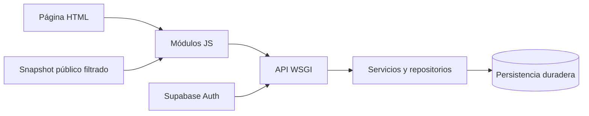

# Arquitectura web MPA y API privada

Páginas HTML y módulos JavaScript consumen una API Python WSGI compartida con el servidor local.
La sesión y las operaciones privadas fallan de forma cerrada ante rechazo o falta de durabilidad.
El motor 011 produce archivos privados y no alimenta automáticamente estas vistas.

## Componentes reales

[server.py](../../src/cajamarca_qhaway/web/server.py) implementa la aplicación WSGI y el handler local.
[api/index.py](../../api/index.py) es la entrada Vercel y conserva un respaldo restringido.
[vercel.json](../../vercel.json) define rewrites, recursos y cabeceras.
El [mapa de páginas](004-sitemap-cajamarca-qhaway.md) describe las rutas.

## Cliente

Los módulos app.js, state.js y data-engine.js coordinan vistas y datos.
budget-view.js y procurement-evidence.js conservan cortes y procedencia.
veedor-auth.js gestiona sesión; review-panel.js y denuncias.js gestionan operaciones privadas.
supabase-client.js concentra el acceso del cliente y propaga errores de escritura.
La fuente verificable es [web/src/js/](../../web/src/js/).
No se documentan componentes ni router SPA retirados como si siguieran disponibles.

## Fronteras de acceso

El servidor expone familias /api/entities, /api/procurements, /api/budget y /api/alerts.
Las familias /api/auth, /api/review, /api/reports y /api/red-flags requieren considerar
su operación concreta y sus controles de privacidad; no son un catálogo público irrestricto.
No deducir permisos solo del nombre de una ruta.
Las respuestas privadas y autenticadas evitan caché compartida.
Una indisponibilidad no devuelve éxito local ni mantiene una sesión rechazada por el proveedor.
Referencias: [auth.py](../../src/cajamarca_qhaway/web/auth.py),
[privacidad del snapshot](../../tests/test_public_snapshot_privacy.py)
y [fallback](../../tests/test_fallback_fail_closed.py).

## Activos y comprobaciones

Los recursos de identidad se sirven localmente desde web/.
Los originales de identidad se conservan para comparar hashes.
Las pruebas Node se ejecutan con node --test tests/*.test.mjs.
Las auditorías de integridad, cifras y accesibilidad son comandos separados de una prueba OAuth real.
No se certifica conformidad completa de accesibilidad únicamente mediante análisis estático.
