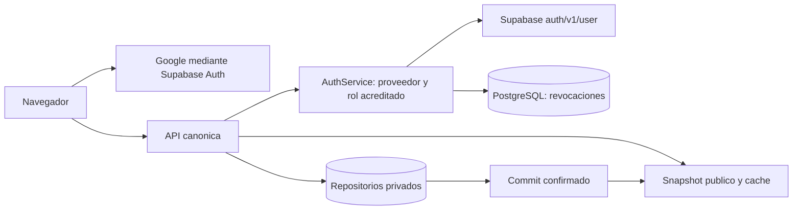

# Correccion de F01 a F08

Este documento define el contrato implementable de
[TK-307](../../tasks/active/TK-307-audit-remediation.md) y la
[auditoria base](../audits/2026-10-15-e2e-security-baseline.md).
Complementa las arquitecturas 003/005; el comportamiento antiguo de sus diagramas
SPA y fallback no constituye una autorizacion para publicar ni aceptar denuncias.
La propuesta de decision se registra en el [ADR 0014](../adr/0014-identidad-acreditada-y-consistencia-privada.md).

## Limites y fuentes de verdad

La plataforma mantiene Python, httpx existente, PostgreSQL y HTML/JS modular.
No agrega framework, proveedor de datos ni sistema propio de contrasenas.
El snapshot verificable sirve lectura publica. El repositorio privado sirve
denuncias, seguimiento y moderacion; nunca se deriva su existencia del snapshot.
La API canonica aplica las mismas restricciones en HTTP local y WSGI/Vercel.
Un fallback de arranque no puede emitir sesiones, confirmar recepcion o decisiones
sin disponer de la misma evidencia de identidad y persistencia.

## F01 y F06: identidad acreditada y cierre de sesion

El ADR 0005 accepted ya exige Google OAuth, sin cuentas propias. Se elimina la
lista de usuarios precargados, contrasenas, HMAC predeterminado, login nominal
autodeclarado y tokens de contingencia del navegador y entrypoint serverless.
No se inventan identidades ni se migran las cuentas de demostracion a usuarios reales.

El flujo de navegador inicia Supabase OAuth Google. Al recibir el access token,
lo intercambia en `POST /api/auth/login` con un objeto `{access_token: string}`.
El backend nunca acepta nombre, organizacion, correo o rol del formulario como
prueba de identidad. Una interfaz que conserva campos de password sin proveedor
compatible debe retirarlos, conservando su mensaje de error ante denegacion.

`web/auth.py` implementa `AuthService(db, client=...)`:

| Operacion | Resultado y garantia |
|---|---|
| `verify(token)` | Sesion `{veedor, expiresAt}` o `None`; consulta revocacion y proveedor por solicitud |
| `login(data)` | `{token, veedor, expiresAt}` solamente despues de `verify` |
| `logout(token)` | Retorna sin valor despues del commit de la revocacion; reintento idempotente |
| `InvalidCredentials` | Entrada o identidad no acreditada; adaptar a 400/401 |
| `AuthUnavailable` | Configuracion, proveedor o repositorio no verificable; adaptar a 503 |

La verificacion usa HTTPS `GET /auth/v1/user`, con `apikey` y Bearer, timeout y sin
seguir redirects. Exige `id`, correo confirmado y `app_metadata.role == reviewer`.
El rol usa el mismo origen administrado que las politicas RLS 0006/0008;
`user_metadata`, dominio del correo y perfil local no acreditan a nadie.
Solo despues de la validacion remota se extrae el `exp` numerico del JWT y se
comprueba que su `sub` coincide con el usuario verificado. No es una validacion
de firma local ni se confia en decodificar un JWT antes de validarlo.
`reviewed_by` y `moderated_by` se derivan exclusivamente de la sesion verificada.

Cada autorizacion busca SHA-256 del token en `auth_revocations`. La migracion
`0012_auth_revocations.sql` crea la tabla privada con `expires_at` y RLS sin
politicas de acceso publico. Logout guarda el hash y confirma el commit antes
de responder exito. Otra instancia consulta la misma tabla y rechaza el token,
aunque Supabase todavia considere valido su JWT. Si la consulta o escritura falla,
se deniega la operacion. Nunca se guarda el token en claro en esa tabla.

El alcance es **el access token actual**. No se afirma cierre global de todos los
dispositivos ni revocacion de refresh tokens. Supabase logout por si solo no
garantiza invalidar inmediatamente los access JWT ya emitidos. El cliente no
debe reutilizar refresh tokens para eludir este cierre; cualquier incorporacion
futura de refresh requiere integrar su revocacion y pruebas correspondientes.
Un mantenimiento privado puede eliminar hashes cuando expire el JWT.

El flujo local ya no recibe ni comprueba passwords y elimina el contador local de
intentos. Los controles del inicio OAuth pertenecen a Google/Supabase. Sus limites
efectivos, configuracion y comportamiento entre clientes deben comprobarse en
staging; las pruebas unitarias no certifican rate limiting remoto. El endpoint
de intercambio no emite un privilegio nuevo a partir de una contrasena.

## F02 y F07: frontera HTTP uniforme

La ruta efectiva se normaliza una sola vez, incluyendo el rewrite `__path` de
Vercel. La misma ruta sirve para despacho y politica de cache. Las respuestas
autenticadas, `/api/auth/*`, `/api/reports` y sus subrutas, `/api/review` y
`/api/red-flags` usan `Cache-Control: private, no-store`. Se incluye seguimiento
anonimo con token, errores y escrituras; `Vary: Authorization` no sustituye
`no-store`. Nunca se clasifica solamente por la ruta externa del wrapper.

La frontera deserializa JSON y exige un objeto antes de llamar `.get` o despachar.
`[]`, numeros, strings, booleanos, `null` y JSON malformado reciben 400 controlado.
Los campos de cada operacion conservan su validacion de negocio. Esta comprobacion
debe cubrir entrada HTTP, WSGI y fallback, antes de cualquier efecto.

## F03: confirmar primero, reflejar despues

Toda revision construye y valida un candidato sin mutar el servicio compartido.
El repositorio confirma la decision antes de actualizar el servicio o el snapshot.
Las proyecciones en memoria se actualizan por `alert_id`, evitando insertar
duplicados en reintentos. Una escritura fallida devuelve 503 y conserva tanto
el snapshot como el servicio y los estados visibles anteriores.

El navegador rechaza HTTP 401/403/503 y excepciones de red. No escribe una alerta
`published`, bitacora de exito ni `success: true` en almacenamiento local cuando
la API no ha confirmado el guardado. Una decision recibida correctamente puede
refrescar la vista usando la respuesta canonica del servidor.

Deduplicar por ID no autoriza a reemplazar decisiones editoriales anteriores.
RN-005-07/CA-005-06 exige conservar el original al retirar una alerta publicada.
La correccion no incorpora una operacion de retirada ni permite sobrescribir
historias publicadas contradictorias. El control transaccional de concurrencia
entre revisores y el historial de retiradas requieren su propio contrato antes
de ampliarse; no se consideran resueltos solo por actualizar una lista por ID.

## F04 y F05: durabilidad y cola privada

En cloud, aceptar denuncias o confirmar revisiones/moderacion requiere PostgreSQL
operativo. Un `DatabaseManager` respaldado por SQLite `:memory:` no acredita
durabilidad. `VERCEL` y el modo de produccion deben bloquear esa ruta, incluso
cuando el handler canonico importa correctamente. Una configuracion ausente o
fallo de escritura responde 503, sin token de recepcion ni confirmacion falsa.
SQLite en memoria sigue disponible para dependencias de prueba explicitamente
inyectadas y desarrollo local, con alcance documentado y sin presentarlo como
almacenamiento de denuncias listo para produccion.

`GET /api/reports` autorizado consulta el repositorio privado con filtro de
estado y paginacion acotada. La moderacion recupera por ID del mismo repositorio,
valida la transicion, persiste y confirma antes de refrescar su proyeccion.
Seguimiento usa la huella del token de seguimiento y ese repositorio. Ninguna
de estas rutas depende de `snapshot.citizen_reports` ni pierde reportes cuando
vence la cache publica o se crea otro proceso. No se exporta texto de denuncias
al snapshot publico para resolver el problema de visibilidad del panel.

## F08: recursos y paginas reconocidos

La resolucion estatica preserva la tabla de rutas MPA reconocidas y sus aliases.
Un asset o pagina desconocidos devuelve 404; no responde la portada con 200.
Se mantiene la proteccion contra traversal y el Content-Type del recurso real.
La validacion incluye una ruta HTML conocida, un modulo JS existente, un JS
ausente y una pagina desconocida, tanto local como mediante el entrypoint.

## Configuracion operativa sin credenciales inventadas

Se reutiliza la configuracion existente mediante nombres, nunca leyendo `.env`
ni archivos de secretos:

| Requisito | Uso |
|---|---|
| `CAJAMARCA_QHAWAY_DATABASE_URL` | PostgreSQL duradero para operaciones y revocaciones |
| `CAJAMARCA_QHAWAY_SUPABASE_URL` o `SUPABASE_URL` | Origen HTTPS del proveedor de identidad |
| `CAJAMARCA_QHAWAY_SUPABASE_ANON_KEY` o `SUPABASE_ANON_KEY` | Clave publica del proyecto para `/auth/v1/user` |
| Google habilitado y redirect permitido | Inicio OAuth real hacia el origen de la aplicacion |
| `app_metadata.role=reviewer` administrado | Acreditacion de personas reales; no habilitar usuarios demo |
| Migracion 0012 aplicada por operador autorizado | Acceso backend privado a las revocaciones |

No hay una clave de firma local que deba configurarse: se retiro ese mecanismo.
La prueba de configuracion valida presencia/uso; este documento no certifica el
proyecto Supabase remoto, sus roles efectivos ni los dominios permitidos.

## Evidencia necesaria para cerrar el ticket

Las pruebas de `tests/test_web_auth.py` usan identidades `example.test`, HTTP mock
inyectado y almacenamiento privado sintetico. Cubren rechazo de rol editable,
correo sin confirmar, token vencido/sub distinto, proveedor caido, configuracion
ausente, bloqueo SQLite cloud y revocacion entre dos servicios independientes
con almacenamiento compartido. Otra regresion usa un adaptador SQLite de archivo
exclusivo de pruebas, conexiones independientes y servicios reconstruidos para
demostrar que logout no depende de un set ni de una conexion de proceso.
No existe un switch de servidor que habilite
automaticamente las identidades sinteticas.

Las regresiones de integracion deben comprobar fallos de guardado sin cambios
en cache/servicio/cliente, refresco de snapshot sin perdida de cola, tipos JSON,
404 y `no-store` para ruta directa y rewrite. El informe final distingue las
pruebas locales de la validacion pendiente en staging PostgreSQL, OAuth Google,
politicas RLS, limites remotos, dos procesos y reinicio. No se escriben denuncias
ni decisiones de prueba en produccion para cerrar esta remediacion.

## Migracion del contrato DOM de login

El cambio OAuth retira solo los controles y atributos de credenciales locales de
`login.html`: email, password, honeypot, botones de password, intentos y bloqueo
local, y los atributos de cuentas precargadas. Conserva `login-form` y
`login-submit-btn` e incorpora `login-error`. El baseline DOM se actualiza solo
para esa pagina y esos elementos deliberadamente retirados; la prueba de anclas
y los contratos del resto de las vistas permanecen activos.

## Reconstruccion de la proyeccion publica

La API de alertas, banderas publicas y snapshot recupera las decisiones confirmadas
al reconstruir la proyeccion. PostgreSQL configurado es autoritativo incluso si
no devuelve alertas publicadas; no se mezclan publicaciones antiguas del disco.
Solo se proyectan RedFlags asociados a esas publicaciones. Si esa consulta falla,
las rutas afectadas responden 503. Sin PostgreSQL configurado se permite la
instantanea publica verificada; en desarrollo las decisiones SQLite confirmadas
permiten probar la recuperacion entre handlers. El fallback offline del navegador
sigue siendo una instantanea y no acredita frescura remota ni retiros editoriales.
