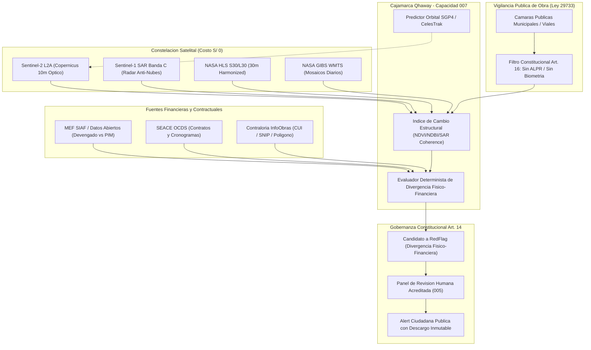
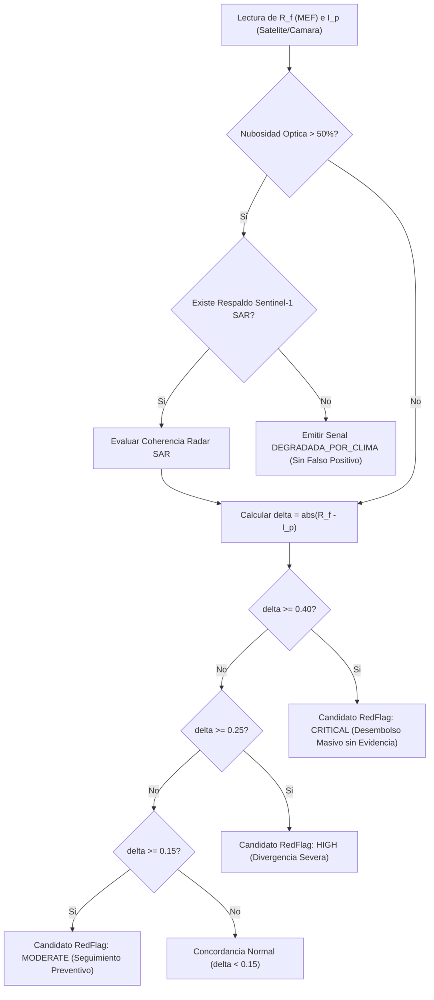

# Estudio de Factibilidad y Arquitectura: Monitoreo Geoespacial Satelital y Camaras Publicas para Obras Publicas en Cajamarca

## Estado de verificación para Etapa 2 (2026-10-14)

El catálogo de obras de producción está vacío hasta contar con CUI, coordenadas y OCID verificables en fuentes oficiales. Se retiraron los 14 sitios ilustrativos que antes aparecían como obras reales. No se ejecuta evaluación satelital con coordenadas o CUI inventados. El catálogo contiene constructores de URL NASA, pero aún no implementa una cosecha STAC ni una observación física real; esa integración sigue pendiente.

La fuente SEACE consultada hoy sí incluye un `projectID` de siete dígitos en un proceso de 2026, pero no aporta geometría. Ese dato aislado no basta para evaluar una obra ni para afirmar correspondencia con el MEF.

## 1. Resumen Ejecutivo y Marco de Referencia

El presente estudio analiza en profundidad la viabilidad tecnica, arquitectonica y legal de incorporar capacidades de teledeteccion satelital multi-temporal y alimentacion de camaras de vigilancia publica al sistema de fiscalizacion civica `cajamarca-qhaway`.

Tomando como base la ingenieria de sistemas geoespaciales de codigo abierto implementada en el repositorio de referencia `gods-eye-view` (Bilawal Sidhu, 2026), se define una adaptacion especifica para la orografia, climatologia y regimen de contrataciones de la region Cajamarca (Peru). Esta adaptacion se enmarca estrictamente dentro de los principios de presupuesto operativo S/ 0 (Art. 18 y 19 de la Constitucion del Proyecto) y soberania de datos abiertos.

El objetivo central es contrastar el avance financiero reportado en las bases de datos abiertas del Ministerio de Economia y Finanzas (MEF SIAF Consulta Amigable) y los contratos formalizados en el Sistema Electronico de Contrataciones del Estado (SEACE OCDS) con la evidencia visual e interferometrica observable sobre el terreno de ejecucion de obras publicas en las 13 provincias de Cajamarca.

---

## 2. Analisis de Reutilizacion y Descarte de la Arquitectura `gods-eye-view`

El repositorio `gods-eye-view` integra un visor tridimensional planetario montado sobre CesiumJS con diversas capas de telemetria en tiempo real e imagineria satelital. La evaluacion tecnica de sus modulos determina con precision que componentes deben adoptarse y cuales deben descartarse para `cajamarca-qhaway`.

### 2.1 Componentes Adoptados y Reutilizables

1. **NASA Global Imagery Browse Services (GIBS) WMTS Client**:
   - `gods-eye-view` implementa en `src/layers/recentImagery/model.js` y `catalog.js` un cliente WMTS que no requiere clave de API (keyless) para consultar mosaicos diarios proyectados en EPSG:3857 (GoogleMapsCompatible).
   - Capas aplicables a Cajamarca:
     - `HLS_S30_Nadir_BRDF_Adjusted_Reflectance` (Sentinel-2 armonizado a 30m, nivel 12).
     - `HLS_L30_Nadir_BRDF_Adjusted_Reflectance` (Landsat 8/9 armonizado a 30m, nivel 12).
     - `VIIRS_NOAA21_CorrectedReflectance_TrueColor` (250m, nivel 9 para vista panoramica regional).
   - Patron de URL reutilizable:
     `https://gibs-{s}.earthdata.nasa.gov/wmts/epsg3857/best/{gibsLayer}/default/{day}/GoogleMapsCompatible_Level{maxLevel}/{z}/{y}/{x}.{format}`

2. **NASA Common Metadata Repository (CMR) Granule Search API**:
   - `gods-eye-view` realiza consultas concurrentes a `https://cmr.earthdata.nasa.gov/search/granules.umm_json` utilizando las colecciones `C2021957295-LPCLOUD` (S30) y `C2021957657-LPCLOUD` (L30).
   - Permite filtrar granulos por caja delimitadora (`bounding_box=west,south,east,north`), ventana temporal (`temporal=start,end`) y extraer metadatos cruciales de nubosidad (`CLOUD_COVERAGE`) y perimetro (`footprint`).
   - Esta logica es adoptada integramente en el catalogo Python de `cajamarca-qhaway` para orquestar la adquisicion de imagenes multi-temporales sobre poligonos de obras.

3. **Prediccion Orbital SGP4 y CelesTrak TLE (`satellite.js`)**:
   - La arquitectura de `src/data/satellitePass.js` utiliza el algoritmo SGP4 con datos de Two-Line Element (TLE) provistos libremente por CelesTrak (Dr. T.S. Kelso).
   - Permite predecir ventanas de paso (rise, peak, set y look angles) de satelites en orbita heliosincronica baja (LEO) sobre coordenadas concretas de Cajamarca (`lat: -7.1617, lon: -78.5128`).
   - Utilidad en `cajamarca-qhaway`: permite programar alertas preventivas de paso satelital para correlacionar con eventos de vaciado de concreto o hitos de entrega de obra reportados por contratistas.

4. **Integracion Tridimensional CesiumJS con 3D Tiles y Terreno**:
   - Uso de `CesiumTerrainProvider` con malla cuantizada abierta (Re:Earth quantized-mesh) o fallback elipsoidal, combinado con `ArcGisMapServerImageryProvider` (Esri World Imagery) y mosaicos OpenStreetMap sin costo.
   - Proyeccion de poligonos de obras y frustums visuales de camaras fijas sobre el terreno accidentado de los valles andinos.

5. **Receptor y Relay de Camaras de Video Publicas (HLS / JPEG)**:
   - Ingesta de transmisiones HLS (`.m3u8` en streaming fragmentado) o capturas estaticas JPEG actualizadas mediante HTTP GET simple.
   - Enfoque "stateless": los cuadros se leen en memoria exclusivamente para renderizado o analisis puntual, sin almacenamiento masivo ni redistribucion indebida.

### 2.2 Componentes Descartados y Justificacion Tecnica/Legal

1. **ADS-B Flight Tracking (adsb.lol / OpenSky)**:
   - Descartado: El rastreo de aviacion comercial y militar no guarda relacion con la ejecucion presupuestal ni obras de infraestructura en Cajamarca. Sobrecargaria el consumo de memoria y red sin aportar evidencia anticorrupcion.
2. **AIS Vessel Tracking (AISStream)**:
   - Descartado: Cajamarca es un departamento enteramente mediterraneo y andino; no cuenta con costa oceanica ni hidrovias de transporte maritimo mercante sujetas a transpondedores AIS de alta mar.
3. **Automatic License Plate Recognition (ALPR) y OpenStreetMap ALPR Scrapers**:
   - Descartado terminantemente: Contrario a los Articulos 14 y 16 de la Constitucion del Proyecto y a la Ley N° 29733 (Ley de Proteccion de Datos Personales del Peru). `gods-eye-view` incluye mapeo de camaras ALPR. En `cajamarca-qhaway` esta explicitamente prohibido procesar placas vehiculares, vehiculos particulares o rostros humanos.

---

## 3. Teledeteccion en los Andes de Cajamarca: Resolucion, Sensores y Nubosidad

La geografia de Cajamarca, caracterizada por altitudes que van desde los 500 msnm en el valle de Jaen y San Ignacio hasta mas de 4,000 msnm en las jalcas de Hualgayoc y Celendin, presenta retos unicos para la observacion optica espacial.

### 3.1 El Desafio de la Nubosidad Andina

Durante la temporada de precipitaciones (noviembre a abril), la nubosidad en la vertiente oriental y central de Cajamarca alcanza entre 70% y 95% de cobertura persistente en imagenes opticas (cirros y cumulonimbos). Una estrategia basada exclusivamente en sensores opticos generaria "falsos silencios" o lecturas fallidas.

Para superar este cuello de botella, `cajamarca-qhaway` establece una arquitectura de deteccion dual:

| Sensor / Constelacion | Tipo de Sensor | Resolucion Espacial | Frecuencia de Paso | Capacidad Anti-Nubes | Aplicacion Primaria en Obra Publica |
|---|---|---|---|---|---|
| **Sentinel-2 (A/B/C) L2A** | Optico Multiespectral (VNIR/SWIR) | 10 m (B2, B3, B4, B8) / 20 m (B11, B12) | 5 dias | Nula (Bloqueado por nubes) | Movimiento de tierras masivo, desbroce, techado de colegios y hospitales (NDVI, NDBI). |
| **Sentinel-1 (A/C) SAR** | Radar de Apertura Sintetica (Banda C, 5.405 GHz) | ~10 m (resolucion equivalente en modo IW GRD) | 6 a 12 dias | **100% (Atraviesa nubes, lluvia y oscuridad nocturna)** | Deteccion de estructuras metalicas, concreto armado, deformaciones de terreno y estabilidad de taludes. |
| **NASA HLS (S30 / L30)** | Optico Armonizado Nadir BRDF | 30 m | 2 a 3 dias combinado | Nula (Requiere cielo despejado) | Series de tiempo historicas consistentes y mosaicos de verificacion regional. |
| **Camaras Publicas Municipales / Viales** | Optico Terrestre (JPEG / HLS) | Centimetrica a metrica local | Minutos / Tiempo real | Inmune a nubes de altura; afectada por neblina local | Verificacion de presencia de maquinaria pesada, obreros con EPP y avance de zanjas/pavimentacion. |

### 3.2 Metricas Espectrales y de Retrodispersion Radar

1. **Normalized Difference Built-Up Index (NDBI)**:
   $$\text{NDBI} = \frac{\text{SWIR} - \text{NIR}}{\text{SWIR} + \text{NIR}} = \frac{B11 - B08}{B11 + B08}$$
   Un incremento sostenido del NDBI dentro del poligono de obra indica sustitucion de suelo vegetal o tierra suelta por concreto, asfalto o calaminas metalicas.

2. **Normalized Difference Vegetation Index (NDVI)**:
   $$\text{NDVI} = \frac{\text{NIR} - \text{Red}}{\text{NIR} + \text{Red}} = \frac{B08 - B04}{B08 + B04}$$
   Una caida abrupta del NDVI en la fase inicial de un proyecto de carretera o presa refleja desbroce y movimiento de tierras legitimo. Si la curva de NDVI permanece inalterada a pesar de reportarse 40% de avance financiero, se dispara una senal de estancamiento fisico.

3. **Retrodispersion Radar de Sentinel-1 SAR ($\sigma^0$) y Coherencia Interferometrica**:
   - La retrodispersion en polarizacion VV y VH es altamente sensible a la rugosidad superficial y a los reflectores diedros (estructuras de edificacion vertical y maquinaria pesada).
   - En presencia de cobertura nubosa > 50%, el motor geoespacial commuta de forma automatica al analisis de amplitud SAR de Sentinel-1.

---

## 4. Modelo Determinista de Deteccion de Divergencia Fisico-Financiera

El nucleo analitico de la Capacidad 007 es el contraste matematico y temporal entre el gasto publico devengado y la transformacion fisica perceptible en el espacio geodesico asignado al proyecto.

### 4.1 Variables del Modelo

1. **Ratio de Devengado Financiero ($R_f$)**:
   Provisto por la Capacidad 003 (`mef_ingestion`) a partir del Sistema de Informacion de Administracion Financiera (SIAF):
   $$R_f = \frac{\text{Devengado Acumulado}}{\text{Presupuesto Institucional Modificado (PIM)}}$$
   donde $R_f \in [0.0, 1.0]$. En caso de proyectos plurianuales, se normaliza con el costo actualizado registrado en el Codigo Unico de Inversion (CUI) de Invierte.pe / InfoObras.

2. **Indice de Actividad Fisica Observada ($I_p$)**:
   Calculado a partir de observaciones satelitales multi-temporales y fotografias de obra verificadas:
   $$I_p = f(\Delta \text{NDBI}, -\Delta \text{NDVI}, \Delta \sigma^0_{\text{SAR}}, \text{Presencia Maquinaria Terrestre})$$
   donde $I_p \in [0.0, 1.0]$. Representa la fraccion de alteracion estructural verificable en el poligono.

3. **Puntaje de Divergencia ($\delta$)**:
   $$\delta = |R_f - I_p|$$

   Ambas proporciones se validan en la escala `[0.0, 1.0]`. Si no hay observacion satelital
   utilizable, la evaluacion queda degradada e informativa y no asigna actividad cero ni severidad
   basada en una ausencia de datos. El identificador de señal se deriva de la evidencia, no del
   instante de ejecucion, para que reprocesar la misma evidencia sea idempotente.

### 4.2 Criterios de Clasificacion de Senales

- **$\delta < 0.15$**: Operacion normal. La curva de gasto acompana razonablemente a la transformacion fisica observable.
- **$0.15 \le \delta < 0.25$**: Divergencia moderada (`MODERATE`). Alerta preventiva por posible retraso en ejecucion de obra o pagos anticipados de materiales.
- **$0.25 \le \delta < 0.40$**: Divergencia alta (`HIGH`). Desbalance manifiesto entre liquidaciones financieras y avance de terreno.
- **$\delta \ge 0.40$**: Divergencia critica (`CRITICAL`). Ejemplo tipico de obra fantasma o paralizada con devengado cercano al 100% y poligono en estado natural o de abandono prematuro.

---

## 5. Salvaguardas Constitucionales y Cumplimiento de la Ley N° 29733

En riguroso acatamiento de la Constitucion del Proyecto `cajamarca-qhaway`, el diseno geoespacial incorpora blindajes tecnicos a nivel de codigo e interfaz:

1. **Articulo 14 (Prohibicion de Acusacion Automatizada)**:
   - Toda senal emitida por el evaluador es estrictamente un `RedFlag` preliminar y privado.
   - Ninguna discrepancia fisico-financiera se publica directamente a la ciudadania. Requiere la validacion de un revisor humano acreditado (Capacidad 005 `review_panel`) que verifique cuadernos de obra, suspensiones por lluvias o informes de OCI antes de convertirse en una `Alert`.
   - Cada senal incluye el descargo inmutable exigido por ley: *"Esta senal constituye un indicador tecnico de divergencia geoespacial y financiera derivado de fuentes de datos abiertos (MEF, Copernicus, NASA). No constituye prueba de delito ni imputacion penal o administrativa. Sujeto a revision humana e inspeccion de campo."*

2. **Articulo 16 y Ley N° 29733 (Proteccion de Datos Personales)**:
   - Queda estrictamente vedado en el codigo fuente cualquier intento de clasificacion o reconocimiento de personas naturales, biometria facial o identificacion de placas vehiculares (ALPR).
   - Los feeds de camaras publicas se configuran con validadores deterministicos que rechazan instantaneamente cualquier transmision que active metadatos o tags de biometria o ALPR.
   - La vigilancia visual se restringe en exclusiva al espacio de la obra publica (zona de faena, tramo de rodadura, estructura hospitalaria o escolar).

3. **Articulo 18 (Ambito Geografico Fijo)**:
   - El catalogo geoespacial esta acotado estrictamente a las 13 provincias de Cajamarca (Cajamarca, Cajabamba, Celendin, Chota, Contumaza, Cutervo, Hualgayoc, Jaen, San Ignacio, San Marcos, San Miguel, San Pablo, Santa Cruz) y al Gobierno Regional de Cajamarca.

4. **Articulo 19 (Presupuesto Operativo S/ 0)**:
   - Se priorizan endpoints abiertos sin credenciales de pago: NASA GIBS WMTS, NASA CMR Granules, Copernicus Open Access Browser / Sentinel Hub Open Data, CelesTrak TLE y transmisiones abiertas de entidades viales y municipales peruanas.

---

## 6. Conclusiones y Hoja de Ruta de Implementacion

1. La integracion del modulo geoespacial dota a `cajamarca-qhaway` de una capacidad de auditoria fisica objetiva que complementa la fiscalizacion documental del SEACE y el MEF.
2. La combinacion de Sentinel-2 optico con Sentinel-1 SAR garantiza la continuidad operativa durante los meses lluviosos de la sierra de Cajamarca sin incurrir en costos de licencia ni APIs de pago.
3. Se procede de inmediato con la formalizacion del ADR-0005, la especificacion SDD Capacidad 007 y los modulos ejecutables en Python respaldados por pruebas automatizadas unitarias.
