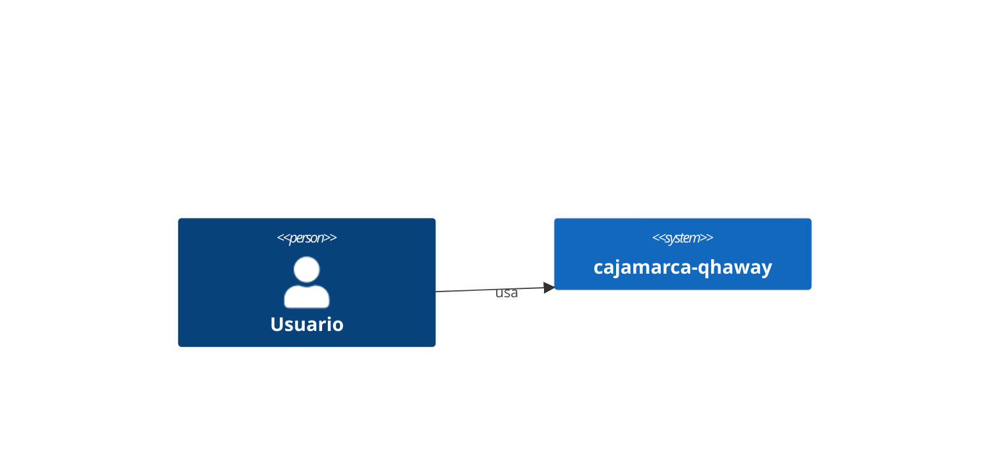
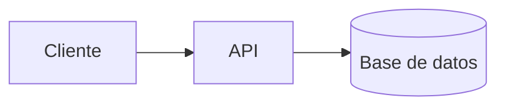

# Arquitectura - cajamarca-qhaway

<!-- Tres renglones: la forma del sistema en una idea. -->

## Contexto (C4 nivel 1)

<!-- Quién usa el sistema y con qué sistemas externos habla. -->

## Contenedores (C4 nivel 2)

<!-- Procesos desplegables y cómo se comunican. -->

## Decisiones clave

<!-- Enlaces a docs/adr/. No repitas aquí el contenido de un ADR: enlázalo.
     Duplicar es garantizar que se desincronicen. -->

| Decisión | ADR |
|---|---|
| | |

## Invariantes

<!-- Supuestos que el código da por ciertos y que no son visibles leyéndolo.
     Romper uno de estos rompe el sistema de formas no locales. -->

-

## Límites del sistema

<!-- Qué está explícitamente fuera. Delimita el alcance para humanos y agentes. -->

## Deuda conocida

<!-- Lo que está mal a sabiendas, y por qué se aceptó. La deuda no documentada se
     confunde con diseño. -->

| Qué | Por qué se aceptó | Cuándo revisar |
|---|---|---|
| | | |
