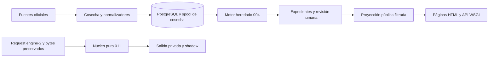

# Arquitectura - cajamarca-qhaway

El sistema combina cosecha oficial, persistencia relacional y páginas HTML con API WSGI.
El flujo heredado 004 permanece separado del núcleo puro 011 y su ejecución privada.
La existencia de módulos no certifica cobertura oficial, despliegue ni aprobación de políticas.

## Componentes y límites

No existe conexión automática de J a publicación.
Los seis contratos heredados están en models/ y los DTO 011 en un paquete independiente.
Referencia directa: [paquete Python](../../src/cajamarca_qhaway/).

| Área | Fuente de implementación |
|---|---|
| Ingesta y continuidad | [live_harvest](../../src/cajamarca_qhaway/capabilities/live_harvest/) |
| Fuentes y reconciliación | [modelos](../../src/cajamarca_qhaway/models/) |
| Repositorios | [persistence](../../src/cajamarca_qhaway/persistence/) |
| Reglas heredadas | [red_flags_engine](../../src/cajamarca_qhaway/capabilities/red_flags_engine/) |
| Reglas exactas privadas | [deterministic_engine](../../src/cajamarca_qhaway/capabilities/deterministic_engine/) |
| Panel y recepción | [review_panel](../../src/cajamarca_qhaway/capabilities/review_panel/) y [denuncia_intake](../../src/cajamarca_qhaway/capabilities/denuncia_intake/) |
| API y servidor | [server.py](../../src/cajamarca_qhaway/web/server.py) y [api/index.py](../../api/index.py) |

## Invariantes comprobables

El núcleo 011 exige as_of y versiones; no consulta reloj, red, DB ni variables de entorno.
Importes y comparadores usan enteros y racionales; toda evaluación explica sus referencias.
La publicación y la moderación son operaciones privadas con identidad acreditada.
La proyección pública filtra datos privados y no rellena aprobaciones ausentes.
Las pruebas correspondientes están en [tests/](../../tests/).

## Decisiones y operación

El [índice ADR](../adr/README.md) conserva el estado de cada decisión sin renumerar documentos.
La [guía de despliegue](../deployment/001-cloud-deployment-guide.md) describe los entrypoints.
Los archivos fechados en audits/ y research/ son evidencia de su corte, no monitores actuales.
La migración productiva 011, el piloto y la calibración continúan fuera de la validación sintética.
