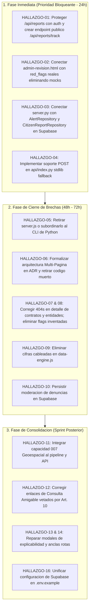

# Auditoria Tecnica Integral y de Brechas: Cajamarca Qhaway

> Estado actualizado: los resultados de estado de esta auditoría fueron reevaluados en la revisión final del 2026-10-13. La auditoría vigente de accesibilidad está en `docs/a11y/2026-10-13-wcag-2.1-aa-audit.md`; los checks finales automatizados se ejecutan desde CI. Las descripciones de comportamiento previo que siguen en este informe son evidencia histórica, no una declaración del estado actual.

- Fecha: 2026-10-13
- Auditor: comprehensive-auditor (Auditor Tecnico Implacable)
- Rama: agent/comprehensive-auditor/full-project-audit
- Estado: Completo
- Ambito: Repositorio completo (backend local, backend serverless, frontend estatico, base de datos Supabase, contratos Pydantic v2, capacidades 001-008 y roadmap)
- Cumplimiento Antislop R-02: Cero caracteres em-dash (\u2014) en este informe.

---

## 1. Resumen Ejecutivo y Metodologia

Se ha ejecutado una auditoria tecnica integral, exhaustiva y sistematica sobre el codigo fuente, especificaciones, esquemas de datos y contratos del proyecto **Cajamarca Qhaway**.

El analisis combino tecnicas estaticas y dinamicas:
1. Inspeccion de paridad endpoint por endpoint entre `server.py`, `api/index.py` y `server.js`.
2. Escaneo automatizado de hipervinculos, anclas y parametros URL en los 15 archivos HTML de `web/`.
3. Verificacion de llamadas `fetch` cliente vs rutas servidor y reglas de reescritura en `vercel.json`.
4. Auditoria de persistencia real vs mocks y fallbacks en `data-engine.js` y `supabase-client.js`.
5. Evaluacion de integracion de las 8 capacidades del sistema frente a la Constitucion (`docs/sdd/constitution.md`) y el Sitemap oficial (`docs/architecture/004-sitemap-cajamarca-qhaway.md`).

### Estadisticas Globales de Hallazgos

| Severidad | Cantidad | Descripcion |
|---|---|---|
| **CRITICO** | 4 | Fallas de seguridad, privacidad de denunciantes, mocks en el panel revisor o deshabilitacion total de endpoints clave. |
| **ALTO** | 7 | Desconexion arquitectonica (dead code SPA), fallbacks silenciosos que ocultan errores, capacidades huerfanas o dualidad no gobernada de runtimes. |
| **MEDIO** | 5 | Violaciones a invariantes constitucionales (Art. 10), enlaces rotos de ancla, modales inoperables por dependencias faltantes y configuracion obsoleta. |
| **BAJO** | 2 | Hashes simulados truncados y claves duplicadas no sincronizadas en almacenamiento local. |
| **TOTAL** | 18 | Hallazgos documentados con archivo, linea y recomendacion tecnica. |

---

## 2. Area A: Paridad de Backend (server.py vs api/index.py vs server.js)

### 2.1 Matriz de Comparacion Exhaustiva de Endpoints

| Endpoint | Metodo HTTP | server.py (Python Local) | api/index.py (Vercel Serverless) | server.js (Express Node) | Paridad y Estado |
|---|---|---|---|---|---|
| `/api/health` | GET | Implementado (200 JSON, metadatos e invariantes) | Implementado (200 JSON en canonico y fallback) | Implementado (200 JSON) | Conforme |
| `/api/snapshot` | GET | Implementado (200 JSON de verified-snapshot) | Implementado (200 JSON en canonico y fallback) | Implementado (200 JSON) | Conforme |
| `/api/entities` | GET | Implementado (200 JSON, soporta `?id=` o `?ruc=`) | Fallback stdlib IGNORA `?id=` y devuelve lista completa | Implementado (200 JSON, soporta `?id=`) | **Inconsistente en fallback stdlib** |
| `/api/procurements` | GET | Implementado (200 JSON, soporta `?ocid=` y `?entity_id=`) | Fallback stdlib IGNORA `?ocid=` y `?entity_id=` | Implementado (200 JSON, soporta `?ocid=` y `?entity_id=`) | **Inconsistente en fallback stdlib** |
| `/api/budget` | GET | Implementado (200 JSON, soporta `?entity_id=`) | Fallback stdlib IGNORA `?entity_id=` | Implementado (200 JSON, soporta `?entity_id=`) | **Inconsistente en fallback stdlib** |
| `/api/alerts` | GET | Implementado (200 JSON, solo `published`, `?id=`, `?entity_id=`) | Fallback stdlib IGNORA query params | Implementado (200 JSON, filtra `published`, `?id=`) | **Inconsistente en fallback stdlib** |
| `/api/red-flags` | GET | Implementado (200 JSON, soporta `?id=`) | Fallback stdlib IGNORA `?id=` | Implementado (200 JSON, soporta `?id=`) | **Inconsistente en fallback stdlib** |
| `/api/reports` | GET | Implementado (200 JSON de todos los reportes) | Implementado (200 JSON) | Implementado (200 JSON) | **Brecha Critica de Privacidad (Exposicion publica sin auth)** |
| `/api/reports` | POST | Implementado (201 JSON, valida `legal_disclaimer_shown`) | **NO IMPLEMENTADO en fallback stdlib (retorna 404)** | Implementado (201 JSON, genera id `cr-...`) | **Ruptura Critica en serverless fallback** |
| `/api/review` | POST | Implementado (201 JSON, valida revisor y notas) | **NO IMPLEMENTADO en fallback stdlib (retorna 404)** | Implementado (201 JSON, protegido por middleware) | **Ruptura Critica en serverless fallback** |
| `/api/auth/login` | POST | Implementado (200 JSON, emite token HMAC, lockout por email) | **NO IMPLEMENTADO en fallback stdlib (retorna 404)** | Implementado (200 JSON, token hex aleatorio, lockout IP+email) | **Ruptura Critica en serverless fallback** |
| `/api/auth/session` | GET | Implementado (200 JSON / 401 si expiro) | **NO IMPLEMENTADO en fallback stdlib (retorna 404)** | Implementado (200 JSON / 401) | **Ruptura en serverless fallback** |
| `/api/auth/logout` | POST | Implementado (200 JSON, revoca token en memoria) | **NO IMPLEMENTADO en fallback stdlib (retorna 404)** | Implementado (200 JSON, borra sesion) | **Ruptura en serverless fallback** |
| `/api/concentration` | GET | Implementado (200 JSON, calculo HHI) | **NO IMPLEMENTADO en fallback stdlib (retorna 404)** | Implementado (200 JSON, calculo HHI) | **Ruptura en serverless fallback** |
| `/api/suppliers` | GET | Implementado (200 JSON, alias de concentration) | **NO IMPLEMENTADO en fallback stdlib (retorna 404)** | Implementado (200 JSON) | **Ruptura en serverless fallback** |
| `/api/sunat/ruc` | GET | Implementado (200 JSON, guarda Art. 16, valida RUC 11 digitos) | Implementado en fallback basico | **NO IMPLEMENTADO en server.js (retorna HTML 200 via wildcard)** | **Ruptura en server.js** |

### 2.2 Analisis Detallado de Discrepancias

1. **Ruptura Total de Metodos POST en Fallback de Vercel (`api/index.py:84-189`)**:
   Cuando Vercel experimenta un fallo en cold-start o excepcion al importar dependencias de `src/`, conmuta a `_stdlib_fallback_dispatch`. Dicha funcion unicamente procesa peticiones `GET` y `OPTIONS`. Cualquier intento de emitir denuncias (`POST /api/reports`), emitir dictamenes de revision (`POST /api/review`) o iniciar sesion de veedor (`POST /api/auth/login`) desemboca en la linea 189 devolviendo HTTP 404 JSON.

2. **Omision de `/api/sunat/ruc` en `server.js` (`server.js:569-571`)**:
   El servidor Express no tiene ruta registrada para `/api/sunat/ruc`. Cuando el cliente consulta dicho endpoint en un entorno corriendo Node.js, la peticion es capturada por el wildcard `app.get('*')`, que sirve el archivo `index.html` con codigo 200 OK. El frontend recibe HTML en lugar de JSON, rompiendo el procesamiento de datos tributarios.

3. **Incompatibilidad Criptografica de Tokens de Veedor**:
   - En `src/cajamarca_qhaway/web/server.py:125-162`, los tokens se emiten como cadenas URL-safe base64 firmadas criptograficamente con HMAC-SHA256 y validadas sin estado contra `_TOKEN_SECRET`.
   - En `server.js:253-267`, los tokens son valores aleatorios hexadecimales de 32 bytes almacenados en un `Map` en memoria (`ACTIVE_SESSIONS`).
   - Un token emitido por un servidor no es reconocido por el otro. Si un entorno balancea peticiones o conmuta entre runtimes, todas las sesiones se invalidan de inmediato.

4. **Vulnerabilidad de Permisos en `POST /api/review`**:
   - `server.js:491` aplica el middleware `requireVeedorAuth` que exige cabecera `Authorization: Bearer <token>` valida. Si falta, responde HTTP 401.
   - `server.py:641-653` permite procesar un dictamen sin cabecera `Authorization` siempre que el cuerpo de la peticion contenga una cadena no generica en `reviewed_by`. Cualquier usuario anonimo puede publicar o descartar alertas enviando un JSON arbitrario.

5. **Infraccion Arquitectonica contra ADR 0001 y ADR 0007**:
   El archivo `server.js` y su dependencia `express` en `package.json` constituyen una base de codigo paralela redundante. El ADR 0001 establecio a Python como lenguaje unico de backend, y el ADR 0007 selecciono la arquitectura hibrida con servidor embebido Python (`cajamarca_qhaway.web.server`). Mantener `server.js` genera dispersion de logica y mantenimiento duplicado.

---

## 3. Area B: Frontend SPA, Navegacion y Vistas Dinamicas

### 3.1 Codigo Muerto Arquitectonico: Enrutador Hash SPA Abandonado

El Sitemap canonico (`docs/architecture/004-sitemap-cajamarca-qhaway.md`) y el ticket `TK-302` especifican una aplicacion SPA basada en hash (`#/inicio`, `#/entidades`, `#/entidad?id=...`, `#/alerta?id=...`, etc.). Para cumplir esto se desarrollaron:
- `web/src/js/router.js` (237 lineas)
- `web/src/js/views.js` (miles de lineas de renderizado seguro de vistas completas)

**Hallazgo**:
- `router.js` y `views.js` NO se importan en ningun archivo HTML ni en `app.js`. Son 100% codigo muerto en produccion.
- `router.js` busca un elemento contenedor con ID `#app-view-container`. Dicho ID no existe en ninguno de los 15 archivos HTML del proyecto.
- En la practica, el proyecto opera como un sitio multi-pagina estatico (`web/index.html`, `web/entidades.html`, `web/entidad-detalle.html`, `web/alertas.html`, etc.), gestionado mediante `app.js` que hidrata selectivamente el DOM.
- No existe ningun ADR que haya documentado ni aprobado la transicion de la arquitectura SPA por Hash a la arquitectura Multi-Pagina (MPA).

### 3.2 Vistas Dinamicas y Comportamiento ante Parametros URL Invalidos o Ausentes

1. **`web/entidad-detalle.html:828-839`**:
   - Si se accede sin parametro (`/entidad-detalle.html`), recurre al valor cableado `'ce-f5f5d8fc32518855'` (Gobierno Regional de Cajamarca) sin indicar que falta seleccion.
   - Si se ingresa un ID invalido o inexistente (`/entidad-detalle.html?id=invalido`), `dataEngine.getEntityById` devuelve `null`. El bloque `if (entity)` no se ejecuta y la pagina muestra silenciosamente los datos fijos del HTML (GORE Cajamarca, Pliego 445, RUC 20453744168). No existe pantalla de error 404 ni mensaje de estado vacio.

2. **`web/contrato-detalle.html:398-405`**:
   - Si se accede sin parametro, recurre al OCID cableado `'ocds-07smqs-gore-2026-001'`.
   - Si el contrato no existe en la base de datos, ejecuta la linea 404:
     ```javascript
     const all = await dataEngine.getProcurements();
     currentProcurement = all[0];
     ```
     Sustituye silenciosamente el contrato solicitado por el primer contrato de la lista, sin notificar al ciudadano ni al investigador que el contrato buscado no fue hallado.

3. **`web/contrato-detalle.html:460-480` (Violacion Constitucional Art. 14)**:
   La vista fabrica banderas rojas en tiempo de ejecucion en el navegador:
   - Asigna codigos inexistentes: `R-PROC-01` ("Adjudicacion con Postor Unico") y `R-AMOUNT-03` ("Contratacion de Alto Volumen").
   - Evalua umbrales directamente en JavaScript y las cataloga como "Severidad Alta" y "Severidad Media".
   - Muestra estas banderas directamente al publico. Esto vulnera el Articulo 14 de la Constitucion: ninguna senal tecnica es visible publicamente sin evaluacion y aprobacion colegiada en el Panel Revisor CU5.

### 3.3 Auditoria de Enlaces Internos y Anclas Rotas

El escaneo de las 15 paginas HTML detecto enlaces a anclas que no existen en el documento de destino:
- `web/alertas.html:209` e `index.html:232, 929` enlazan a `/transparencia#descarga-microdatos`. El ID `descarga-microdatos` no existe en `transparencia.html`.
- `web/alertas.html:514` enlaza a `/transparencia#metodologia-algoritmica`. El ID `metodologia-algoritmica` no existe en `transparencia.html`.
- `web/index.html:933` enlaza a `/transparencia#api-civica`. El ID `api-civica` no existe en `transparencia.html`.
- `web/entidades.html:211` y `web/metodologia.html:14` enlazan a `/acerca#metodologia`. El ID `metodologia` no existe en `acerca.html`.
- `web/metodologia.html:7` ejecuta redireccion inmediata a `/acerca#metodologia`, aterrizando en una seccion inexistente.

### 3.4 Modales Inoperables en `web/src/js/explicabilidad.js`

- En `explicabilidad.js:323-326, 349-352`, las funciones `openExplicabilidadModal` y `openRawPayloadModal` invocan `window.bootstrap.Modal.getOrCreateInstance(modalEl)`.
- El proyecto no carga Bootstrap JS en ningun archivo HTML (utiliza Tailwind CSS via CDN). Por lo tanto, `window.bootstrap` es siempre `undefined`.
- Ademas, los elementos `#modal-explicabilidad` y `#modal-raw-payload` no existen en el marcado de `alertas.html`. Los modales no se abren.

---

## 4. Area C: Capa de Datos, Persistencia y Seguridad

### 4.1 Fuga Critica de Privacidad en Denuncias Ciudadanas (`/api/reports`)

- **Ubicacion**: `src/cajamarca_qhaway/web/server.py:467-470`, `server.js:393-396`, `web/denuncia.html:551-554`.
- **Vulnerabilidad**: El endpoint `GET /api/reports` es publico y no requiere autenticacion. Devuelve la lista completa de denuncias ciudadanas registradas con su campo `raw_text` integro.
- **Impacto en el Frontend**: En `web/denuncia.html:551`, la funcionalidad de consulta de estado ("Rastrear Expediente") descarga la totalidad de denuncias del observatorio en el navegador del usuario para filtrar localmente por el codigo ingresado:
  ```javascript
  const res = await fetch('/api/reports');
  const reports = await res.json();
  const found = reports.find(r => r.report_id === token);
  ```
- **Consecuencia**: Cualquier persona puede consultar `GET /api/reports` y leer testimonios confidenciales de denunciantes sobre presunta corrupcion en Cajamarca. Esto vulnera la Ley 29733 de Proteccion de Datos Personales y el mandato de proteccion del denunciante (Spec 006).

### 4.2 Simulacion de Candidatos en el Panel Revisor (`web/admin-revision.html:528-542`)

- En `admin-revision.html:528-542`, la funcion `loadPanelData()` no consulta las banderas rojas reales generadas por el motor algoritmico (`red_flags`).
- En su lugar, fabrica 5 candidatos ficticios tomando las primeras 5 entidades del directorio:
  ```javascript
  candidates = entities.slice(0, 5).map((e, idx) => ({
    id: `cand-${idx + 1}`,
    red_flag_ids: [`rf-cand-${idx + 1}`],
    flag_code: idx % 2 === 0 ? 'R-CANON-02' : 'R-FRAC-08',
    ...
  }));
  ```
- Cuando el veedor humano emite un dictamen formal, aprueba una bandera inventada (`rf-cand-1`) que no existe en el catalogo oficial ni en la base de datos. El panel de revision humana opera desconectado del motor algoritmico real.

### 4.3 Desconexion entre Servicios Web y Repositorios de Persistencia

- El proyecto cuenta con repositorios tipados en `src/cajamarca_qhaway/persistence/repositories/` (`AlertRepository`, `CitizenReportRepository`, `EntityRepository`, `ProcurementRepository`).
- Sin embargo, `src/cajamarca_qhaway/web/server.py:170-171` instancia `DenunciaIntakeService()` y `ReviewPanelService()`, cuyas implementaciones guardan los registros unicamente en diccionarios en memoria (`self._reports = {}`, `self._decisions = {}`).
- En `server.py:622, 689`, las denuncias y alertas se agregan al objeto en memoria `snapshot_cache`.
- Si el servidor se reinicia o se ejecuta en entornos serverless efimeros (Vercel Lambdas), las alertas aprobadas y las denuncias ciudadanas se pierden irremediablemente. Ninguna se escribe en la base de datos PostgreSQL de Supabase.

### 4.4 Moderacion de Denuncias Confinada a LocalStorage (`web/src/js/supabase-client.js:750-781`)

- La funcion `moderateCitizenReport` actualiza unicamente la clave `cajamarca_qhaway_citizenReports` en el `localStorage` del navegador del moderador.
- No realiza ninguna llamada HTTP a Supabase ni al backend API. Si el veedor cambia de equipo o borra la cache del navegador, la denuncia vuelve a estado `pending`.

### 4.5 Fallbacks Fragiles y Cifras Cableadas en `data-engine.js`

1. **Cifras Macroeconomicas Cableadas (`data-engine.js:293-295`)**:
   En `getMacroKPIs()`:
   ```javascript
   totalPim: totalPim > 0 ? totalPim : 2567443011,
   totalDevengado: totalDevengado > 0 ? totalDevengado : 1831063097,
   executionRate: executionRate > 0 ? executionRate : 71.3,
   ```
   Si la consulta de presupuestos falla o devuelve 0, el sistema inyecta silenciosamente 2,567 millones de soles y 71.3% de ejecucion. Un fallo total de conexion pasa desapercibido como si los datos fueran reales.

2. **Simulacion de Estado SUNAT (`data-engine.js:361-372`)**:
   En `getSupplierSunat()`: si la API `/api/sunat/ruc` no responde, valida si el RUC tiene 11 digitos y genera un perfil falso marcando al contribuyente como `estado: 'ACTIVO'` y `condicion: 'HABIDO'`. Puede mostrar a una empresa dada de baja o no habida como plenamente operativa.

### 4.6 Configuracion Obsoleta del Endpoint de Supabase

- `.env.example:3` y `docs/adr/0007-arquitectura-plataforma-web-hibrida.md:57` contienen la URL obsoleta `https://tiythjlrjhvwkiqsnvwq.supabase.co`.
- El proyecto activo y configurado en `web/src/js/config.js` y `docs/architecture/003-supabase-persistence-architecture.md` es `https://oglltrpvvifqvwmxmkjq.supabase.co`.
- Quien configure su entorno local a partir de `.env.example` fallara en todas las conexiones a la base de datos.

---

## 5. Area D: Estado de las 8 Capacidades del Sistema

### 5.1 Evaluacion Capacidad por Capacidad

| Capacidad | Nombre | Estado de Codigo | Estado de Persistencia | Estado de Frontend | Diagnostico Tecnico |
|---|---|---|---|---|---|
| **001** | Entity Mapping | 100% Completo | Persistido en YAML y DDL | Conectado (14 pliegos) | Conforme. Dataset canonico inmutable cerrado de 14 entidades en Cajamarca. |
| **002** | SEACE Ingestion | 100% Completo | Integrado en spool y BD | Conectado (Exploradores) | Conforme. Parseo OCDS y poller de cosecha continua operativos. |
| **003** | MEF Ingestion | 100% Completo | Integrado en spool y BD | Conectado (Monitor PIM/Dev) | Conforme. Parseo de Datastore CKAN MEF operativo. |
| **004** | Red Flags Engine | 100% Completo | Almacenado en tabla BD | Conectado (Catalogo) | Conforme en backend. 5 indicadores deterministas probados. |
| **005** | Review Panel | 60% Parcial | Solo en memoria | Mocks en bandeja | **Incompleto**. Backend no persiste decisiones en BD; la interfaz web muestra candidatos cableados (`rf-cand-1`). |
| **006** | Denuncia Intake | 60% Parcial | Solo en memoria | Fuga en tracker | **Vulnerable**. Formulario funciona, pero no persiste en BD y el tracker expone todos los reportes publicamente. |
| **007** | Geospatial Monitoring | 30% Aislado | Sin persistencia | 0% Desconectado | **Huerfano**. Posee modelos y logica de divergencia en `src/`, pero carece de integracion con pipeline, CLI, API y vistas web. |
| **008** | SUNAT Enrichment | 85% Integrado | JSON en disco | Conectado en Python | **Discrepante**. Endpoint `/api/sunat/ruc` funciona en Python con guarda Art. 16, pero falta en Node y tiene mock en JS. |

---

## 6. Area E: Invariantes Constitucionales, Roadmap y Tickets

### 6.1 Cumplimiento de Invariantes Constitucionales (`docs/sdd/constitution.md`)

- **Articulo 10 (Fuentes Verificables y Veto Estricto)**:
  - VETADO: Consulta Amigable (`apps5.mineco.gob.pe`).
  - **Violacion**: Los pies de pagina de `web/index.html:990` y `web/entidad-detalle.html:805` incluyen un enlace saliente a `https://apps5.mineco.gob.pe/transparencia/mensual/` rotulado como "MEF SIAF DataStore". Debe sustituirse por el Portal de Datos Abiertos CKAN oficial.
- **Articulo 14 (Ninguna Alerta sin Revision Humana)**:
  - **Violacion**: `web/contrato-detalle.html:460-480` genera banderas rojas automaticas con codigos `R-PROC-01` y `R-AMOUNT-03` mostradas directamente en vista publica sin haber pasado por el Panel Revisor CU5.
- **Articulo 15 (Explicabilidad Algoritmica Integral)**:
  - Parcialmente conforme en datos, pero con fallas de presentacion: los modales de explicabilidad en `explicabilidad.js` no abren debido a la dependencia rota de Bootstrap JS.
- **Articulo 16 (Prohibicion de Perfilamiento de Personas)**:
  - Conforme en backend: la guarda constitucional `CONSTITUTIONAL_PRIVACY_GUARD_ART_16` en `server.py` y `sunat_enrichment` bloquea y sanciona consultas con DNIs de 8 digitos.
- **Articulo 17 (Reserva Legal de DJI)**:
  - Conforme: No se realiza cruce de datos con Declaraciones Juradas de Intereses.
- **Articulo 18 (Ambito Territorial Exclusivo en Cajamarca)**:
  - Conforme en backend y directorio: universo fijado en el GORE y las 13 provincias.
- **Articulo 19 (Contratos Canonicos Pydantic v2)**:
  - Conforme en Python: 136 pruebas unitarias verifican esquemas inmutables.
  - Brecha menor: La semilla fallback en `supabase-client.js:36-328` mantiene campos antiguos de prueba (`pr-8b1d9c...`) que no coinciden con los identificadores generados por los extractores reales.

### 6.2 Deuda Tecnica y Tareas Pendientes para Fase 2 y Fase 3

De la revision de `docs/roadmap.md`, `specs/pending-adrs.md` y las tareas en `tasks/done/`, se identifican los siguientes compromisos y deudas tecnicas abiertas:

1. **Fila 5 de Pending ADRs: Proveedor SMS / WhatsApp para `009`**:
   No existe especificacion formal ni ADR para el canal de mensajeria rural, bloqueando la atencion directa a zonas sin conectividad de datos.
2. **Fila 8 de Pending ADRs: Descargas Masivas OECE (`GET /downloads`)**:
   Pendiente de re-verificacion de disponibilidad de bulk download desde redes peruanas para evitar la sobrecarga de consultas individuales al feed OCDS.
3. **Fila 9 de Pending ADRs: Esquema Dinamico del Datastore MEF**:
   Verificacion con navegador real del `resource_id` definitivo de la API del MEF para automatizar cambios de periodo sin intervencion manual.
4. **Fila 10 de Pending ADRs: Formalizacion Legal de Descargos**:
   Pendiente de aprobacion legal colegiada con organizaciones aliadas (Proetica, Propuesta Ciudadana, GRUFIDES) sobre el texto de los descargos de alertas y proteccion a denunciantes.
5. **Validacion Operativa en Campo (Horizonte Next)**:
   Pruebas piloto de usabilidad con veedores comunales y periodistas de investigacion en las provincias de Chota, Jaen y Cajamarca.

---

## 7. Inventario Estructurado de Hallazgos por Severidad

---

### [CRITICO]

#### HALLAZGO-01: Exposicion Publica Desprotegida de Denuncias Ciudadanas Confidenciales
- **Archivo y Linea**: `src/cajamarca_qhaway/web/server.py:467-470`, `server.js:393-396`, `web/denuncia.html:551-554`.
- **Explicacion**: El endpoint `GET /api/reports` retorna sin autenticacion el listado completo de denuncias ciudadanas y testimonios con su texto crudo. La pagina de seguimiento de denuncias (`web/denuncia.html`) descarga todas las denuncias en el navegador de cualquier visitante para buscar un token. Esto viola la Ley 29733 de Proteccion de Datos Personales y expone a represalias a los denunciantes.
- **Recomendacion Tecnica**:
  1. Restringir inmediatamente `GET /api/reports` para que exija token de veedor acreditado (`requireVeedorAuth` o sesion valida).
  2. Implementar un endpoint de consulta publica acotado y seguro: `GET /api/reports/track?token=<codigo>`, que retorne unicamente el identificador, la fecha y el estado de moderacion (`moderation_status`), sin exponer jamas el texto de la denuncia ni datos de otros ciudadanos.

#### HALLAZGO-02: Generacion de Candidatos Ficticios en el Panel de Revision Humana
- **Archivo y Linea**: `web/admin-revision.html:528-542`.
- **Explicacion**: La interfaz del panel de veedores genera en JavaScript 5 candidatos simulados con codigos inexistentes (`R-CANON-02`, `R-FRAC-08`) a partir de las entidades, en lugar de consultar la coleccion real de `red_flags` producida por el motor algoritmico. El revisor humano dictamina sobre datos artificiales.
- **Recomendacion Tecnica**:
  Reemplazar la generacion sintetica en `loadPanelData()` por una consulta real a `dataEngine.getRedFlags()`, cruzada con las alertas decididas para mostrar exclusivamente las banderas rojas pendientes de revision.

#### HALLAZGO-03: Perdida Silenciosa de Alertas y Denuncias por Falta de Persistencia en Base de Datos
- **Archivo y Linea**: `src/cajamarca_qhaway/web/server.py:170-171, 620-623, 687-690`, `capabilities/review_panel/service.py:20`, `capabilities/denuncia_intake/service.py:19`.
- **Explicacion**: Los servicios `ReviewPanelService` y `DenunciaIntakeService` persisten en diccionarios en memoria. `server.py` no utiliza `AlertRepository` ni `CitizenReportRepository`. Toda alerta aprobada o denuncia registrada se pierde al reiniciar el servidor o al reciclarse la instancia serverless en Vercel.
- **Recomendacion Tecnica**:
  Inyectar `DatabaseManager` y los repositorios correspondientes (`AlertRepository`, `CitizenReportRepository`) en el despachador de `server.py` para escribir directamente en las tablas de PostgreSQL de Supabase o en el spool local de contingencia.

#### HALLAZGO-04: Bloqueo de Todas las Operaciones POST en Fallback Serverless de Vercel
- **Archivo y Linea**: `api/index.py:84-189`.
- **Explicacion**: La funcion `_stdlib_fallback_dispatch` solo admite metodos `GET` y `OPTIONS`. Ante cualquier fallo de importacion en cold start, las llamadas a `POST /api/reports`, `POST /api/review`, `POST /api/auth/login` y `POST /api/auth/logout` fallan devolviendo 404 Not Found en lugar de procesarse o responder el codigo de error adecuado.
- **Recomendacion Tecnica**:
  Implementar el soporte de metodos POST en el fallback con persistencia en archivos de spool locales o devolver formalmente un codigo HTTP 503 Service Unavailable con cabecera `Retry-After`.

---

### [ALTO]

#### HALLAZGO-05: Coexistencia No Gobernada de Servidor Express Duplicando la Logica del Backend
- **Archivo y Linea**: `server.js:1-576`, `package.json:8-9`.
- **Explicacion**: `server.js` implementa un servidor Express en Node.js que duplica las rutas de `server.py`. Carece del endpoint `/api/sunat/ruc`, utiliza un esquema de tokens incompatible (hexadecimal aleatorio vs HMAC-SHA256) y contraviene el ADR 0001 (Python unico runtime de backend) y ADR 0007.
- **Recomendacion Tecnica**:
  Eliminar `server.js` o documentar su estatus como servidor auxiliar exclusivo de maquetacion, unificando el comando `npm start` para delegar la ejecucion a `uv run cajamarca-qhaway web serve`.

#### HALLAZGO-06: Codigo Muerto del Enrutador Hash SPA y Desalineacion con el Sitemap
- **Archivo y Linea**: `web/src/js/router.js:37-236`, `web/src/js/views.js:1-1200`.
- **Explicacion**: `router.js` y `views.js` implementan el enrutamiento SPA por hash requerido en el Sitemap 004, pero jamas son importados ni inicializados. El contenedor `#app-view-container` no existe en ninguna pagina. El sitio funciona como arquitectura multi-pagina estatica sin respaldo formal en un ADR.
- **Recomendacion Tecnica**:
  Formalizar mediante un ADR la decision de operar con arquitectura multi-pagina con hidratacion DOM reactiva, y depurar o reutilizar los modulos huerfanos `router.js` y `views.js`.

#### HALLAZGO-07: Fabricacion de Banderas Rojas en Cliente y Fallback Oculto en Contratos
- **Archivo y Linea**: `web/contrato-detalle.html:398-405, 460-480`.
- **Explicacion**: Si un contrato no existe, se muestra silenciosamente el primer registro de la lista sin advertencia. Ademas, genera banderas rojas en cliente (`R-PROC-01`, `R-AMOUNT-03`) y las muestra publicamente sin revision humana, violando el Articulo 14 de la Constitucion.
- **Recomendacion Tecnica**:
  1. Si el contrato no existe, renderizar un mensaje claro de 404 / expediente no encontrado.
  2. Eliminar la generacion de banderas en cliente y consultar unicamente las alertas con estado `published` asociadas a ese contrato en la base de datos oficial.

#### HALLAZGO-08: Fallback Silencioso con Datos Falsos ante IDs Invalidos de Entidad
- **Archivo y Linea**: `web/entidad-detalle.html:828-839`.
- **Explicacion**: Si el parametro `?id=` es invalido, la funcion omite actualizar el DOM y deja visibles los textos estaticos del Gobierno Regional de Cajamarca. El usuario recibe informacion de una entidad distinta a la consultada sin recibir mensaje de error.
- **Recomendacion Tecnica**:
  Verificar `if (!entity)` y reemplazar el contenido del contenedor principal por un estado de error accesible indicando que la entidad solicitada no existe en el universo de las 14 entidades auditadas.

#### HALLAZGO-09: Cifras de Respaldo Cableadas y Simulacion Artificial de Datos SUNAT
- **Archivo y Linea**: `web/src/js/data-engine.js:293-295, 361-372`.
- **Explicacion**: Si la consulta presupuestal falla, inyecta S/ 2,567M y 71.3% de ejecucion fija. Asimismo, `getSupplierSunat()` simula que cualquier RUC de 11 digitos esta `ACTIVO` y `HABIDO` cuando la API no responde, ocultando la situacion tributaria real de proveedores.
- **Recomendacion Tecnica**:
  1. Sustituir los valores cableados por 0 o estado de carga no disponible, alertando al usuario sobre la falta de conectividad con el MEF.
  2. En `getSupplierSunat()`, marcar el estado como `NO VERIFICADO` o `CONSULTA PENDIENTE` cuando falle el servicio oficial de SUNAT.

#### HALLAZGO-10: Moderacion de Denuncias Confinada a LocalStorage sin Sincronizacion
- **Archivo y Linea**: `web/src/js/supabase-client.js:750-781`.
- **Explicacion**: `moderateCitizenReport()` guarda los cambios de estado de denuncias exclusivamente en el `localStorage` del navegador, sin enviar peticiones a Supabase ni al backend API.
- **Recomendacion Tecnica**:
  Implementar la llamada PATCH/POST hacia la tabla `citizen_reports` de Supabase o endpoint `/api/reports/moderate` con la debida autorizacion del veedor.

#### HALLAZGO-11: Desconexion Completa de la Capacidad 007 (Monitoreo Geoespacial)
- **Archivo y Linea**: `src/cajamarca_qhaway/capabilities/geospatial_monitoring/`.
- **Explicacion**: La capacidad 007 cuenta con modelos y calculo de divergencia fisica-financiera, pero carece de integracion con `pipeline.py`, comandos en `cli.py`, endpoints en `server.py` o capas visuales en la plataforma web.
- **Recomendacion Tecnica**:
  Integrar el evaluador de divergencia dentro del ciclo de deteccion de `pipeline.py` y crear un endpoint `/api/geospatial/divergence` para exponer las senales al Panel Revisor CU5.

---

### [MEDIO]

#### HALLAZGO-12: Violacion del Veto Constitucional a Consulta Amigable (Art. 10)
- **Archivo y Linea**: `web/index.html:990`, `web/entidad-detalle.html:805`.
- **Explicacion**: Enlaces en el pie de pagina dirigen a `https://apps5.mineco.gob.pe/transparencia/mensual/`, fuente expresamente vetada por el Articulo 10 de la Constitucion por opacidad metodologica y falta de API verificable.
- **Recomendacion Tecnica**:
  Reemplazar la URL por el Portal Nacional de Datos Abiertos: `https://datosabiertos.gob.pe/` o el endpoint oficial del Datastore CKAN del MEF.

#### HALLAZGO-13: Dependencia Rota de Bootstrap JS y Selectores Inexistentes en Explicabilidad
- **Archivo y Linea**: `web/src/js/explicabilidad.js:323-326, 349-352`.
- **Explicacion**: Invoca `window.bootstrap.Modal` sobre los IDs `#modal-explicabilidad` y `#modal-raw-payload`. Dado que el proyecto usa Tailwind y no incluye Bootstrap JS, los modales nunca abren y arrojan advertencias en consola.
- **Recomendacion Tecnica**:
  Reemplazar la llamada por la utilidad nativa `openRawPayloadDrawer()` implementada en `app.js` basada en Tailwind y HTML5 semantico.

#### HALLAZGO-14: Enlaces a Anclas Inexistentes en Paginas de Transparencia y Acerca
- **Archivo y Linea**: `web/alertas.html:209, 514`, `web/index.html:232, 929, 933`, `web/entidades.html:211`, `web/metodologia.html:14`.
- **Explicacion**: Los hipervinculos apuntan a `#descarga-microdatos`, `#metodologia-algoritmica`, `#api-civica` y `#metodologia`, IDs que no existen en los documentos destino (`transparencia.html` y `acerca.html`).
- **Recomendacion Tecnica**:
  Asignar los atributos `id` correspondientes a las secciones contenedoras en `web/transparencia.html` y `web/acerca.html`.

#### HALLAZGO-15: Dependencia de Imagen Externa No Resiliente en Ficha de Entidad
- **Archivo y Linea**: `web/entidad-detalle.html:767`.
- **Explicacion**: Carga un logotipo desde `https://lh3.googleusercontent.com/aida/...`. En condiciones de conectividad rural intermitente o sin salida a internet, la peticion se bloquea hasta activar el fallback `onerror`.
- **Recomendacion Tecnica**:
  Sustituir el atributo `src` directamente por el vector local `/media/brand-mark.svg`.

#### HALLAZGO-16: URL Obsoleta de Supabase en Archivos de Configuracion y Documentacion
- **Archivo y Linea**: `.env.example:3`, `docs/adr/0007-arquitectura-plataforma-web-hibrida.md:57`.
- **Explicacion**: Hacen referencia al proyecto descontinuado `tiythjlrjhvwkiqsnvwq.supabase.co` en lugar del proyecto activo `oglltrpvvifqvwmxmkjq.supabase.co`.
- **Recomendacion Tecnica**:
  Actualizar `.env.example` y el ADR 0007 con el identificador del proyecto activo.

---

### [BAJO]

#### HALLAZGO-17: Generacion de Hash Simulado Inseguro en Fallback de Exportacion CSV
- **Archivo y Linea**: `web/src/js/export-csv.js:44-50`.
- **Explicacion**: Si la Web Crypto API no esta disponible, genera una cadena `sha256-sim-` basada en un hash simple de 32 bits en lugar de un digest SHA-256 valido de 64 caracteres hexadecimales.
- **Recomendacion Tecnica**:
  Implementar una rutina pura en JavaScript para calculo determinista de SHA-256 cuando `window.crypto.subtle` no se encuentre presente.

#### HALLAZGO-18: Almacenamiento Dual y Desincronizado de Sesiones de Veedor
- **Archivo y Linea**: `web/src/js/state.js:13, 27` vs `web/src/js/app.js:20, 290`.
- **Explicacion**: `state.js` almacena la sesion en `localStorage` bajo `cajamarca_qhaway_reviewer_session`, mientras que `app.js` y `admin-revision.html` gestionan el token en `sessionStorage` bajo `cajamarca_veedor_token`.
- **Recomendacion Tecnica**:
  Unificar el gestor de sesion en un unico modulo con almacenamiento homogeneo en `sessionStorage`.

---

## 8. Plan de Mitigacion y Priorizacion de Acciones



---

*Fin del Informe de Auditoria Tecnica Integral.*
