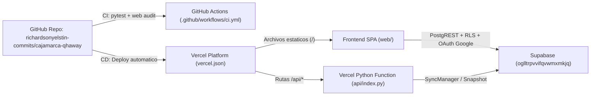

# Guía de Despliegue Cloud (GitHub, Supabase y Vercel)

Manual operativo del Pilar 3 para desplegar y conectar Cajamarca Qhaway en GitHub,
Supabase PostgreSQL (`oglltrpvvifqvwmxmkjq`) y Vercel Serverless Python.
Garantiza continuidad operativa online y modo de contingencia rural desconectado.

## 1. Arquitectura de Despliegue



## 2. Repositorio en GitHub

- **Repositorio oficial**: `https://github.com/richardsonyelstin-commits/cajamarca-qhaway`
- **Flujo de Integración Continua (`.github/workflows/ci.yml`)**:
  1. Instala el paquete en modo editable (`pip install -e ".[dev]"`).
  2. Ejecuta la suite completa de pruebas (`pytest -v`, 104 pruebas deterministas).
  3. Ejecuta la auditoría de integridad web (`python -m cajamarca_qhaway.cli web audit`).

## 3. Base de Datos y Seguridad en Supabase

- **Project ID**: `oglltrpvvifqvwmxmkjq`
- **Endpoint PostgREST**: `https://oglltrpvvifqvwmxmkjq.supabase.co/rest/v1`
- **Migraciones aplicadas (`migrations/0001` a `0004`)**:
  - `0001_initial_schema.sql`: Crea las 6 tablas canónicas (`contracting_entities`,
    `procurement_records`, `budget_execution_records`, `red_flags`, `alerts`,
    `citizen_reports`) con restricciones `CHECK` constitucionales.
  - `0002_rls_policies.sql`: Habilita Row Level Security (RLS) de menor privilegio:
    - Rol `anon`: lectura exclusiva de alertas con `status = 'published'` (Art. 14) y
      registro de denuncias con `legal_disclaimer_shown = true` (CA-006-01).
    - Rol `authenticated`: acceso a `red_flags` y publicación auditada en `alerts`
      bajo OAuth Google (ADR 0005).
  - `0003_indexes_and_views.sql`: Índices B-Tree y GIN sobre `raw_payload` JSONB.
  - `0004_seed_cajamarca_entities.sql`: Siembra determinista de las 14 entidades del
    universo de Cajamarca (Art. 18).

### Variables de Entorno para Backend / Worker

Configure en el entorno de ejecución (nunca en el código fuente ni en `web/`):

- `CAJAMARCA_QHAWAY_DB_URL`: Cadena PostgreSQL transaccional hacia Supabase.
- `SUPABASE_URL`: `https://oglltrpvvifqvwmxmkjq.supabase.co`
- `SUPABASE_ANON_KEY`: Llave pública `anon` protegida por políticas RLS.

## 4. Despliegue en Vercel (`vercel.json` + `api/index.py`)

El archivo `vercel.json` en la raíz del proyecto enlaza dos capas:

1. **Capa Estática (`web/`)**: Sirve `web/index.html`, `web/src/css/*`, `web/src/js/*`,
   `web/media/*` y el snapshot firmado `web/src/data/verified-snapshot.json`.
2. **Capa Serverless (`api/index.py`)**: Expone los endpoints `/api/health`,
   `/api/snapshot`, `/api/entities`, `/api/procurements`, `/api/budget`, `/api/alerts`,
   `/api/red-flags`, `/api/reports` y `/api/review` reutilizando `cajamarca_qhaway.web`.
3. **Cabeceras de Seguridad HTTP**:
   - `X-Content-Type-Options: nosniff`
   - `X-Frame-Options: DENY`
   - `Referrer-Policy: strict-origin-when-cross-origin`

## 5. Comandos Operativos Locales

```bash
# 1. Regenerar el snapshot verificado desde los modelos Pydantic v2
python -m cajamarca_qhaway.cli web export-snapshot

# 2. Auditar integridad de la carpeta web/ e invariantes constitucionales
python -m cajamarca_qhaway.cli web audit

# 3. Levantar el servidor híbrido local (estáticos + API REST)
python -m cajamarca_qhaway.cli web serve --port 8080
```
