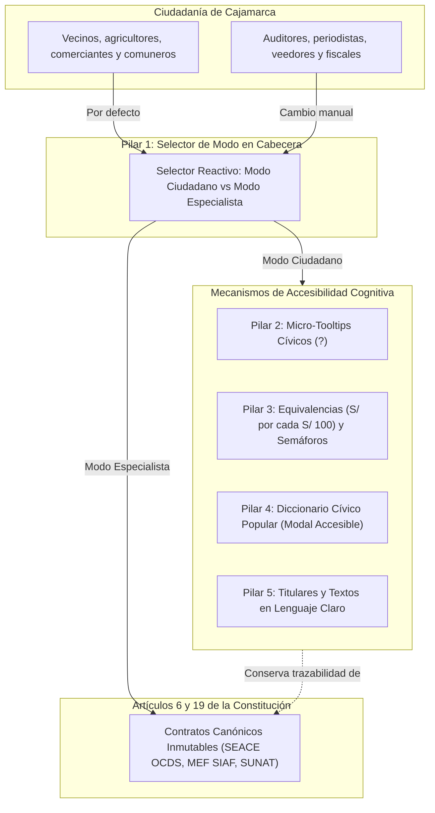
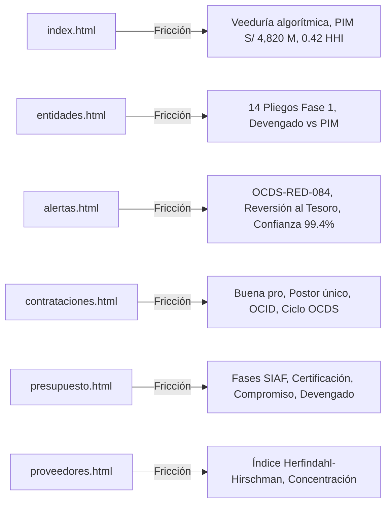
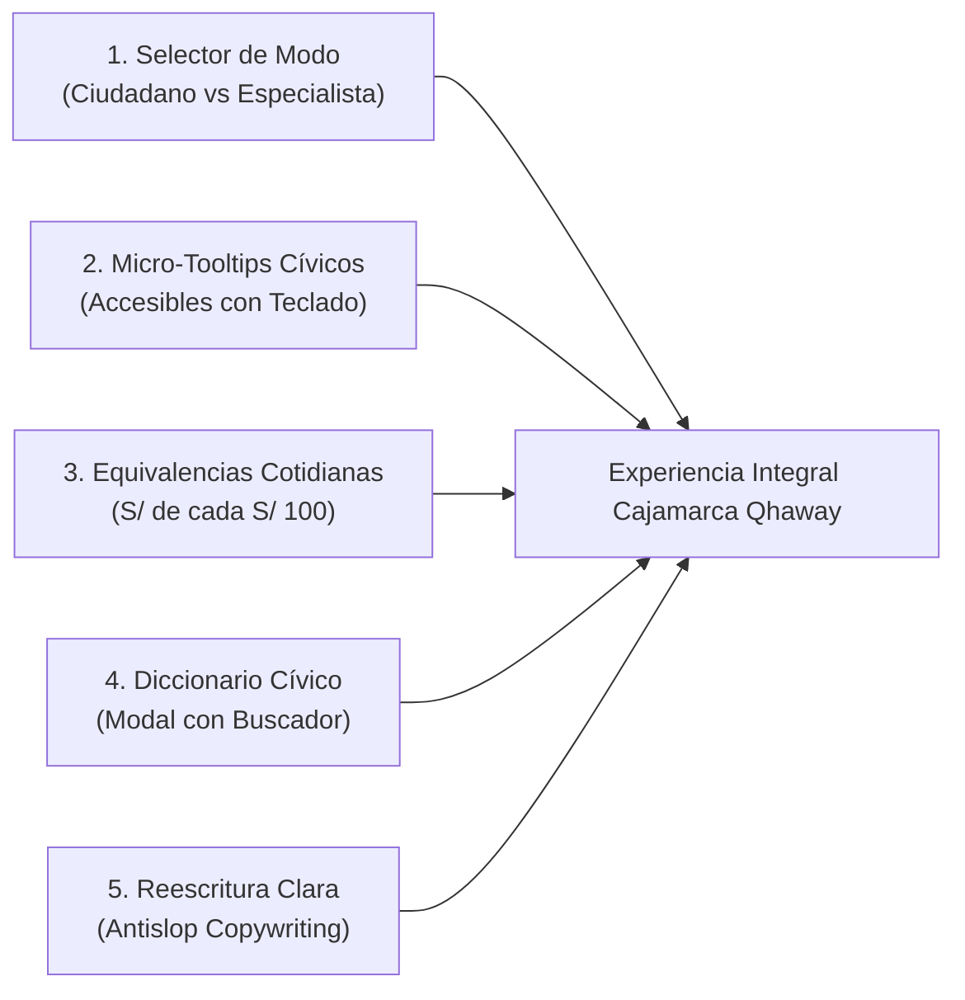
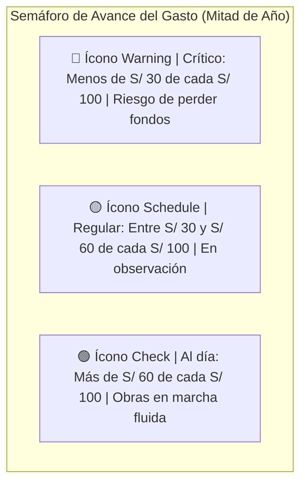
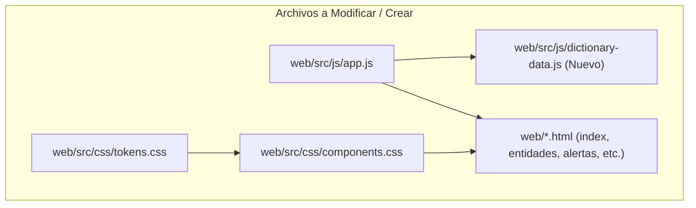
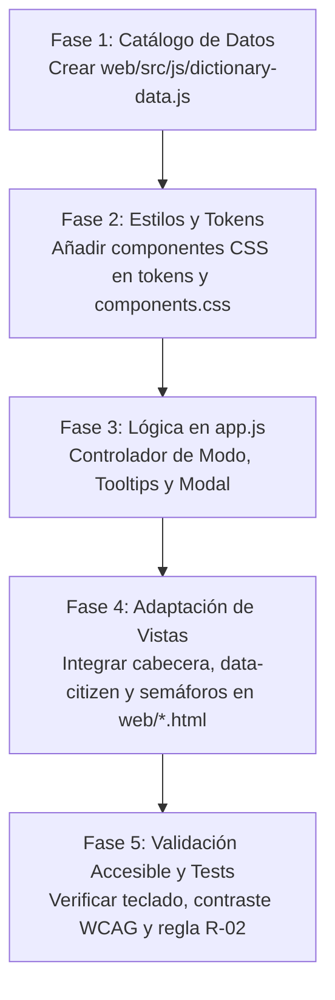

# Plan Integral de Pedagogía Cívica, Lenguaje Claro y Accesibilidad Cognitiva

Estrategia integral de transformación de la experiencia ciudadana para Cajamarca Qhaway.
Garantiza que cualquier habitante de Cajamarca comprenda el destino del dinero público
sin degradar el rigor analítico exigido por auditores, investigadores y periodistas.



---

## 1. Contexto, Problema Detectado y Objetivos Estratégicos

### 1.1 El Reto Cívico en la Región Cajamarca
Las auditorías comunitarias y las visitas de campo con organizaciones de base en Cajamarca
(como rondas campesinas de Chota y Bambamarca, frentes de defensa ambiental y comerciantes locales)
revelaron una barrera insalvable en la versión actual de la plataforma web.
Aunque la herramienta expone datos oficiales verídicos y procesados con alta fidelidad técnica,
el vocabulario utilizado reproduce la frialdad y hermeticidad de la administración burocrática limeña.

Los ciudadanos manifestaron sentirse ajenos y desorientados frente a términos como:
- Siglas institucionales no explicadas: PIM, PIA, Devengado, OCDS, OCID, SEACE, SIAF, HHI, CUI.
- Jerga técnica de contrataciones: "adjudicación simplificada", "pliego presupuestal",
  "concentración de mercado", "veeduría algorítmica", "bandera roja", "subejecución".
- Cifras abstractas sin anclaje terrenal: montos como "S/ 4,820 Millones" o porcentajes como "28.4%"
  que no comunican si el dinero alcanza para terminar una posta médica o un canal de regadío.

### 1.2 Las Cuatro Preguntas Fundamentales del Ciudadano de a Pie
Cualquier vecino que entre a Cajamarca Qhaway debe responder en menos de 5 segundos a estas 4 dudas:
1. **¿Cuánta plata tiene mi provincia o región este año?**
   (En soles claros, sin confundir presupuesto prometido con presupuesto real disponible).
2. **¿Cuánto dinero ya se gastó realmente y cuánto falta por gastar?**
   (Expresado en escala humana cotidiana: "de cada 100 soles, se han gastado 28").
3. **¿A quiénes se les dieron los contratos y si siempre ganan los mismos?**
   (Identificando si hubo competencia real o si una sola empresa se llevó la obra sin postores rivales).
4. **¿Qué sospechas o alertas preventivas existen sobre las obras públicas?**
   (Explicadas como señales preventivas de cuidado comunitario, sin afirmar sentencias penales falsas).

### 1.3 Convivencia Armónica: Ciudadanía y Especialistas
El principio rector es la inclusión sin degradación. No se trata de infantilizar la información,
sino de construir un puente pedagógico. La plataforma ofrecerá una doble capa:
- **Capa Ciudadana (Lenguaje Claro por defecto):** Metáforas cotidianas, explicaciones directas,
  sujetos activos y equivalencias en dinero de bolsillo.
- **Capa Especialista (Vista Técnica):** Terminología presupuestal y de contrataciones oficial
  (PIM, Devengado, OCID, fórmulas matemáticas OCDS), accesible con un solo clic.

---

## 2. Diagnóstico Exhaustivo de Términos Técnicos por Vista Web

A continuación se detalla el análisis de fricción cognitiva detectado en cada pantalla actual.



### 2.1 Vista de Inicio (`web/index.html`)
- **Titular actual:** "Veeduría Algorítmica y Control Ciudadano de los Recursos Públicos".
  *Problema:* "Veeduría algorítmica" suena distante y mecánico. Nadie en una comunidad habla de algoritmos.
  *Traducción ciudadana:* "Vigilancia comunitaria del dinero público en Cajamarca".
- **KPI de presupuesto:** "PIM Total Fiscalizado: S/ 4,820.5 M".
  *Problema:* La sigla PIM es desconocida para el 90% de la población.
  *Traducción ciudadana:* "Presupuesto total para obras este año: S/ 4,820 Millones (aprox. S/ 3,100 por habitante)".
- **Ejecución del gasto:** "Devengado Consolidado: 28.4% Crítico".
  *Problema:* "Devengado" se confunde con deuda o con dinero guardado.
  *Traducción ciudadana:* "Dinero gastado a la fecha: S/ 28 de cada S/ 100 disponibles".
- **Indicador de mercado:** "0.42 HHI (Moderado)".
  *Problema:* El índice Herfindahl-Hirschman es incomprensible fuera del ámbito econométrico.
  *Traducción ciudadana:* "Competencia entre contratistas: Regular (pocas empresas se reparten las obras)".
- **Contratos:** "58% adjudicación directa".
  *Problema:* No explica qué riesgo implica que se entregue a dedo o con mínima competencia.
  *Traducción ciudadana:* "6 de cada 10 contratos se entregaron de forma directa sin concurso abierto amplio".

### 2.2 Directorio de Entidades (`web/entidades.html` y `web/entidad-detalle.html`)
- **Denominación territorial:** "14 Pliegos Monitoreados (Fase 1)".
  *Problema:* La palabra "pliego" es jerga de la ley de presupuesto.
  *Traducción ciudadana:* "Las 14 instituciones vigiladas: El Gobierno Regional y las 13 Municipalidades Provinciales".
- **Cabeceras de tabla:** "PIM Asignado", "Devengado Acumulado", "Avance Financiero %".
  *Traducción ciudadana:* "Presupuesto del año", "Dinero ya pagado", "Avance del gasto".
- **Alertas institucionales:** "4 Banderas Rojas Activas".
  *Problema:* El término "bandera roja" puede interpretarse como que la autoridad ya fue juzgada penalmente.
  *Traducción ciudadana:* "4 Alertas preventivas por revisar en contratos y obras".

### 2.3 Monitor de Alertas (`web/alertas.html`)
- **Encabezado:** "Detección algorítmica preventiva de anomalías en contrataciones públicas (OCDS SEACE)".
  *Traducción ciudadana:* "Revisión automática de contratos y gastos para detectar riesgos antes de que se pierda el dinero".
- **Alerta OCDS-RED-084:** "Subejecución Crítica del Canon Minero en Inversiones Productivas... anticipa una reversión histórica al Tesoro Público".
  *Problema:* El ciudadano no comprende qué es una reversión al Tesoro Público ni por qué es grave.
  *Traducción pedagógica:* "Peligro de devolver la plata del canon a Lima: La plata no se ha usado a tiempo y corre el riesgo de regresar al gobierno central en lugar de usarse en canales, escuelas y postas médicas de Cajamarca".
- **Metadatos de alerta:** "Confianza: 99.4%", "Regla matemática auditada".
  *Traducción ciudadana:* "Certeza del dato: Datos oficiales comprobados con el sistema nacional del Estado".

### 2.4 Módulo de Contrataciones (`web/contrataciones.html` y `web/contrato-detalle.html`)
- **Términos OCDS:** "OCID", "Fase 03 de 05 del Ciclo OCDS", "Licitación Pública", "Adjudicación Simplificada".
  *Problema:* El ciclo de vida de contrataciones abiertas confunde las etapas.
  *Traducción pedagógica:*
  - "OCID": Código único de rastreo del contrato en el sistema nacional.
  - "Adjudicación Simplificada": Compra rápida con menos requisitos y plazos más cortos.
  - "Buena Pro": Momento oficial en que se declara qué empresa ganó el contrato.
  - "Postor Único": Situación de alerta donde solo una empresa presentó propuesta y nadie compitió contra ella.

### 2.5 Monitor Presupuestal (`web/presupuesto.html`)
- **Las 4 fases del gasto MEF SIAF:** PIA, PIM, Certificación, Compromiso, Devengado, Girado.
  *Problema:* La gente asume que si el dinero está "comprometido", la obra ya está lista.
  *Traducción pedagógica:*
  - "PIA": La plata aprobada en enero en el papel.
  - "PIM": La plata real con la que se cuenta tras modificaciones del año.
  - "Compromiso": El contrato firmado donde se promete pagar a alguien.
  - "Devengado": La plata que la institución ya autorizó a pagar porque la empresa entregó el avance.
  - "Girado": El cheque o transferencia que ya salió de la cuenta bancaria del Estado.

### 2.6 Directorio de Proveedores (`web/proveedores.html`)
- **Términos económicos:** "Concentración de mercado", "Matriz HHI", "Cuotas relativas de mercado".
  *Traducción pedagógica:*
  - "¿Quiénes ganan los contratos?": Lista de empresas contratistas en Cajamarca.
  - "Nivel de concentración": "¿Siempre ganan las mismas empresas o la plata se reparte entre varias?".

### 2.7 Canal de Denuncias (`web/denuncia.html`)
- **Términos de sistema:** "Capacidad 006 Intake", "Pipeline seguro de verificación", "Tipología del hecho".
  *Traducción pedagógica:*
  - "Reporte seguro y protegido": "Cuéntanos qué obra o compra sospechosa has visto en tu comunidad".
  - "Tipo de sospecha": "Obra abandonada, empresa sin experiencia, costos inflados o presunto favoritismo".

---

## 3. Propuesta Detallada de los 5 Pilares de Solución



### 3.1 Pilar 1: Selector "Modo Ciudadano / Modo Especialista"

#### Ubicación y Componente en Interfaz
Se insertará en el encabezado principal (`<header>`), en la barra superior junto al control de Modo Rural (2G)
y al selector de Tema Oscuro/Claro.

#### Diseño Visual y Estados
- Botón interruptor estilizado con dos pestañas o botón switch (`role="switch"`):
  - **Opción Ciudadano:** Ícono `groups` o `sentiment_satisfied`, etiqueta: "Modo Ciudadano (Lenguaje Claro)".
  - **Opción Especialista:** Ícono `analytics`, etiqueta: "Modo Especialista (Técnico)".
- En pantallas pequeñas (móviles): Se muestra un icono descriptivo con tooltip y etiqueta abreviada: "Ciudadano" / "Técnico".

#### Persistencia y Carga Reactiva
1. Al cargar la página, JavaScript lee la clave en `localStorage`:
   `cajamarca_qhaway_lang_mode = 'ciudadano' | 'especialista'`.
2. Si no existe registro previo, **el valor predeterminado es siempre 'ciudadano'**.
3. Se aplica inmediatamente el atributo en el elemento raíz:
   `<html data-lang-mode="ciudadano">`.
4. El cambio es instantáneo (reactivo en caliente):
   - Al pulsar el botón, conmuta el atributo en el DOM sin recargar la página.
   - Dispara un evento personalizado: `window.dispatchEvent(new CustomEvent('cajamarca:lang-mode-change', { detail: { mode } }))`.
   - Elementos con marcado dual cambian su texto visible de inmediato:
     `<span class="civic-text-swap" data-citizen="Presupuesto disponible" data-expert="PIM 2025">Presupuesto disponible</span>`.
   - Se muestra una notificación sutil tipo toast:
     "Modo Ciudadano activado: Explicaciones sencillas y dinero de bolsillo".

---

### 3.2 Pilar 2: Píldoras y Micro-Tooltips Cívicos "¿Qué significa esto?"

#### Arquitectura de Accesibilidad (WCAG 2.2 AA)
Para evitar la exclusión de usuarios en pantallas táctiles o navegantes con teclado, los tooltips no dependerán
únicamente del evento `:hover` de ratón.

- **Marcado semántico estricto:**
```html
<span class="inline-flex items-center gap-1">
  <span class="civic-label">PIM</span>
  <button type="button"
          class="civic-tooltip-trigger inline-flex items-center justify-center w-5 h-5 rounded-full bg-secondary-container/60 text-on-secondary-container text-xs font-bold hover:bg-secondary hover:text-white focus:outline-none focus-visible:ring-2 focus-visible:ring-secondary focus-visible:ring-offset-1 transition-colors cursor-pointer"
          aria-expanded="false"
          aria-haspopup="dialog"
          aria-controls="tooltip-pim"
          aria-label="Qué significa PIM">
    ?
  </button>
</span>
```

#### Comportamiento Interactivo y Foco
- Se activa al hacer clic o al pulsar `Enter` o `Espacio` en el botón.
- El contenedor del tooltip emerge flotante posicionado con `aria-live="polite"`.
- Al pulsar `Escape`, el tooltip se cierra inmediatamente y devuelve el foco al botón activador.
- Si el usuario navega fuera con la tecla `Tab` o hace clic en otra área, el tooltip se oculta.
- Cada tooltip contiene:
  1. **En fácil (1 frase):** Explicación cotidiana.
  2. **Ejemplo en dinero:** Equivalencia práctica.
  3. **Enlace al Diccionario Cívico:** `<button onclick="openCivicDictionaryModal('pim')">Ver explicación completa en el Diccionario</button>`.

---

### 3.3 Pilar 3: Equivalencias Cotidianas y Semáforos Intuitivos

#### La Regla del Dinero de Bolsillo: "S/ X de cada S/ 100"
Los porcentajes abstractos son difíciles de visualizar para el ciudadano de a pie. La plataforma aplicará
una conversión matemática universal:

```
Porcentaje de Ejecución (E%) -> S/ E de cada S/ 100 gastados
Restante sin gastar -> S/ (100 - E) aún en la cuenta
```

- **Ejemplo en interfaz (Modo Ciudadano):**
  > En lugar de solo mostrar: `28.4% de ejecución (Devengado)`
  > Se mostrará:
  > **S/ 28 de cada S/ 100 gastados**
  > *"De cada 100 soles que tiene la provincia para obras este año, solo ha pagado 28 soles. Todavía quedan 72 soles sin invertirse."*

#### Escala Humana Per Cápita para Cajamarca
Los montos en miles de millones (ej. S/ 4,820 Millones) se acompañarán de su proporción por poblador:
- Población de referencia de Cajamarca (Censo/INEI): aprox. 1.55 millones de habitantes.
- **S/ 4,820 Millones = aprox. S/ 3,100 por cada cajamarquino.**
- Esta comparación aterriza el volumen de recursos en la realidad de una familia comunal.

#### Semáforos Visuales No Dependientes del Color (WCAG 1.4.1 y Antislop Human)
Para garantizar accesibilidad a personas con daltonismo o baja visión, cada indicador combina cuatro señales:
Color + Ícono + Etiqueta textual en lenguaje claro + Valor numérico.



- **Rojo (Crítico):**
  - Ícono: `report_problem` o `warning`.
  - Color: `--color-alert-rose` (#e11d48) con borde de alto contraste.
  - Texto: "Avance muy bajo: Peligro de devolver dinero a Lima o atraso severo en obras".
- **Ámbar (En observación):**
  - Ícono: `schedule` o `info`.
  - Color: `--color-alert-amber` (#d97706).
  - Texto: "Avance regular: Gasto lento, requiere acelerar compras y licitaciones".
- **Verde (Al día):**
  - Ícono: `check_circle`.
  - Color: `--color-civic-emerald` (#059669).
  - Texto: "Avance adecuado: El dinero se viene invirtiendo al ritmo programado".

---

### 3.4 Pilar 4: Diccionario Cívico Popular (Modal Accesible con Buscador)

#### Arquitectura del Componente Modal
Se incorporará un componente universal de Diccionario Cívico en la plataforma:
- Estructura HTML con `role="dialog"`, `aria-modal="true"`, `aria-labelledby="civic-dict-title"`.
- Trampa de foco gestionada en JavaScript: al pulsar `Tab`, la navegación queda confinada dentro del modal.
- Cierre garantizado con:
  - Tecla `Escape`.
  - Botón de cierre en esquina (`aria-label="Cerrar diccionario"`).
  - Clic en el fondo oscurecido exterior (backdrop).
- Al cerrarse, devuelve el foco de navegación exactamente al botón que lo abrió.

#### Características Funcionales
1. **Buscador predictivo en tiempo real:**
   Filtra entradas según palabras técnicas (PIM, HHI, Buena Pro) o preguntas cotidianas ("¿Por qué devuelven la plata?", "sobrecosto", "empresa favorita").
2. **Filtros temáticos en botones (pills):**
   - Todos (25 términos).
   - El dinero y los presupuestos (PIM, PIA, Canon, Devengado, Reversión).
   - Los contratos y las compras (SEACE, Licitación, Buena Pro, Postor Único, Adicionales).
   - Las alertas y sospechas (Bandera Roja, Sobreprecio, Empresa Consentida).
   - Las instituciones (GORE, Municipalidad Provincial, OSCE, Contraloría).
3. **Estructura fija de cada ficha pedagógica:**
   - **Término popular y oficial:** ej. "Presupuesto disponible del año (PIM)".
   - **En fácil (definición ciudadana):** Explicación clara sin palabras complejas.
   - **¿Por qué te debe importar a ti?:** Impacto directo en la vida del vecino o vecina.
   - **Ejemplo en plata real:** Caso ilustrativo en soles.
   - **Dónde verlo en Cajamarca Qhaway:** Enlace directo a la sección correspondiente.

---

### 3.5 Pilar 5: Reescritura en Lenguaje Claro de Titulares y Textos Clave

Aplicando rigurosamente `antislop-copywriting` y `antislop-human`:
- Voz activa y sujetos explícitos (quién hace qué con el dinero).
- Cero frases infladas ("marcando un hito", "paisaje transformador", "desbloquear").
- Respeto escrupuloso de la Regla R-02 de Antislop: **CERO guiones largos em-dash (`` / `\u2014`)**.

#### Matriz de Reescritura Editorial Comparativa

| Ubicación | Texto Técnico Actual | Texto Propuesto en Lenguaje Claro (Modo Ciudadano) | Justificación Pedagógica |
| :--- | :--- | :--- | :--- |
| `index.html` (Hero H1) | Veeduría Algorítmica y Control Ciudadano de los Recursos Públicos | ¿A dónde va el dinero de Cajamarca? Vigilancia comunitaria de obras y contratos | Convierte una declaración abstracta en una pregunta directa que interpela al vecino. |
| `index.html` (Hero Descripción) | Supervisión continua sobre S/ 4,820 Millones asignados al GORE y las 13 Municipalidades Provinciales. Detección preventiva de banderas rojas en contrataciones OCDS y subejecución presupuestal del MEF. | Monitoreamos los S/ 4,820 Millones del Gobierno Regional y las 13 provincias de Cajamarca. Te mostramos cuánto dinero se ha gastado realmente, qué empresas ganan los contratos y qué obras tienen alertas de retraso o sobrecostos. | Explica en verbos de acción directa qué hace la plataforma por la persona. |
| `index.html` (Botón principal) | Explorar 14 Entidades Fiscalizadas | Ver cómo gasta mi provincia y el Gobierno Regional | Centra la acción en el interés geográfico del usuario (su provincia). |
| `index.html` (Botón secundario) | Ver Alertas Activas (22 Banderas) | Ver 22 alertas preventivas en obras públicas | Aclara que las alertas son preventivas y están vinculadas a obras. |
| `entidades.html` (H1) | Directorio de 14 Entidades Fiscalizadas | Cuánto dinero tienen el Gobierno Regional y las 13 provincias | Sustituye el término "entidades fiscalizadas" por las instituciones concretas. |
| `entidades.html` (Descripción) | Auditoría cívica y seguimiento comparativo en tiempo real del Presupuesto Institucional Modificado (PIM 2025), avance de ejecución en inversiones públicas (devengado %), volumen de contrataciones SEACE OCDS... | Compara aquí cuánto dinero recibió cada provincia este año, cuánto ha pagado en obras hasta hoy y cuáles tienen sospechas técnicas en sus contrataciones. | Desglosa las siglas en preguntas de interés comunitario. |
| `alertas.html` (H1) | Monitor de Alertas y Banderas Rojas Activas | Obras y contratos con alertas preventivas en Cajamarca | Suaviza la carga punitiva y explica que se trata de prevenir antes de que la obra se detenga. |
| `alertas.html` (Disclaimer) | Marco Normativo: Art. 15, Ley N° 27806 de Transparencia y Veeduría Ciudadana. No constituye imputación judicial directa. | Aviso importante: Estas alertas son llamadas de atención preventivas calculadas con datos oficiales del Estado. No son acusaciones judiciales ni sentencias. Sirven para que la comunidad y los auditores vigilen a tiempo. | Redacción en lenguaje llano del descargo legal obligatorio del Art. 15. |
| `contrataciones.html` (H1) | Contratos Públicos SEACE (OCDS Standard v1.1) | ¿Quiénes construyen las obras? Registro de contratos públicos | Comunica de inmediato el contenido de la sección a cualquier lector. |
| `presupuesto.html` (H1) | Monitor Presupuestal MEF SIAF | El dinero del pueblo: ¿Cuánto se gasta y cuánto falta? | Conecta las finanzas públicas con el origen legítimo de los recursos: la gente. |
| `proveedores.html` (H1) | Directorio de Proveedores y Concentración (HHI) | ¿Siempre ganan los mismos? Directorio de contratistas | Desmitifica el índice HHI con la pregunta que todo ciudadano se hace en su plaza. |

---

## 4. Gran Tabla de Correspondencia: Términos Técnicos a Lenguaje Claro

A continuación, la tabla canónica con los 24 términos de mayor fricción para la ciudadanía.

| # | Término Técnico / Sigla | Traducción en Lenguaje Claro Ciudadano | Explicación Pedagógica en 1 Línea | Ejemplo en Dinero Cotidiano |
| :--- | :--- | :--- | :--- | :--- |
| 1 | **PIM** (Presupuesto Institucional Modificado) | Presupuesto disponible del año | La plata total real que la institución tiene para gastar en el año, tras ajustes y transferencias. | Como el sueldo del mes más los cachuelos extras que confirmaste en el camino. |
| 2 | **PIA** (Presupuesto Institucional de Apertura) | Presupuesto inicial de enero | La plata que se calculó en el papel a comienzos de año antes de que empezara el gasto real. | Como el presupuesto que anotas en un cuaderno antes de salir a comprar al mercado. |
| 3 | **Devengado** | Dinero ya pagado oficialmente | La plata que la institución ya autorizó pagar a una empresa porque ya entregó productos o avances de obra. | Como cuando el albañil levantó la pared y tú ya le firmaste el recibo para pagarle su jornal. |
| 4 | **Girado** | Dinero transferido al banco | El momento exacto en que el dinero sale de la cuenta del Estado y entra a la cuenta del contratista. | El dinero contante y sonante saliendo por ventanilla o transferencia electrónica. |
| 5 | **Compromiso Anual** | Dinero apartado por contrato | La plata que ya está apartada legalmente porque se firmó un contrato y no se puede usar para otra cosa. | Como cuando separas en un sobre el dinero del alquiler del mes: ya no puedes gastarlo en comida. |
| 6 | **Subejecución Presupuestal** | Gasto muy lento / Dinero estancado | Cuando pasa el año y la autoridad gasta mucho menos de lo que tenía presupuestado para obras. | Te dieron 100 soles para mejorar tu casa, pasaron seis meses y apenas compraste tres ladrillos. |
| 7 | **Reversión al Tesoro Público** | Devolución de plata a Lima | Peligro de que el dinero no gastado en Cajamarca regrese al gobierno central y se pierda para la región. | Como un subsidio de comida que vence hoy: si no lo canjeas a tiempo, la tienda te quita el vale. |
| 8 | **OCDS** (Open Contracting Data Standard) | Estándar de Contrataciones Abiertas | Formato internacional que obliga a ordenar los contratos desde la convocatoria hasta el último pago. | Como una libreta de cuentas idéntica que usan los veedores de todo el mundo para comparar obras. |
| 9 | **OCID** (Open Contracting ID) | Código de rastreo del contrato | El número único para buscar y vigilar un contrato en internet desde el primer día. | Como el número de DNI o de encomienda que usas para rastrear un paquete por agencia. |
| 10 | **SEACE** | Sistema de Compras del Estado | La página web oficial donde todas las instituciones públicas del Perú publican sus licitaciones. | La vitrina pública donde el Estado avisa qué necesita comprar y quién se lo va a vender. |
| 11 | **SIAF** | Sistema de Finanzas del Estado | El sistema nacional donde se anota cada sol que entra y sale de las arcas públicas en el Perú. | El libro mayor de contabilidad oficial de la nación administrado por el Ministerio de Economía. |
| 12 | **HHI** (Herfindahl-Hirschman) | Nivel de reparto de contratos | Indicador que mide si las obras se reparten entre muchas empresas o si una sola se lleva casi todo. | Si en una fiesta hay diez personas y una sola se come ocho platos de cuy, el reparto está muy concentrado. |
| 13 | **Concentración de Mercado** | Contratistas consentidos | Cuando pocas empresas se quedan repetidamente con la mayor parte de las obras de una provincia. | Como una sola tienda del pueblo que se queda con todas las ventas porque no deja entrar competencia. |
| 14 | **Adjudicación Simplificada** | Compra rápida de menor tamaño | Procedimiento más corto para obras o compras medianas y pequeñas con menos trámites. | Comprar al por menor con tres cotizaciones rápidas en lugar de una gran subasta regional. |
| 15 | **Licitación Pública** | Concurso público para grandes obras | Concurso obligatorio y detallado para proyectos grandes como hospitales, carreteras o puentes. | Una gran convocatoria pública donde empresas de todo el país compiten presentando ofertas en sobre cerrado. |
| 16 | **Postor Único** | Licitación sin competencia | Cuando se convoca una obra pero solo una empresa se presenta y gana sin rivales que bajen el precio. | Una carrera donde corre un solo competidor y se lleva la medalla sin esforzarse. |
| 17 | **Buena Pro** | Declaración de ganador del contrato | Momento oficial en que la entidad anuncia qué empresa ganó la licitación y hará la obra. | El apretón de manos formal que proclama al vencedor del concurso público. |
| 18 | **Pliego Presupuestal** | Institución que administra dinero | Entidad pública autorizada por ley para manejar su propio presupuesto anual (ej. Municipio o GORE). | Cada una de las cabezas de familia que administra el dinero asignado para su casa. |
| 19 | **Bandera Roja** (Red Flag) | Alerta preventiva de riesgo | Señal automática que se enciende cuando una obra tiene datos extraños como sobrecosto o retraso. | Como la luz roja en el tablero del carro que avisa que falta aceite antes de que el motor se funda. |
| 20 | **Alerta Publicada** (Alert) | Sospecha verificada por humanos | Señal de riesgo que ya fue revisada y confirmada por veedores acreditados antes de mostrarse en la web. | Un aviso confirmado con documentos oficiales que la comunidad debe vigilar de cerca. |
| 21 | **Veeduría Ciudadana** | Vigilancia comunitaria de obras | El derecho de los vecinos, comuneros y ronderos a revisar cómo las autoridades gastan la plata del pueblo. | El comité vecinal que va a la obra a mirar si el cemento que echan es de la calidad prometida. |
| 22 | **Canon Minero y Regalías** | Plata del subsuelo para el pueblo | Dinero que las empresas mineras pagan al Estado y que regresa a Cajamarca para obras públicas. | La compensación por los minerales extraídos que debe transformarse en agua, salud y carreteras. |
| 23 | **CUI** (Código Único de Inversiones) | DNI de la obra pública | Número de 7 u 8 dígitos que identifica a un proyecto de inversión pública desde su idea hasta su fin. | La partida de nacimiento de una carretera, posta o colegio en el sistema de proyectos del Estado. |
| 24 | **Adicional de Obra** | Aumento de costo no planeado | Dinero extra que la empresa constructora pide después de firmado el contrato porque surgieron imprevistos. | Como cuando el maestro de obra te dice a mitad de construcción que los cimientos costarán más dinero. |

---

## 5. Especificación Técnica para el Agente Implementador (`citizen-ux-builder`)

Esta sección provee la arquitectura técnica detallada para que el agente constructor aplique los cambios
sin romper los contratos de backend ni las invariantes constitucionales.



### 5.1 Inventario de Archivos
1. **`web/src/js/dictionary-data.js` (Creación):**
   Módulo ES6 que exporta el objeto `CIVIC_DICTIONARY` con los 24 términos catalogados, sinónimos,
   categorías y ejemplos cotidianos.
2. **`web/src/js/app.js` (Modificación):**
   - Incorporar controlador de modo (`initLanguageMode()`, `applyLanguageMode()`, `toggleLanguageMode()`).
   - Controlador de tooltips accesibles (`initCivicTooltips()`).
   - Controlador de modal de Diccionario Cívico (`openCivicDictionaryModal()`, `initCivicDictionarySearch()`).
   - Funciones de conversión a escala cotidiana (`formatCitizenPocketMoney()`, `formatCitizenPerCapita()`).
3. **`web/src/css/tokens.css` y `web/src/css/components.css` (Modificación):**
   - Clases para el switch de modo (`.civic-mode-toggle`, `.civic-mode-switch`).
   - Clases para micro-tooltips accesibles (`.civic-tooltip-bubble`, `.civic-tooltip-trigger`).
   - Clases para modal de diccionario (`.civic-modal-backdrop`, `.civic-modal-window`).
   - Clases de semáforos no dependientes del color (`.civic-status-badge`, `.civic-status-icon`).
4. **Vistas HTML (`web/index.html`, `web/entidades.html`, `web/alertas.html`, etc.):**
   - Inserción del control de modo en la cabecera unificada.
   - Marcado de titulares con `civic-text-swap` o etiquetas pedagógicas duales.
   - Micro-tooltips en las siglas clave (PIM, Devengado, OCDS, HHI, SEACE).

---

### 5.2 Estructura de Datos del Diccionario (`web/src/js/dictionary-data.js`)

```javascript
/**
 * dictionary-data.js: Catalogo pedagogico de terminos publicos en Lenguaje Claro
 * Politica Antislop R-02: Cero guiones largos em-dash en todo el archivo.
 */

export const CIVIC_DICTIONARY = [
  {
    id: 'pim',
    term_official: 'PIM (Presupuesto Institucional Modificado)',
    term_citizen: 'Presupuesto disponible del año',
    category: 'presupuesto', // 'presupuesto' | 'contratos' | 'alertas' | 'instituciones'
    short_def: 'La plata total real que la institucion tiene para gastar en el ano tras ajustes oficiales.',
    why_it_matters: 'Te dice cuanta plata de verdad tiene tu alcalde o gobernador para hacer obras en tu pueblo.',
    pocket_example: 'Como tu sueldo mensual mas los cachuelos extras que confirmaste en el camino.',
    explore_url: '/presupuesto'
  },
  {
    id: 'devengado',
    term_official: 'Devengado (Ejecución de Gasto)',
    term_citizen: 'Dinero ya pagado oficialmente',
    category: 'presupuesto',
    short_def: 'Plata que la entidad ya autorizo pagar al contratista por obras o compras entregadas.',
    why_it_matters: 'Si una obra tiene 0% de devengado, significa que el Estado todavia no ha pagado nada porque la obra no avanza o no rinde cuentas.',
    pocket_example: 'Como cuando el maestro albanil levanto la pared y tu le firmas el visto bueno para pagarle.',
    explore_url: '/presupuesto'
  },
  {
    id: 'postor-unico',
    term_official: 'Postor Único en Licitación',
    term_citizen: 'Licitación sin competencia (una sola empresa)',
    category: 'contratos',
    short_def: 'Situacion donde solo una empresa se presento a la obra y gano sin competir con nadie.',
    why_it_matters: 'Cuando no hay competencia, la empresa puede cobrar mas caro o exigir condiciones desfavorables para la comunidad.',
    pocket_example: 'Como una carrera con un solo corredor: gana la medalla sin sudar ni competir con nadie.',
    explore_url: '/contrataciones'
  },
  {
    id: 'hhi',
    term_official: 'Índice Herfindahl-Hirschman (HHI)',
    term_citizen: 'Nivel de reparto de contratos entre empresas',
    category: 'contratos',
    short_def: 'Calculo matematico que mide si las obras se reparten entre muchos contratistas o si pocos se llevan casi todo.',
    why_it_matters: 'Permite descubrir si siempre ganan las mismas empresas consentidas en tu provincia.',
    pocket_example: 'Si en una fiesta una sola persona se come casi todo el banquete, la comida esta concentrada en uno solo.',
    explore_url: '/proveedores'
  },
  {
    id: 'bandera-roja',
    term_official: 'Bandera Roja (Red Flag Algorítmica)',
    term_citizen: 'Alerta preventiva de riesgo en una obra',
    category: 'alertas',
    short_def: 'Senal automatica de advertencia cuando una obra presenta sobrecostos, atrasos o falta de competencia.',
    why_it_matters: 'No es una condena penal, sino un aviso a tiempo para que la comunidad fiscalice antes de que el dinero desaparezca.',
    pocket_example: 'Como la luz roja del tablero del carro que avisa que falta aceite antes de que el motor se funda.',
    explore_url: '/alertas'
  },
  {
    id: 'reversion-tesoro',
    term_official: 'Reversión al Tesoro Público',
    term_citizen: 'Peligro de devolver la plata a Lima',
    category: 'presupuesto',
    short_def: 'Riesgo de que el dinero presupuestado no gastado a tiempo deba devolverse al gobierno central al cierre del ejercicio.',
    why_it_matters: 'Si tu municipalidad no gasta su canon a tiempo, la plata se regresa a Lima y Cajamarca se queda sin carreteras ni agua.',
    pocket_example: 'Como un vale de alimentos que vence hoy: si no lo canjeas a tiempo, la tienda te retira el beneficio.',
    explore_url: '/presupuesto'
  }
];
```

---

### 5.3 Controlador de Estado e Interfaz (`web/src/js/app.js`)

```javascript
/**
 * Logica modular a integrar en web/src/js/app.js
 */

const STORAGE_KEYS = {
  THEME: 'cajamarca_qhaway_theme',
  RURAL: 'cajamarca_qhaway_rural_lite',
  LANG_MODE: 'cajamarca_qhaway_lang_mode', // 'ciudadano' | 'especialista'
  TOKEN: 'cajamarca_veedor_token',
  PROFILE: 'cajamarca_veedor_profile'
};

export function initLanguageMode() {
  const savedMode = localStorage.getItem(STORAGE_KEYS.LANG_MODE) || 'ciudadano';
  applyLanguageMode(savedMode, false);

  const toggleBtns = document.querySelectorAll('[data-action="toggle-lang-mode"], #lang-mode-toggle');
  toggleBtns.forEach(btn => {
    btn.addEventListener('click', () => {
      const current = document.documentElement.getAttribute('data-lang-mode') || 'ciudadano';
      const nextMode = current === 'ciudadano' ? 'especialista' : 'ciudadano';
      applyLanguageMode(nextMode, true);
      localStorage.setItem(STORAGE_KEYS.LANG_MODE, nextMode);
    });
  });
}

export function applyLanguageMode(mode, notify = false) {
  const isCitizen = mode === 'ciudadano';
  document.documentElement.setAttribute('data-lang-mode', mode);

  // Actualizar botones de conmutacion en la interfaz
  const toggleBtns = document.querySelectorAll('[data-action="toggle-lang-mode"], #lang-mode-toggle');
  toggleBtns.forEach(btn => {
    btn.setAttribute('aria-pressed', String(isCitizen));
    const label = btn.querySelector('.lang-mode-label');
    const icon = btn.querySelector('.lang-mode-icon');
    if (isCitizen) {
      btn.title = 'Modo Ciudadano Activo: Lenguaje claro y explicaciones sencillas (clic para Modo Especialista)';
      if (label) label.textContent = 'Modo Ciudadano';
      if (icon) icon.textContent = 'groups';
      btn.classList.add('border-secondary', 'bg-secondary-container/20', 'text-secondary');
      btn.classList.remove('border-slate-border', 'text-on-surface-variant');
    } else {
      btn.title = 'Modo Especialista Activo: Siglas tecnicas y formulas OCDS (clic para Modo Ciudadano)';
      if (label) label.textContent = 'Modo Técnico';
      if (icon) icon.textContent = 'query_stats';
      btn.classList.remove('border-secondary', 'bg-secondary-container/20', 'text-secondary');
      btn.classList.add('border-slate-border', 'text-on-surface-variant');
    }
  });

  // Intercambio reactivo de textos marcados
  document.querySelectorAll('.civic-text-swap').forEach(el => {
    const textCitizen = el.getAttribute('data-citizen');
    const textExpert = el.getAttribute('data-expert');
    if (isCitizen && textCitizen) {
      el.textContent = textCitizen;
    } else if (!isCitizen && textExpert) {
      el.textContent = textExpert;
    }
  });

  // Notificacion toast opcional
  if (notify) {
    window.showToast(
      isCitizen
        ? 'Modo Ciudadano activado: Explicaciones directas y dinero de bolsillo.'
        : 'Modo Especialista activado: Terminología técnica presupuestal y OCDS.',
      'info'
    );
  }

  // Despachar evento para componentes dinamicos (tablas, graficos, exploradores)
  window.dispatchEvent(new CustomEvent('cajamarca:lang-mode-change', { detail: { mode } }));
}

/**
 * Calculador de dinero de bolsillo pedagógico
 */
export function formatCitizenPocketMoney(percentage) {
  const solesPer100 = Math.round(percentage);
  const remaining = Math.max(0, 100 - solesPer100);
  return {
    badge: `S/ ${solesPer100} de cada S/ 100`,
    narrative: `De cada 100 soles recibidos para obras este año, se han gastado ${solesPer100} soles y faltan gastar ${remaining} soles.`
  };
}
```

---

### 5.4 Marcado de Cabecera Accesible en `web/*.html`

Ubicación en el contenedor de acciones derecha de la barra de navegación:

```html
<!-- Selector Modo Ciudadano / Modo Especialista (Pilar 1) -->
<button id="lang-mode-toggle"
        data-action="toggle-lang-mode"
        class="flex items-center gap-1.5 px-2.5 py-1.5 rounded text-xs font-semibold border transition-all cursor-pointer focus:outline-none focus-visible:ring-2 focus-visible:ring-secondary"
        aria-pressed="true"
        title="Cambiar entre Lenguaje Ciudadano y Lenguaje Técnico">
  <span class="material-symbols-outlined text-[17px] lang-mode-icon shrink-0">groups</span>
  <span class="hidden sm:inline text-[11px] lang-mode-label">Modo Ciudadano</span>
</button>
```

---

### 5.5 Criterios de Aceptación Verificables (Gherkin Falsable)

```gherkin
Escenario: El usuario ingresa por primera vez a la web
  Dado que un ciudadano ingresa por primera vez a cualquier página de Cajamarca Qhaway
  Cuando el documento HTML finaliza su carga inicial
  Entonces el atributo data-lang-mode debe ser "ciudadano"
  Y el selector en la cabecera muestra el estado activo "Modo Ciudadano"
  Y los titulares y KPI principales muestran explicaciones en lenguaje claro
  Y las métricas de gasto expresan la equivalencia "S/ X de cada S/ 100 gastados"

Escenario: El usuario conmuta a Modo Especialista
  Dado que el usuario se encuentra en Modo Ciudadano
  Cuando hace clic o pulsa Enter en el botón #lang-mode-toggle
  Entonces el atributo data-lang-mode cambia a "especialista"
  Y el valor en localStorage('cajamarca_qhaway_lang_mode') se actualiza a "especialista"
  Y los términos marcados con .civic-text-swap cambian a sus siglas oficiales (PIM, Devengado, HHI)
  Y el cambio ocurre de forma inmediata sin recargar la página

Escenario: Interacción accesible con micro-tooltip cívico
  Dado que un usuario navega exclusivamente con teclado
  Cuando pulsa la tecla Tab hasta enfocar un botón .civic-tooltip-trigger
  Y presiona la tecla Enter o Espacio
  Entonces el micro-tooltip se despliega con su explicación en lenguaje sencillo
  Y el botón recibe aria-expanded="true"
  Cuando el usuario presiona la tecla Escape
  Entonces el micro-tooltip se cierra
  Y el foco permanece exactamente en el botón activador

Escenario: Apertura y cierre del Diccionario Cívico Popular
  Dado que el usuario desea consultar un término
  Cuando activa el botón del Diccionario Cívico
  Entonces se abre el modal con role="dialog" y aria-modal="true"
  Y el foco del teclado queda confinado dentro del diálogo
  Y el buscador permite filtrar las fichas en tiempo real
  Cuando el usuario presiona Escape o activa el botón de cerrar
  Entonces el modal se oculta y el foco vuelve al botón de origen
```

---

## 6. Matriz de Cumplimiento Constitucional y Ético

Este plan respeta estrictamente los principios fundacionales del proyecto:

1. **Artículos 6 y 19 (Contratos canónicos inmutables):**
   Los contratos `ContractingEntity`, `ProcurementRecord`, `BudgetExecutionRecord`, `RedFlag`,
   `Alert` y `CitizenReport` conservan sus nombres de campo técnicos en `snake_case` inglés
   en todo el código, API y bases de datos. El Lenguaje Claro opera exclusivamente en la capa de
   presentación y pedagogía ciudadana (UI/UX).
2. **Artículo 10 (Evidencia inmutable y verificable):**
   Toda traducción o simplificación conserva visible el enlace directo al dato crudo de origen
   (botón "Inspeccionar Evidencia OCDS / SIAF") y el identificador oficial (RUC, OCID o Código SIAF).
3. **Artículo 14 (Moderación humana obligatoria):**
   Las alertas mostradas en Modo Ciudadano provienen únicamente de aquellas con `status = 'published'`
   debidamente revisadas y firmadas por veedores humanos con `reviewed_by` y `reviewed_at`.
4. **Artículo 15 (Explicabilidad integral y descargos legales):**
   Tanto en Modo Ciudadano como en Modo Especialista se mantiene visible el descargo preceptivo
   aclarando que las banderas son indicadores preventivos y no condenas judiciales ni imputaciones directas.
5. **Artículo 16 (Prohibición estricta de scoring de personas):**
   Ninguna explicación, alerta o indicador evalúa personas individuales con nombre propio ni crea rankings
   de funcionarios. La fiscalización es sobre procesos, contratos y entidades institucionales.
6. **Artículo 18 (Ámbito territorial focalizado en Cajamarca):**
   Toda la narrativa, ejemplos y contextualizaciones se mantienen rigurosamente anclados
   en las 13 provincias del departamento de Cajamarca.
7. **Política Antislop R-02 (Cero em-dashes):**
   Se prohíbe terminantemente el uso de la raya o guión largo (`` / `\u2014`) en el texto, código
   y comentarios, empleando comas, puntos o paréntesis.

---

## 7. Hoja de Ruta de Implementación para `citizen-ux-builder`



1. **Fase 1: Catálogo de Datos:**
   Crear `web/src/js/dictionary-data.js` con las 24 fichas pedagógicas redactadas en Lenguaje Claro.
2. **Fase 2: Estilos y Tokens de Accesibilidad:**
   Añadir en `tokens.css` y `components.css` las clases para el toggle de cabecera, burbujas de tooltip
   y modal con trampa de foco.
3. **Fase 3: Integración en `app.js`:**
   Implementar `initLanguageMode()`, `applyLanguageMode()`, `initCivicTooltips()` y `openCivicDictionaryModal()`.
4. **Fase 4: Actualización de Páginas Web:**
   Actualizar la barra superior en `index.html`, `entidades.html`, `alertas.html`, `contrataciones.html`,
   `presupuesto.html`, `proveedores.html` y `acerca.html` con soporte dual reactivo.
5. **Fase 5: Verificación de Calidad y Cierre:**
   Auditar contraste accesible (4.5:1 texto, 3:1 componentes), navegación completa por teclado (Tab, Enter, Escape)
   y escaneo estricto de cero em-dashes.
