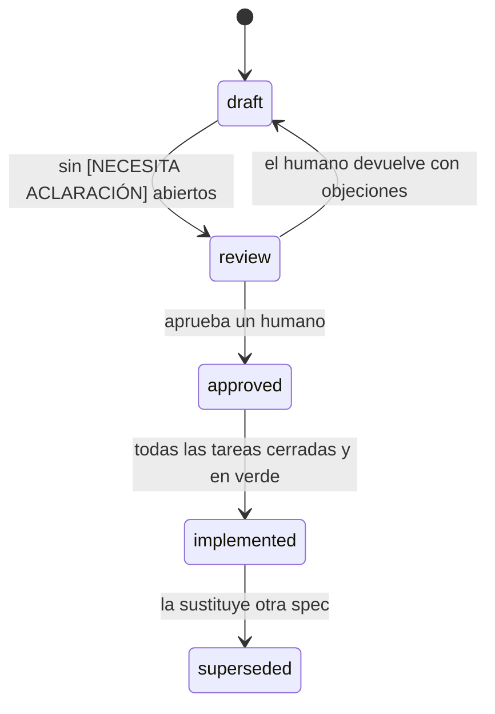

# Constitución del método - cajamarca-qhaway

Constitución v2.0 autorizada por el propietario el 2026-10-15 mediante contrato arquitectónico.
Tres niveles: garantías ético-legales, evidencia e inteligencia, y evolución territorial y visual.
Diecinueve artículos gobiernan cómo se escribe, se aprueba y se deriva una especificación en
este proyecto. Adaptada del método de `scientific-literature-pipeline`
(`docs/sdd/constitution.md` de ese proyecto) - misma forma, mismo rigor falsable, vocabulario
propio de este dominio. Los artículos 14-18 no tienen equivalente allá: encapsulan los
invariantes de `CLAUDE.md` de este proyecto, que en un sistema que produce señales de posible
corrupción no son negociables ni discutibles spec por spec.

Cada artículo dice qué prohíbe y cómo se comprueba que se cumple. Si el código y la spec
discrepan, el defecto está en el código; cambiar la spec para justificarlo es la única forma de
romper este método.

## Artículo 1. La especificación manda

La spec es la fuente de verdad de cada capacidad. El código, las pruebas y la documentación
técnica se derivan de ella, nunca al revés.

**Comprobación:** ante una discrepancia entre `specs/NNN-*/spec.md` y `src/`, se corrige `src/`.
Un cambio a una spec `approved` para hacer pasar una prueba es rechazable.

## Artículo 2. Separación estricta de artefactos

Cada capacidad tiene hasta tres artefactos y ninguno invade el terreno del otro.

| Artefacto | Responde a | Prohibido |
|---|---|---|
| `spec.md` | qué y por qué | librerías, clases, rutas de fichero, firmas, nombres de endpoint |
| `plan.md` | cómo | requisitos nuevos que no estén ya en la spec |
| `tasks.md` | en qué orden y quién | diseño nuevo que no esté en el plan |

**Comprobación:** un `spec.md` que contenga `import`, `src/`, el nombre de una librería concreta
o una firma de función está mal escrito. Un `plan.md` que introduzca una regla de negocio ausente
de la spec está mal escrito. Un `tasks.md` no existe para una capacidad cuya spec o plan todavía
tenga una ambigüedad bloqueante: fabricar tareas sobre una base inestable es peor que no tener
tareas.

## Artículo 3. Prohibido el supuesto silencioso

Toda ambigüedad no resuelta se marca en el propio texto con `[NECESITA ACLARACIÓN: …]`. Inventar
la respuesta y seguir adelante es el fallo más caro de este método: el supuesto sobrevive
escondido hasta que el código ya depende de él, y en este dominio un supuesto equivocado puede
convertirse en una acusación pública infundada.

**Comprobación:** ninguna spec con un `[NECESITA ACLARACIÓN]` abierto puede pasar a `approved`.
La comprobación es un `grep` sobre el fichero, no un juicio.

## Artículo 4. Criterios de aceptación falsables

Cada criterio se enuncia de forma que un tercero pueda escribir la prueba sin preguntar nada. Un
criterio que no se pueda convertir en un `assert` no es un criterio: es un deseo.

**Comprobación:** «debe ser explicable» y «debe ser confiable» son defectos. «Toda `Alert`
publicada expone `red_flag_id`, `evidence.field`, `evidence.source`, `evidence.retrieved_at`» es
un criterio.

## Artículo 5. La prueba precede al código

Cada criterio de aceptación tiene una prueba nombrada en `tasks.md` **antes** de que exista la
implementación, y esa prueba falla al escribirse. Una tarea sin prueba asociada no está terminada
aunque el código funcione.

**Comprobación:** `tasks.md` nombra el fichero y la función de prueba de cada tarea.

## Artículo 6. Los contratos canónicos son compartidos y no se negocian en una spec

`ContractingEntity`, `ProcurementRecord`, `BudgetExecutionRecord`, `RedFlag`, `Alert` y
`CitizenReport` son vocabulario común a las seis capacidades activas de Fase 1 (definidos en el
Artículo 19). Los nombres de campo son en inglés y en `snake_case`.

Una spec **usa** esos contratos; no los redefine, no los renombra y no les añade campos por su
cuenta. Si una capacidad necesita un campo que no existe, eso es un `[NECESITA ACLARACIÓN]` con
propuesta, y se resuelve con un ADR que afecta a todas las capacidades a la vez.

**Comprobación:** dos specs que describan el mismo contrato con campos distintos son un defecto
bloqueante, no una diferencia de criterio.

## Artículo 7. Trazabilidad de extremo a extremo

Toda tarea apunta a un criterio de aceptación, y todo criterio apunta a una regla de negocio.
Código que no se pueda rastrear hasta una regla es alcance no pedido y se borra.

**Comprobación:** los identificadores `RN-NNN-nn` (regla), `CA-NNN-nn` (criterio) y `T-NNN-nn`
(tarea) se citan explícitamente y forman una cadena sin huecos.

## Artículo 8. Ciclo de vida y aprobación

Solo un humano mueve una spec a `approved`. Un agente puede redactar, revisar y proponer; no
puede aprobar su propio trabajo ni el de otro agente. Esto no es cortesía: es la misma regla que
protege la revisión de `Alert` (Artículo 14) aplicada al propio método que las produce.

## Artículo 9. Una spec aprobada no se edita en silencio

Un cambio sobre una spec `approved` se registra en su sección de historial con fecha y motivo, y
vuelve a `review`. Si el cambio altera un contrato canónico o el orden del pipeline, exige un ADR
en `status: proposed` antes de tocar el texto.

## Artículo 10. Evidencia como requisito, no como adorno

Son admisibles fuentes primarias oficiales con payload íntegro, URL y extracción UTC:
MEF (Consulta Amigable diaria/mensual, CKAN/PNDA e Invierte.pe/SSI), OECE/SEACE
(OCDS, Pentaho, buscador público y CONOSCE), SUNAT, Copernicus, NASA y cámaras públicas.
Cada adaptador declara cobertura real; HTTP 403, CAPTCHA o falta de identificadores
no equivalen a una consulta exitosa ni autorizan evidencia sintética.

Toda capacidad que produce o transforma un `RedFlag` o una `Alert` declara explícitamente, en su
spec, de qué fuente exacta, con qué fecha de extracción y con qué payload original respalda cada
salida. Una capacidad cuyo resultado no se pueda reconstruir hasta el dato de origen está
incompleta, aunque funcione - es una reformulación del Artículo 15 aplicada a nivel de
implementación, y se repite aquí porque es la defensa legal y periodística de todo el proyecto
(ver `CLAUDE.md`, invariantes).

**Comprobación:** la spec nombra el campo de procedencia (`source`, `retrieved_at`,
`raw_payload_ref`) que rellena cada capacidad. Si no lo nombra, no está terminada.

Para los registros de la Consulta de Ejecución del Gasto Presupuestal del MEF (`id=504`),
`BudgetExecutionRecord.raw_payload` conserva la fila completa mostrada por el módulo mensual,
incluidos `codigo_entidad`, `nombre_entidad`, `PIA`, `PIM`, `CERTIFICACION`,
`COMPROMISO_ANUAL`, `ATENCION_COMPROMISO_MENSUAL`, `DEVENGADO`, `GIRADO`, `AVANCE_PCT`,
`ANO_EJE`, `FECHA_CORTE_OFICIAL`, `FUENTE_URL` y `ruta_navegacion`. El objeto fuente se conserva
sin mutaciones y cada dato normalizado se deriva por separado.

El módulo oficial verificable comprende el enlace del MEF `id=504`,
`apps5.mineco.gob.pe/transparencia/Mensual/` y su navegación en
`apps5.mineco.gob.pe/transparencia/Navegador/`; es fuente primaria en paridad con el catálogo
CKAN/PNDA. Su automatización usa una sesión persistente, conserva cookies y renueva los campos
WebForms ocultos en cada postback.

## Artículo 11. Simplicidad deliberada

Se especifica lo que la capacidad debe hacer en Fase 1, acotada a Cajamarca, no lo que podría
necesitar en una expansión a otras regiones. Un apartado «fuera de alcance» explícito es
obligatorio: sirve para cerrar debates, no para adornar.

**Comprobación:** una spec que mencione otra región peruana fuera de la sección "fuera de
alcance" está mal escrita, salvo que `PROJECT.yaml` haya cambiado antes.

## Artículo 12. Límites del agente que escribe specs

- No inventa endpoints, campos de API ni cobertura de datos: los toma de
  `docs/research/2026-08-20-verificacion-tecnica-fuentes.md` o los marca `[sin verificar]`.
- No toca `src/`, `tests/`, `docs/adr/` ni specs que no le hayan asignado.
- No hace `commit` ni `push` salvo petición explícita.
- No cita como autoridad una nota con `verified: false`, ni siquiera propia - incluidos
  `docs/research/2026-08-20-diseno-cajamarca-qhaway-fase1.md` y
  `brain/70-inbox/2026-08-20-estado-del-arte-ia-anticorrupcion.md`, que se usan como punto de
  partida, no como hecho establecido.

## Artículo 13. Enmienda de esta constitución

La enmienda exige mandato humano explícito y registro de decisión.
El propietario autorizó la v2.0 y su ejecución en esta conversación el 2026-10-15.
Las futuras enmiendas requieren autorización humana con alcance identificado.

---

## Artículo 14. Ninguna alerta sin revisión humana

Nivel I: toda publicación exige dictamen colegiado con firma nominal, `reviewed_by`,
`reviewed_at` UTC, `review_notes`, evidencia y `legal_disclaimer` obligatorio.
Se permiten públicamente agregados del motor, conteos de revisión y datos oficiales objetivos.
Las banderas individuales y el dossier cognitivo privado no se publican automáticamente.

Ninguna capacidad publica una `Alert` de forma autónoma. El motor de red flags (`004`) produce
candidatos; solo una decisión humana explícita, registrada con `reviewed_by` y `reviewed_at`, en
`005-review-panel`, convierte un candidato en `Alert` publicable.

**Comprobación:** una spec cuyo flujo permita que un `RedFlag` se convierta en `Alert` sin pasar
por `005-review-panel` es un defecto bloqueante de máxima severidad, no una optimización a
discutir. Ningún ADR puede levantar esta regla - solo un cambio a esta constitución, por un
humano (Artículo 13).

## Artículo 15. Explicabilidad completa como criterio de aceptación, no como nota al margen

Nivel II: TIER_1_PROBATIVE comprende reglas calibradas por régimen, modalidad, monto y UIT,
estadística reproducible y similitud vectorial con configuración versionada.
Cada señal expone fórmula, valor observado, umbral y referencias verificables.
Las técnicas estadísticas declaran tamaño y cobertura de muestra; no prueban corrupción.
TIER_2_COGNITIVE_COPILOT asiste con resumen, hipótesis, contra-hipótesis y diligencias.
Usa esquema estricto, temperatura 0.0 cuando el proveedor la soporte y evidencia suministrada.
Su salida nunca crea una RedFlag ni aprueba una Alert.
El modo determinista offline se identifica como tal y declara evidencia faltante.

Toda `Alert` expone, sin excepción, como parte de sus **criterios de aceptación** (no de su
descripción): qué `RedFlag` la origina, con qué fórmula y umbral; el dato exacto que la disparó;
la fuente primaria oficial identificada por su adaptador, con su
`retrieved_at`; y el descargo estándar de que es un indicador automatizado, no una prueba.

**Comprobación:** una spec que describa la capa de explicabilidad en prosa pero no la traduzca en
al menos un `CA-NNN-nn` verificable no puede pasar a `approved`. Es el mismo criterio del
Artículo 4, aplicado sin excepción a esta capa concreta.

## Artículo 16. Prohibido el scoring o ranking de personas

Se autoriza `case_priority_score` de 0 a 100 por proceso o expediente con desglose explicable,
HHI de mercado y grafos de relaciones públicas declaradas.
Estos valores priorizan revisión; nunca califican honorabilidad ni responsabilidad penal.

Ninguna spec asigna un puntaje, ranking o nivel de riesgo a una persona identificada por nombre.
Las alertas son sobre procesos y contratos (`ProcurementRecord`, `BudgetExecutionRecord`), nunca
sobre funcionarios, proveedores o denunciantes como individuos puntuados.

Si una capacidad, al especificarse, revela una tentación de hacerlo - por ejemplo, un indicador
que naturalmente produce "funcionarios con más contratos de riesgo"- **no se decide en la spec**.
Se marca `[NECESITA ACLARACIÓN: esta capacidad tienta a puntuar personas, escalar antes de
implementar]` y se detiene ahí. No es una decisión de diseño que un agente pueda tomar en
silencio ni resolver reformulando el indicador por su cuenta.

**Comprobación:** `grep` sobre cualquier `spec.md` en busca de un campo o cálculo cuya unidad de
análisis sea una persona con nombre propio. Si aparece fuera de una ambigüedad marcada, es un
defecto bloqueante.

## Artículo 17. DJI solo para relaciones declaradas, nunca cruzado con patrimonio no declarado

Se admite enriquecimiento SUNAT oficial por RUC con estado, condición, inicio de actividades,
CIIU y representantes públicos de personas jurídicas, sujeto a minimización y procedencia.
CU4 usa identificadores aleatorios y huellas SHA-256 sin almacenar IP del denunciante.
SHA-256 no anonimiza por sí solo un texto ni permite prometer anonimato absoluto.

Cualquier spec que involucre datos de Declaraciones Juradas de Intereses (DJI) se limita a
mapear relaciones **declaradas** funcionario-empresa-familiar. Ninguna spec cruza DJI con gasto
observable, propiedades, redes sociales o cualquier fuente de terceros para inferir patrimonio no
declarado - ese análisis (*lifestyle audit*) está fuera de alcance de Fase 1 por decisión de
`PROJECT.yaml` y por el riesgo legal bajo la Ley 29733 que señala
`brain/70-inbox/2026-08-20-estado-del-arte-ia-anticorrupcion.md` (sección 6, `verified: false`,
pero suficiente para justificar cautela).

Ninguna spec de este tipo pasa de `draft` sin una nota explícita: **"requiere evaluación legal
previa bajo Ley 29733, no realizada por este agente"**. No se redacta como si la base legal ya
estuviera resuelta.

**Comprobación:** `008-dji-ingestion` no se especifica en esta ronda (ver `specs/README.md`)
precisamente por este artículo. Cuando se especifique, debe citar aquí el sign-off legal humano
antes de pasar a `review`.

## Artículo 18. Ámbito geográfico fijo en Cajamarca

Nivel III: las raíces canónicas son GORE Cajamarca y 13 municipalidades provinciales.
Se habilitan ejecutoras dependientes verificadas y proyectos CUI sin duplicar totales.
Las particiones Actividad/Proyecto y Fuentes/Rubros nunca se suman con su maestro.
La identidad `identidad-qhaway/` puede evolucionar preservando anclajes funcionales y accesibilidad.

Ninguna spec generaliza a otra región del Perú. `PROJECT.yaml` fija el alcance; un agente que
detecte la tentación de abstraer "por si se expande a otras regiones" lo marca como ambigüedad
abierta o lo omite, nunca lo construye por iniciativa propia (Artículo 11).

## Artículo 19. Vocabulario canónico de contratos compartidos

Seis contratos son vocabulario común a las seis capacidades activas de Fase 1. Se definen aquí
en forma preliminar; cada spec los usa sin redefinirlos (Artículo 6). Los nombres de campo son
`snake_case` en inglés; el contenido narrativo de los propios datos (nombres de entidad,
descripciones de obra) permanece en el idioma de origen (español).

### `ContractingEntity`

La entidad contratante verificada - producida por `001-entity-mapping`, consumida por todas las
demás.

| Campo | Tipo | Nota |
|---|---|---|
| `entity_id` | string | Identificador canónico interno, estable entre corridas |
| `official_name` | string | Razón social/denominación oficial, tal como la publica la fuente |
| `entity_level` | enum | `regional` \| `provincial_municipality` \| `district_municipality` |
| `province` | string \| null | Una de las 13 provincias de Cajamarca, o `null` si es el Gobierno Regional |
| `ruc` | string | RUC de 11 dígitos - `scheme: PE-RUC` en OCDS |
| `consucode_id` | string \| null | Identificador `PE-CONSUCODE` usado como `buyer.id`/`procuringEntity.id` en la API OCDS de OECE - ver `docs/research/2026-08-20-verificacion-tecnica-fuentes.md` §1.2 |
| `department` | string | Fijo: `"CAJAMARCA"` en Fase 1 - el mismo valor que `parties[].address.department` en OCDS |
| `verified_at` | ISO 8601 UTC | Cuándo se confirmó este registro contra la fuente oficial |
| `active` | boolean | Si sigue vigente como sujeto de ingesta |

### `ProcurementRecord`

Un proceso o contrato de contratación pública, alineado a OCDS para no reinventar campos que el
propio estándar ya resuelve. Ver
`docs/research/2026-08-20-verificacion-tecnica-fuentes.md` §1 antes de asumir cualquier campo no
confirmado aquí.

| Campo | Tipo | Nota |
|---|---|---|
| `procurement_id` | string | Determinista, derivado de `ocid`; estable entre capturas |
| `ocid` | string | El `ocid` de OCDS, sin modificar |
| `entity_id` | string | FK a `ContractingEntity` |
| `title` | string | `tender.title`, sin transformar |
| `procurement_method` | string \| null | Tal como lo publica OCDS |
| `awarded_amount` | number \| null | Monto adjudicado, en soles |
| `executed_amount` | number \| null | Se rellena, si aplica, con datos cruzados de `BudgetExecutionRecord`; `null` si no hay cruce todavía |
| `number_of_bidders` | integer \| null | Cuando OCDS lo declare |
| `supplier_name` | string \| null | Del `party` con rol `supplier`, si existe |
| `supplier_ruc` | string \| null | Idem, `additionalIdentifiers[].scheme == "PE-RUC"` |
| `raw_payload` | objeto | El `release` OCDS completo, sin transformar |
| `source` | string | Fijo: `"seace-ocds"` |
| `retrieved_at` | ISO 8601 UTC | Cuándo se obtuvo este payload |
| `source_evidence` | lista | Evidencia complementaria con fuente, URL, payload y extracción |

### `BudgetExecutionRecord`

Un registro de ejecución por entidad, ejercicio y corte oficial.
Un maestro ActProy integra las particiones sin sumarlas nuevamente.
Los nombres siguientes preservan el contrato serializado vigente.

| Campo | Tipo | Nota |
|---|---|---|
| `execution_record_id` | string | Determinista, derivado de `entity_id` + periodo + fuente |
| `entity_id` | string | FK a `ContractingEntity` |
| `fiscal_year` | integer | Año fiscal |
| `budgeted_amount` | number | PIM oficial |
| `executed_amount` | number | Devengado oficial |
| `pia_amount` | number | Presupuesto de apertura |
| `modification_amount` | number | PIM menos PIA |
| `certified_amount` | number | Certificación |
| `committed_annual_amount` | number | Compromiso anual |
| `monthly_commitment_amount` | number | Atención de compromiso mensual |
| `paid_amount` | number | Girado |
| `execution_pct` | number | Avance oficial redondeado a un decimal |
| `is_canonical_total` | boolean | Solo el maestro entra en agregados institucionales |
| `cut_type` | enum | daily o monthly |
| `official_cut_date` | fecha ISO | Fecha declarada por el módulo oficial |
| `breakdown_by_scope` | objeto | Proyecto y Actividad con payload y corte propios |
| `breakdown_by_funding_source` | lista | Fuentes con rubros anidados, sin doble conteo |
| `comparison_cuts` | lista | Cortes comparativos independientes del maestro |
| `budget_category` | string \| null | Genérica de gasto o categoría presupuestal, si el dataset la expone |
| `raw_payload` | objeto | Fila fuente íntegra de CKAN/PNDA o Consulta Amigable |
| `source` | string | `"mef-datastore"` o `"mef-consulta-amigable"` |
| `retrieved_at` | ISO 8601 UTC | Cuándo se obtuvo este registro |

### `RedFlag`

Un indicador de riesgo activado sobre uno o más `ProcurementRecord`/`BudgetExecutionRecord`.
Siempre trazable a una fórmula pública y un umbral declarado.
La prioridad compuesta pertenece al expediente y no reemplaza estas señales individuales.

| Campo | Tipo | Nota |
|---|---|---|
| `red_flag_id` | string | Determinista |
| `indicator_code` | string | Identificador estable del indicador (p. ej. `single-bidder`, `execution-overrun`) |
| `formula_description` | string | La fórmula en lenguaje simple, tal como la vería un usuario final |
| `threshold_value` | valor | El umbral exacto que se cruzó |
| `observed_value` | valor | El valor real observado que cruzó el umbral |
| `procurement_ids` | lista de string | Uno o más `ProcurementRecord.procurement_id` que sustentan el indicador |
| `execution_record_ids` | lista de string | Idem para `BudgetExecutionRecord`, si aplica |
| `evidence_source` | string | De qué ingesta viene el dato que disparó la regla |
| `retrieved_at` | ISO 8601 UTC | Fecha de extracción del dato de origen |
| `generated_at` | ISO 8601 UTC | Cuándo el motor produjo este candidato |

### `Alert`

Expediente de revisión; solo su estado publicado puede llegar al dashboard público.
Los estados generated e in_review no son decisiones humanas.

| Campo | Tipo | Nota |
|---|---|---|
| `alert_id` | string | Determinista |
| `red_flag_ids` | lista de string | Uno o más `RedFlag` agrupados bajo esta alerta |
| `entity_id` | string | La `ContractingEntity` afectada |
| `status` | enum | `generated` \| `in_review` \| `published` \| `discarded` |
| `reviewed_by` | string o null | Firma nominal obligatoria para decisión humana |
| `reviewed_at` | ISO 8601 UTC o null | Obligatorio al decidir |
| `review_notes` | string o null | Motivo no vacío al decidir |
| `legal_disclaimer` | string | Texto fijo: indicador automatizado, no prueba de corrupción |
| `evidence` | lista de evidencia | Fórmula, dato observado, umbral, fuente y extracción de cada `RedFlag` |
| `published_at` | ISO 8601 UTC \| null | Solo si `status == published` |

Extensión autorizada para implementación del Nodo 3:
`case_priority_score` (0-100), componentes explicables y `ai_copilot_analysis` privado.
El dossier contiene `executive_summary`, `risk_hypothesis`, `legal_counter_hypothesis`
y `verification_checklist`, con modo, versión y referencias de evidencia.
Estas extensiones no se declaran disponibles hasta superar pruebas y migraciones del Nodo 3.

### `CitizenReport`

Una denuncia ciudadana entrante, antes de moderación.

| Campo | Tipo | Nota |
|---|---|---|
| `report_id` | string | Generado al recibir la denuncia |
| `submitted_at` | ISO 8601 UTC | |
| `channel` | enum | `web` \| `sms` \| `whatsapp` - los dos últimos dependen de `009`, no construida aún |
| `raw_text` | string | Tal como la escribió la persona, sin tocar |
| `related_entity_id` | string \| null | Si la persona señaló una entidad conocida |
| `moderation_status` | enum | `pending` \| `accepted_as_lead` \| `rejected` |
| `moderated_by` | string \| null | Obligatorio si `moderation_status != pending` |
| `moderated_at` | ISO 8601 UTC \| null | |
| `legal_disclaimer_shown` | boolean | Debe ser `true` antes de aceptar el envío - ver `006-denuncia-intake` |

Estos seis contratos son la base; una spec que necesite un campo adicional lo marca
`[NECESITA ACLARACIÓN]` y propone el ADR correspondiente (Artículo 6).
