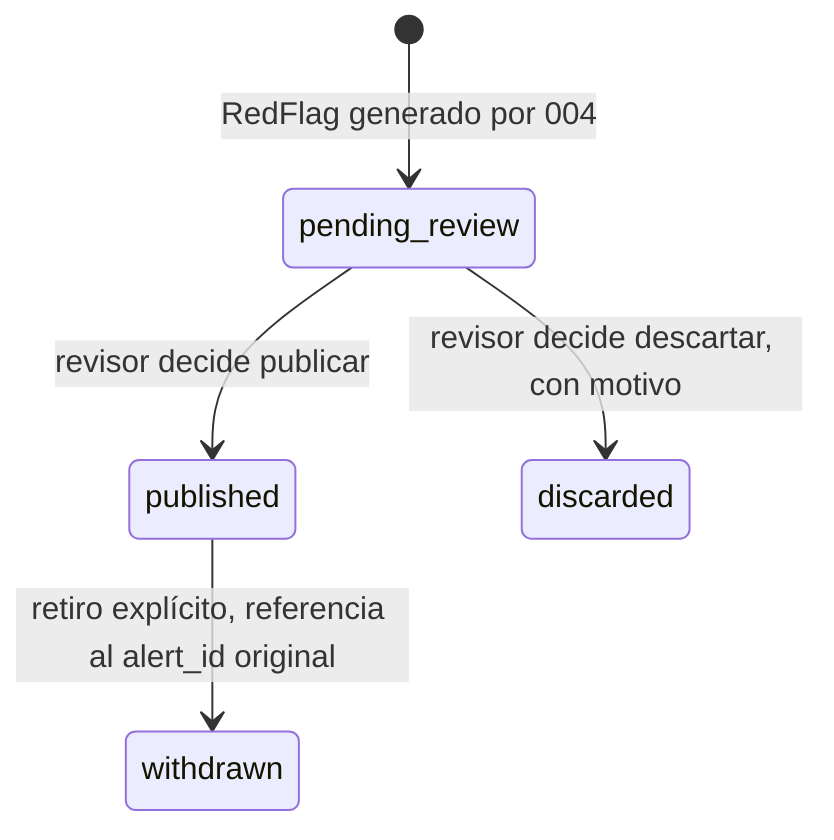

# Plan 005 - review-panel

## Estado contrastado (2026-10-16)

La implementación local correspondiente está en [código](../../src/cajamarca_qhaway/capabilities/review_panel/).
El estado draft se conserva: tener implementación no constituye aprobación documental.
Las reglas siguientes son requisitos y diseño; no certifican cobertura o servicios remotos.

A diferencia de `002`, `003` y `004`, esta capacidad no depende de ninguna verificación técnica
externa: su lógica es un flujo de decisión humana sobre datos que ya existen como `RedFlag`. Lo
que bloquea el plan no es evidencia técnica, sino dos decisiones de producto (AC-005-01,
composición del panel; AC-005-02, texto legal del descargo) que no le corresponden a un agente.

## Máquina de estados de una decisión



No existe transición directa de `[*]` a `published`: `pending_review` es un estado obligatorio,
lo que hace que RN-005-01 sea una propiedad de la máquina de estados, no solo una regla escrita -
un tercero que implemente esta máquina no puede saltarse el paso sin reescribir la máquina misma,
lo cual es una señal visible en el código, no un descuido silencioso.

## Contrato interno de la operación de revisión

```
decide(
  red_flag_ids: list[str],
  decision: "publish" | "discard",
  reviewed_by: str,          # obligatorio, identidad de persona concreta
  review_notes: str | None,  # obligatorio si decision == "discard"
) -> Alert
```

`reviewed_by` no se infiere de una sesión implícita ni de una cabecera HTTP sin verificar: debe
ser un identificador de persona ya autenticada por el sistema que exista fuera de esta capacidad
La implementación actual usa Supabase Auth y acreditación administrada en web/auth.py;
la comprobación OAuth real en un entorno de staging es una compuerta operativa separada.

## Concurrencia (CL-005-01)

Diseño provisional, condicionado a AC-005-01 (tamaño del panel): un `RedFlag` en estado
`pending_review` se "reclama" antes de decidir, con un `claimed_by` temporal, para que dos
revisores no puedan resolver el mismo candidato con decisiones contradictorias sin que el
segundo vea que ya fue tomado. Con un panel de una sola persona, este mecanismo es innecesario;
con un panel de varias personas, es obligatorio. No se implementa hasta saber cuál es el caso
real.

## Dependencias nuevas

La identidad se verifica en web/auth.py y la escritura de decisiones en los repositorios.
El mecanismo implementado no cambia por sí solo la composición humana requerida del panel.
Las dependencias de ejecución se consultan en pyproject.toml y uv.lock.

## Riesgos

| Riesgo | Impacto | Mitigación |
|---|---|---|
| Decisión concurrente contradictoria | Confusión sobre el estado real de una alerta | Mecanismo de reclamo (arriba), pendiente de AC-005-01 |
| `reviewed_by` capturado desde un campo editable por el propio revisor | Identidad falsificable, rompe defensibilidad legal | `reviewed_by` debe venir de un mecanismo de autenticación, nunca de un campo de formulario libre |
| Cuello de botella humano (CL-005-02) | Candidatos acumulados sin publicar ni descartar | No es un riesgo técnico que este plan resuelva; es una limitación operativa a monitorear |

## Estrategia de prueba

```
tests de la maquina de estados:
  - un RedFlag nunca llega a Alert sin pasar por pending_review
  - discard sin review_notes falla
  - publish sin reviewed_by falla
  - retiro de una Alert publicada no modifica el registro original
  - agrupar dos RedFlag en una Alert requiere una lista explícita, no inferencia automática
```

Las funciones se encuentran en capabilities/review_panel/, web/auth.py
y persistence/repositories/alert_repository.py.

## Orden de implementación

1. Máquina de estados y contrato de `decide()` - no bloqueado.
2. Identidad de revisor: implementación presente con Supabase Auth; validar OAuth real en staging.
3. Mecanismo de concurrencia/reclamo - **bloqueado por AC-005-01**.
4. Texto final del descargo - **bloqueado por AC-005-02**.

No se escribe `tasks.md` todavía: los pasos 3 y 4 son bloqueantes para un panel operativo real, y
fabricar tareas solo para 1-2 dejaría fuera la parte que más le importa a quien va a usar esto en
la práctica.
