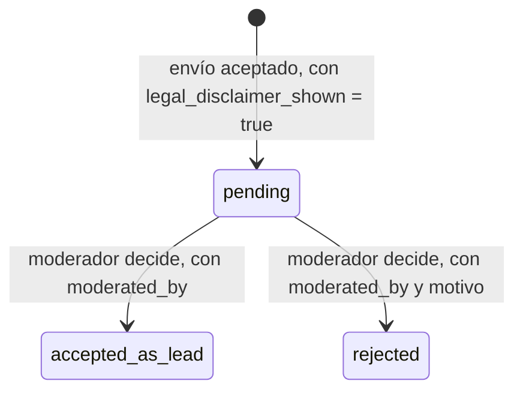

# Plan 006 - denuncia-intake

## Estado contrastado (2026-10-16)

La implementación local correspondiente está en [código](../../src/cajamarca_qhaway/capabilities/denuncia_intake/).
El estado draft se conserva: tener implementación no constituye aprobación documental.
Las reglas siguientes son requisitos y diseño; no certifican cobertura o servicios remotos.

Plan mínimo. Dos de las seis ambigüedades de `spec.md` (AC-006-01, texto legal; AC-006-02, flujo
operativo de investigación) son las que más importan y ninguna de las dos es una decisión técnica
- son de contenido legal/editorial y de coordinación externa, respectivamente. Lo que sigue cubre
la parte que sí es puramente técnica: la máquina de estados de moderación, que no depende de esas
decisiones para su forma (sí depende de ellas para su contenido).

## Máquina de estados de moderación

Misma forma que la máquina de `005-review-panel`, deliberadamente: dos capacidades con la misma
exigencia de "nada pasa sin una persona identificada que decida" comparten el mismo patrón de
diseño, aunque no compartan contrato canónico (RN-006-05 ya fija que no se fusionan).

## Validación de envío

Antes de crear el `CitizenReport`: verificar que `legal_disclaimer_shown == true` viene en la
propia petición de envío, no inferido de un estado de sesión previo - un formulario de una sola
pantalla que muestra el aviso y pide confirmarlo en el mismo paso del envío es la forma más simple
de cumplir RN-006-01 sin depender de sesión.

## Dependencias nuevas

El canal web usa la API WSGI, modelos del paquete y persistencia del repositorio de denuncias.
Las dependencias efectivas están en pyproject.toml y uv.lock.
No existe una integración de mensajería 009 ni se incorpora una dependencia de SMS/WhatsApp.

## Riesgos

| Riesgo | Impacto | Mitigación |
|---|---|---|
| Aviso legal mostrado pero no leído/entendido de verdad | Denunciante cree tener protección que no existe | Fuera del alcance técnico resolverlo del todo; la spec exige que se muestre y confirme, no puede forzar comprensión |
| Denuncia con datos personales del propio denunciante en `raw_text` | Riesgo bajo Ley 29733 si se publica o comparte sin control | RN-006-07: nunca se publica una denuncia directamente; el moderador ve el texto antes de cualquier uso posterior |
| Volumen de denuncias supera capacidad de moderación (mismo riesgo que CL-005-02 en `005`) | Cola de `pending` creciente | No resuelto en este plan - depende de la misma capacidad operativa que AC-005-04 |

## Orden de implementación

1. Formulario de envío con aviso legal obligatorio y máquina de estados `pending` - no bloqueado
   técnicamente, pero el **contenido** del aviso sí lo está (AC-006-01).
2. Interfaz de moderación (aceptar/rechazar con motivo) - no bloqueado técnicamente.
3. Flujo de qué pasa con una denuncia `accepted_as_lead` - **bloqueado por AC-006-02**, que
   depende de la coordinación con Proética/Propuesta Ciudadana/GRUFIDES, bloqueante ya declarado
   en el roadmap del proyecto.

No se escribe `tasks.md`: el paso 3 es el que le da sentido de producto a esta capacidad, y no
tiene caso planificar tareas de implementación sobre los pasos 1-2 sin saber para qué flujo
downstream se están construyendo.
