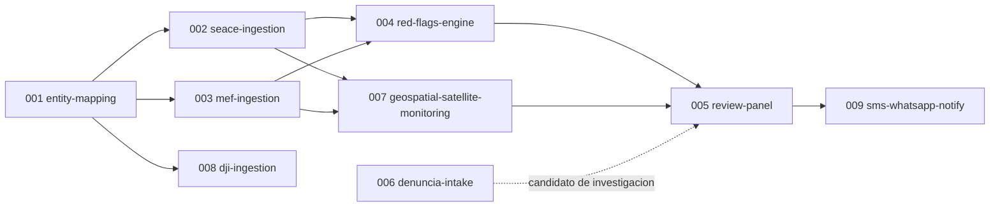

# Mapa de capacidades - cajamarca-qhaway

Capacidades identificadas para Fase 1, en orden de dependencia. Las siete primeras tienen
spec en `draft` (ver `docs/sdd/constitution.md`, Articulo 8, para el ciclo de vida). Las dos
ultimas quedan **reservadas, sin spec todavia**, por las razones concretas que se listan abajo --
no por olvido.

## Capacidades con spec (`draft`)

El propietario autorizó la reforma Constitución v2.0 el 2026-10-15.
Las specs 001-007 incorporan fuentes plurales, particiones presupuestales y niveles de IA.
La extensión 010 fija criterios de presupuesto, evidencia dual e identidad.
La disponibilidad del copiloto y la recalibración se certifica al cerrar el Nodo 3.

| # | Capacidad | Produce | Estado |
|---|---|---|---|
| 001 | `entity-mapping` | `ContractingEntity` | `draft` -- implementado en `cajamarca_qhaway.capabilities.entity_mapping`; corpus dorado de 14 entidades verificado |
| 002 | `seace-ingestion` | `ProcurementRecord` | `draft` -- contrato implementado; cliente/parser con filtro Cajamarca en `cajamarca_qhaway.capabilities.seace_ingestion` |
| 003 | `mef-ingestion` | `BudgetExecutionRecord` | `draft` -- contrato implementado; cliente/parser CKAN datastore en `cajamarca_qhaway.capabilities.mef_ingestion` |
| 004 | `red-flags-engine` | `RedFlag` | `draft` -- contrato implementado; motor con catalogo de 5 indicadores en `cajamarca_qhaway.capabilities.red_flags_engine` |
| 005 | `review-panel` | `Alert` | `draft` -- contrato implementado; servicio de compuerta humana en `cajamarca_qhaway.capabilities.review_panel` |
| 006 | `denuncia-intake` | `CitizenReport` | `draft` -- contrato implementado; servicio de recepcion y moderacion en `cajamarca_qhaway.capabilities.denuncia_intake` |
| 007 | `geospatial-satellite-monitoring` | `PhysicalFinancialDivergenceSignal`, `RedFlag` | `draft` -- contrato implementado; catalogo geoespacial, Sentinel-1/2, NASA HLS/GIBS y evaluador en `cajamarca_qhaway.capabilities.geospatial_monitoring` |

*Nota (2026-10-13):* Los contratos canonicos del Articulo 19 y las interfaces desacopladas de las capacidades 001 a 007 han sido implementados en `src/cajamarca_qhaway/` con 124 pruebas unitarias y de integracion pasando.

## Capacidades reservadas (sin spec)

| # | Capacidad | Por que espera |
|---|---|---|
| 008 | `dji-ingestion` | Bloqueada por el Articulo 17 de la constitucion: requiere evaluacion legal formal bajo la Ley 29733 antes de que tenga sentido especificar el pipeline tecnico. Especificarla ahora seria fingir que esa decision ya se tomo. |
| 009 | `sms-whatsapp-notify` | Depende de que exista al menos una `Alert` real que notificar (`005`) y de una decision de proveedor de SMS/WhatsApp que no le corresponde a este agente (`specs/pending-adrs.md`). |

## Como se actualiza este mapa

Cuando una spec avanza de estado (Articulo 8 de la constitucion), esta tabla se actualiza en el
mismo cambio -- no es un artefacto generado automaticamente en este proyecto todavia.
