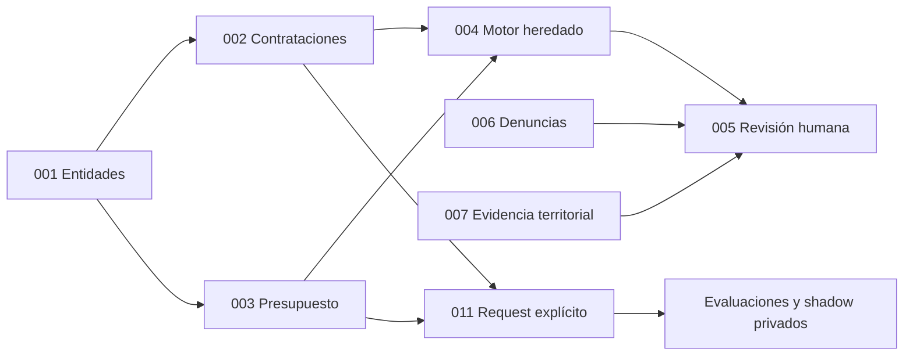

# Mapa de capacidades - cajamarca-qhaway

Las capacidades documentan requisitos y mantienen su estado de aprobación original.
El árbol contiene implementaciones que no equivalen a una certificación productiva de cada caso.
011 ya dispone de runtime privado y permanece separado del motor heredado 004.

## Mapa actual

| Spec | Código | Estado técnico y documental |
|---|---|---|
| [001](001-entity-mapping/spec.md) | entity_mapping | Entidades; spec draft |
| [002](002-seace-ingestion/spec.md) | seace_ingestion, live_harvest | Contrataciones y procedencia; spec draft |
| [003](003-mef-ingestion/spec.md) | mef_ingestion, live_harvest | Presupuesto y fuentes; spec draft |
| [004](004-red-flags-engine/spec.md) | red_flags_engine | Motor heredado, catálogo de diez reglas |
| [005](005-review-panel/spec.md) | review_panel | Compuerta humana y decisiones persistidas; spec draft |
| [006](006-denuncia-intake/spec.md) | denuncia_intake | Recepción y moderación; spec draft |
| [007](007-geospatial-satellite-monitoring/spec.md) | geospatial_monitoring | Módulo presente; cobertura depende de catálogo y evidencia reales |
| [010](010-budget-moments-dual-sources-identity/spec.md) | Modelos, ingesta y vistas | Cortes, ámbitos y evidencia; spec draft |
| [011](011-deterministic-engine/spec.md) | deterministic_engine | Seis reglas exactas y shadow privado; spec proposed |

Los módulos se encuentran en [capabilities/](../src/cajamarca_qhaway/capabilities/).
Las pruebas están en [tests/](../tests/).
No se declara que todos los criterios de campo estén satisfechos por tener módulos y tests.

La última flecha no supone una integración automática de los conectores con 011.
Su adaptador requiere normalización y correspondencias acreditadas desde bytes preservados.

## Reservadas

008 dji-ingestion no tiene spec ni ingesta autorizada de relaciones reales.
009 sms-whatsapp-notify no tiene spec ni proveedor decidido.
Las dependencias legales y de producto siguen en [pending-adrs.md](pending-adrs.md).

## Lectura de estados

Draft y proposed identifican aprobación documental; no son un contador de módulos existentes.
Los planes heredados conservan el razonamiento de diseño y señalan ahora la implementación local.
La Constitución v2 está vigente; su enmienda 011 y ADR 0015-0019 permanecen propuestos.
No se migran por documentación aprobaciones humanas, prioridades ni alertas publicadas.
