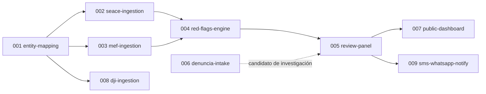

# Mapa de capacidades — cajamarca-qhaway

Nueve capacidades identificadas para Fase 1, en orden de dependencia. Las seis primeras tienen
spec en `draft` (ver `docs/sdd/constitution.md`, Artículo 8, para el ciclo de vida). Las tres
últimas quedan **reservadas, sin spec todavía**, por las razones concretas que se listan abajo —
no por olvido.

## Capacidades con spec (`draft`)

| # | Capacidad | Produce | Estado |
|---|---|---|---|
| 001 | `entity-mapping` | `ContractingEntity` | `draft` — implementado en `cajamarca_qhaway.capabilities.entity_mapping`; corpus dorado de 14 entidades verificado |
| 002 | `seace-ingestion` | `ProcurementRecord` | `draft` — contrato implementado; cliente/parser con filtro Cajamarca en `cajamarca_qhaway.capabilities.seace_ingestion` |
| 003 | `mef-ingestion` | `BudgetExecutionRecord` | `draft` — contrato implementado; cliente/parser CKAN datastore en `cajamarca_qhaway.capabilities.mef_ingestion` |
| 004 | `red-flags-engine` | `RedFlag` | `draft` — contrato implementado; motor con catálogo de 5 indicadores en `cajamarca_qhaway.capabilities.red_flags_engine` |
| 005 | `review-panel` | `Alert` | `draft` — contrato implementado; servicio de compuerta humana en `cajamarca_qhaway.capabilities.review_panel` |
| 006 | `denuncia-intake` | `CitizenReport` | `draft` — contrato implementado; servicio de recepción y moderación en `cajamarca_qhaway.capabilities.denuncia_intake` |

*Nota (2026-10-12):* Los seis contratos canónicos del Artículo 19 y las interfaces desacopladas de las capacidades 001 a 006 han sido implementados en `src/cajamarca_qhaway/` con 61 pruebas unitarias y de integración pasando. Las ambigüedades de producción externa continúan documentadas para sincronización en vivo.

## Capacidades reservadas (sin spec)

| # | Capacidad | Por qué espera |
|---|---|---|
| 007 | `public-dashboard` | Depende de que `004`/`005` produzcan `Alert` reales y estables — especificar el dashboard antes serviría para un contrato que todavía puede cambiar. |
| 008 | `dji-ingestion` | Bloqueada por el Artículo 17 de la constitución: requiere evaluación legal formal bajo la Ley 29733 antes de que tenga sentido especificar el pipeline técnico. Especificarla ahora sería fingir que esa decisión ya se tomó. |
| 009 | `sms-whatsapp-notify` | Depende de que exista al menos una `Alert` real que notificar (`005`) y de una decisión de proveedor de SMS/WhatsApp que no le corresponde a este agente (`specs/pending-adrs.md`). |

## Cómo se actualiza este mapa

Cuando una spec avanza de estado (Artículo 8 de la constitución), esta tabla se actualiza en el
mismo cambio — no es un artefacto generado automáticamente en este proyecto todavía.
